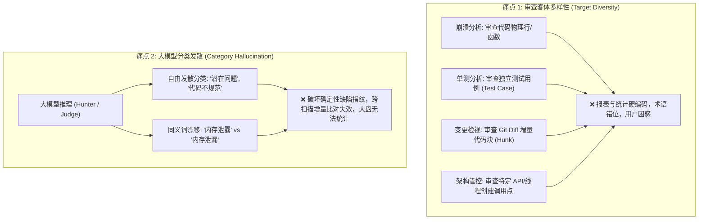
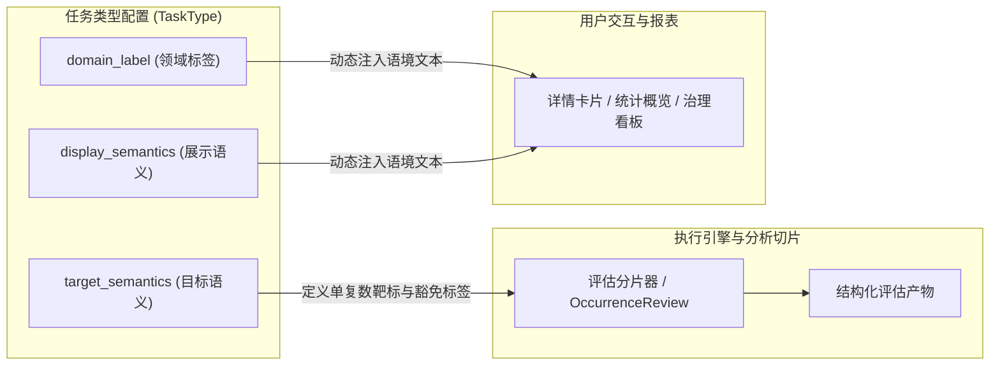
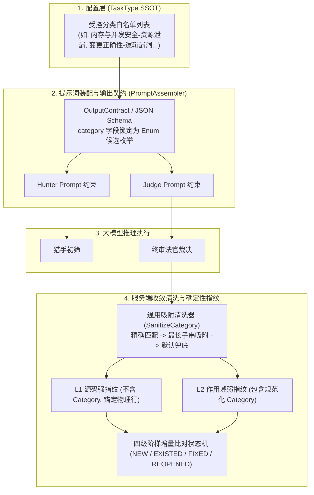

# Code-Shield 任务类型领域语义与受控分类配置指南 🛡️

## 一、 背景与架构痛点

在 Code-Shield 演进到支持十余种异构代码分析场景（从底层 C/C++ 内存崩溃、并发线程管控，到单测有效性分析、Git 增量 PR 变更检视）的过程中，系统面临两个显著的结构性矛盾：



为了彻底解决上述痛点，平台在任务类型定义中引入了**“领域语义 (Domain Semantics)”**与**“受控分类白名单 (Categories SSOT)”**两大核心治理机制：
1. **领域语义**：将“评估客体对象”与“呈现语境文案”抽象为配置项，彻底解耦底层引擎与前端展示，实现面向不同审查靶标的自适应动态呈现；
2. **受控分类白名单**：作为各任务类型下缺陷/风险判定的单一真实源（SSOT），在 LLM 提示词装配阶段进行强 Schema 约束，阻断大模型分类幻觉，确保增量生命周期指纹与企业度量大盘的高度一致性。

---

## 二、 领域语义 (Domain Semantics) 深度解析

领域语义位于任务类型配置中，主要由三部分组成：**领域标签 (`domain_label`)**、**目标语义 (`target_semantics`)** 与 **展示语义 (`display_semantics`)**。



### 2.1 字段含义与技术规范

| 配置字段 | 类型 | 核心作用与使用场景 |
| :--- | :--- | :--- |
| **领域标签 (`domain_label`)** | `string` | 标识该任务类型所属的技术领域或业务主题（如 `综合演进与深度检视`、`内存安全`、`架构规范治理`）。用于跨任务大盘聚合统计、汇总报表分类展示。 |
| **目标语义 (`target_semantics`)** | `JSON Object` | **后端分析引擎评估的最小靶标对象模型**。定义当前任务审查的物理或逻辑客体，主要包含 `singular`（单数名）、`plural`（复数名）以及 `not_target_label`（非靶标豁免标签）。 |
| **展示语义 (`display_semantics`)** | `JSON Object` | **前端界面与报告展示的用户呈现语境映射**。定义向研发人员展示的客体名称与状态文案，避免 UI 硬编码“代码行”或“文件”。 |

### 2.2 `target_semantics` 规范

`target_semantics` 规范了执行引擎在做评估切片（Slicing）与状态统计时的基础语义单元：

```json
{
  "singular": "变更 hunk",
  "plural": "变更 hunk",
  "not_target_label": "非本次变更相关"
}
```

* **`singular` / `plural`**：评估对象的单/复数称谓。
  * 例如对于近期变更任务，评估客体为 Git Diff 中的每个差异块（`变更 hunk`）；
  * 对于单测有效性任务，评估客体为 `@Test` 或 `TestXxx` 用例（`测试用例`）；
  * 对于显式线程管控任务，评估客体为裸线程发起点（`显式线程创建点`）。
* **`not_target_label`**：当切片或关键字命中后，经判定不属于本次评估目标时的过滤打标文案。
  * 例如在增量变更任务中，某文件被列出但该处改动非本次 PR 核心业务改动，则标记为“非本次变更相关”并直接豁免。

### 2.3 `display_semantics` 规范

`display_semantics` 规范了报表与大盘渲染时的用户呈现术语：

```json
{
  "domain_label": "综合演进与深度检视",
  "target_label": "变更 hunk",
  "not_target_label": "非本次变更相关"
}
```

* **`domain_label`**：展示给用户的所属领域名称；
* **`target_label`**：展示给用户的评估客体统一称谓；
* **`not_target_label`**：展示给用户的跳过/豁免状态标签。

### 2.4 各典型任务类型的领域语义对比矩阵

| 任务类型 (`TaskType`) | 领域标签 (`domain_label`) | 目标语义 (`target_semantics`) | 展示客体标签 (`target_label`) | 非目标标签 (`not_target_label`) |
| :--- | :--- | :--- | :--- | :--- |
| **近期变更检视 (`change_review`)** | 综合演进与深度检视 | `{"singular":"变更 hunk", "plural":"变更 hunk"}` | 变更 hunk | 非本次变更相关 |
| **单测有效性 (`ut_effectiveness`)** | 测试工程质量 | `{"singular":"测试用例", "plural":"测试用例"}` | 测试用例 | 非目标测试用例 |
| **线程创建管控 (`thread_create`)** | 架构规范治理 | `{"singular":"显式线程创建点", "plural":"显式线程创建点"}` | 显式线程创建点 | 非线程创建命中 |
| **Coredump 崩溃风险 (`coredump_risk`)** | 内存与底层崩溃防御 | `{"singular":"代码切片", "plural":"代码切片"}` | 代码切片 | 非目标文件 |

---

## 三、 受控分类白名单 (Categories SSOT) 深度解析

> **受控分类白名单（Categories SSOT）**是系统在该任务类型下官方认证且唯一允许检出的标准缺陷类别全集。



### 3.1 核心设计机理

1. **大模型输出强约束（Schema Constraint）**
   * 系统在装配 Hunter 猎手和 Judge 终审法官的 Prompt 时（`assembler.go` / `output_contract.go`），会将 `AllowedCategories` 动态编译成 JSON Schema 的 `enum` 列表；
   * 提示词中明确声明：*“`category` 必须且只能使用以下受控值；禁止自造分类，禁止省略二级分类”*。大模型输出依从率超过 98%。
2. **保障确定性指纹与增量对账（Tiered Diff Engine）**
   * Code-Shield 采用多级指纹技术：
     * **L1 强指纹**：`SHA256(RepoID + TaskTypeID + Path + Scope + TriggerLine)`，锚定物理代码事实；
     * **L2 弱指纹**：`SHA256(RepoID + TaskTypeID + Path + Scope + NormCategory)`，用于在代码行产生偏移时通过“同文件 + 同函数 + 同分类”进行容错自愈；
     * **Tier 2 对账状态机**：如果触发行偏移不超过 10 行且**分类一致**，系统将自动识别为同一个历史缺陷（`EXISTED`），防止历史缺陷被当作新缺陷误报。若分类发散，增量治理状态机将彻底失效。
3. **企业度量统计与质量看板一致性**
   * 团队在治理大盘中需要精确度量：“本次 PR 引入了多少接口兼容性问题？遗留了多少并发竞争隐患？”；
   * 严格受控的白名单杜绝了“内存泄露”、“内存泄漏”、“未释放内存”、“资源未归还”等混乱同义词对度量指标的稀释。
4. **服务端吸附清洗（Sanitization）**
   * 当偶发大模型返回带轻微修饰词的字符串时，服务端的通用清洗器（`SanitizeCategory`）会依照该任务的白名单进行精确匹配、包含匹配、最长公共子串吸附；若依然无法对齐，则优雅降级为该任务的默认受控分类。

---

## 四、 前端管理界面配置操作规范

系统管理员可通过 Web 管理界面（**系统管理 -> 任务类型管理**）对各任务类型进行精细化编辑。

### 4.1 模态框配置区域指南

```text
┌─────────────────────────────────────────────────────────────────────────────────┐
│ 编辑任务类型: 近期变更检视                                                     │
├─────────────────────────────────────────────────────────────────────────────────┤
│ [领域族群选择下拉框] (如: comprehensive_evolution / memory_crash / ...)         │
│ 💡 族群说明: 多维度综合深度架构审查、存量与增量代码变更演化安全防护            │
├─────────────────────────────────────────────────────────────────────────────────┤
│ 领域语义 (Domain Semantics)                                                     │
│   领域标签: [综合演进与深度检视                                            ]   │
│   目标语义 JSON:                                                                │
│   [ {"plural":"变更 hunk", "singular":"变更 hunk", "not_target_label":"..."} ]  │
│   展示语义 JSON:                                                                │
│   [ {"domain_label":"综合演进与深度检视", "target_label":"变更 hunk", ...}   ]  │
├─────────────────────────────────────────────────────────────────────────────────┤
│ 辩护对抗维度 (Defense Dimensions) [标准事实库]    [ 载入所属族群推荐维度按钮 ]  │
│   ☑ 回归防护充分 (RegressionGuarded)                                            │
│   ☑ 有意接口契约演进 (IntentionalContractChange)                                │
│   [-- 从系统标准法理库中引入维度 (未启用项) --    ] [ + 引入标准维度 ]          │
├─────────────────────────────────────────────────────────────────────────────────┤
│ 受控分类白名单 (Categories SSOT)                                                │
│   [内存与并发安全-资源泄漏 ×] [变更正确性-逻辑漏洞 ×] [接口兼容性-破坏性变更 ×] ...│
│   [ 输入分类后按回车添加 (如: 内存与并发安全-资源泄漏)                         ]│
└─────────────────────────────────────────────────────────────────────────────────┘
```

### 4.2 配置规范与格式校验

1. **领域语义 JSON 格式规范**：
   * 必须符合合法 JSON 对象格式，字段必须使用双引号包裹；
   * `target_semantics` 必须包含 `singular`、`plural`、`not_target_label`；
   * `display_semantics` 建议包含 `domain_label`、`target_label`、`not_target_label`。
2. **受控分类命名规范（两级分类制）**：
   * **推荐命名格式**：`【一级宏观维度】-【二级具体缺陷形态】`；
   * **示例**：
     * 正例：`内存与并发安全-资源泄漏`、`变更正确性-边界防御`、`接口兼容性-破坏性变更`
     * 反例：`代码写得很烂`（缺乏客观事实）、`内存`（缺乏二级具体行为）、`Bug`（完全模糊无意义）
3. **回车即时添加与去重**：
   * 在输入框中输入新的分类名称，敲击 `Enter` 键即可生成标签；
   * 标签右侧自带 `×` 图标，支持一键移除不适用的分类；前端会自动完成去重与空串过滤。

---

## 五、 四大典型场景标准参考配置模版

### 5.1 场景一：近期变更检视 (`change_review`)

* **领域族群**：`comprehensive_evolution`（综合演进分析族）
* **领域标签**：`综合演进与深度检视`
* **目标语义 (`target_semantics`)**：
  ```json
  {
    "singular": "变更 hunk",
    "plural": "变更 hunk",
    "not_target_label": "非本次变更相关"
  }
  ```
* **展示语义 (`display_semantics`)**：
  ```json
  {
    "domain_label": "综合演进与深度检视",
    "target_label": "变更 hunk",
    "not_target_label": "非本次变更相关"
  }
  ```
* **推荐受控分类白名单**：
  * `内存与并发安全-资源泄漏`
  * `内存与并发安全-数据竞争`
  * `内存与并发安全-生命周期错误`
  * `变更正确性-逻辑漏洞`
  * `变更正确性-边界防御`
  * `变更正确性-回归风险`
  * `可观测性-关键分支日志缺失`
  * `可观测性-敏感日志暴露`
  * `接口兼容性-破坏性变更`
  * `接口兼容性-上下游参数失配`
  * `质量控制-增量复杂度过高`
  * `质量控制-重复代码`
  * `其它问题-其它变更风险`

### 5.2 场景二：单测有效性分析 (`ut_effectiveness`)

* **领域族群**：`test_engineering`（测试工程质量族）
* **领域标签**：`测试工程质量`
* **目标语义 (`target_semantics`)**：
  ```json
  {
    "singular": "测试用例",
    "plural": "测试用例",
    "not_target_label": "非目标测试用例"
  }
  ```
* **展示语义 (`display_semantics`)**：
  ```json
  {
    "domain_label": "测试工程质量",
    "target_label": "测试用例",
    "not_target_label": "非目标测试用例"
  }
  ```
* **推荐受控分类白名单**：
  * `测试有效性-无有效断言`
  * `测试有效性-恒真作弊断言`
  * `测试有效性-无效异常捕获吞噬`
  * `测试有效性-过度Mock逻辑空跑`
  * `测试质量-用例职责模糊`
  * `其它问题-单测工程缺陷`

### 5.3 场景三：显式线程创建管控 (`thread_create`)

* **领域族群**：`architecture_governance`（架构规范与治理族）
* **领域标签**：`架构规范治理`
* **目标语义 (`target_semantics`)**：
  ```json
  {
    "singular": "显式线程创建点",
    "plural": "显式线程创建点",
    "not_target_label": "非线程创建命中"
  }
  ```
* **展示语义 (`display_semantics`)**：
  ```json
  {
    "domain_label": "架构规范治理",
    "target_label": "显式线程创建点",
    "not_target_label": "非线程创建命中"
  }
  ```
* **推荐受控分类白名单**：
  * `线程管控-未纳入统一线程池`
  * `线程管控-未托管裸线程创建`
  * `线程管控-分离线程缺少汇聚`
  * `并发隐患-缺少RAII生命周期管理`
  * `其它问题-并发违规`

### 5.4 场景四：Coredump 与底层崩溃防御 (`coredump_risk`)

* **领域族群**：`memory_crash`（内存与底层崩溃安全族）
* **领域标签**：`内存与底层崩溃防御`
* **目标语义 (`target_semantics`)**：
  ```json
  {
    "singular": "代码切片",
    "plural": "代码切片",
    "not_target_label": "非目标文件"
  }
  ```
* **展示语义 (`display_semantics`)**：
  ```json
  {
    "domain_label": "内存与底层崩溃防御",
    "target_label": "代码切片",
    "not_target_label": "非目标文件"
  }
  ```
* **推荐受控分类白名单**：
  * `空指针解引用`
  * `越界访问`
  * `释放后使用`
  * `双重释放`
  * `数据竞争`
  * `死锁风险`
  * `未捕获异常`
  * `未初始化变量`
  * `其它崩溃隐患`

---

## 六、 常见配置误区与最佳实践 (FAQ)

### Q1: 可以在分类白名单中临时写一个宽泛分类（如“其它代码缺陷”）吗？
> **建议**：可以设置一个明确限定范围的兜底分类（例如 `其它问题-其它变更风险` 或 `其它崩溃隐患`），但**绝不建议配置完全无边界的宽泛分类（如“其它问题”、“Bug”）**。  
> 宽泛分类容易成为大模型避开严谨推导的“偷懒垃圾桶”，导致法官倾向于把不确定的问题全部分流至兜底分类，削弱对抗辩论与精准定级的价值。

### Q2: 生产环境中修改已有任务类型的受控分类名称，会有什么后果？
> **注意**：
> 1. 系统采用 **TaskTypeRevision** 版本化快照机制，每次修改任务类型的配置，系统都会自动递增生成一个不可变的版本快照（Revision Hash）。历史扫描报告仍将对齐当时的快照版本，**不会破坏历史报表的展示**；
> 2. 但是，**跨版本增量对账（Tier 2 弱指纹匹配）依赖分类名称的一致性**。如果把 `内存与并发安全-资源泄漏` 随意重命名为 `内存泄漏`，在下一次全仓或增量扫描时，系统可能无法将旧有的未修复缺陷自动识别为 `EXISTED`，导致研发人员看到重复的“新问题”。因此，已投产任务的标准分类名称应尽量保持稳定。

### Q3: 为什么界面上“辩护对抗维度”不允许手动随意输入文本，而分类白名单支持手动输入？
> **核心区别**：
> - **辩护对抗维度（Defense Dimensions）**是法理事实体系（如 `Guards`、`MacroIsolation`、`ScopeExemption`）。大模型和法官裁决需要依据可被严谨证明的代码物理事实（客观反证法），任意手填主观狡辩理由（如“项目紧急”、“已跟主管沟通”）会瓦解辩论引擎的反驳能力，因此必须由系统标准法理库统一认证；
> - **受控分类白名单（Categories SSOT）**是特定任务业务场景下的缺陷领域词表，不同业务部门或新引入的专项分析任务必然具备个性化的业务风险分类，因此支持管理员自由配置与扩展。
