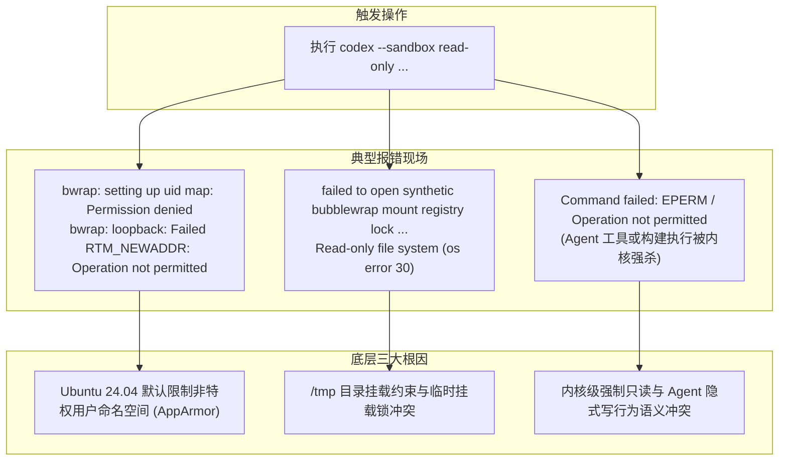

# Ubuntu 24.04 环境下 Codex 沙箱与只读模式配置排障指南 🛡️

## 一、 背景与问题现象

在 Code-Shield 及本地研发实践中，**Codex CLI**（`@openai/codex`）常被用作自主探索型智能体（Thick Agent）执行代码审查、问题复核或本地安全审计。

然而，在 **Ubuntu 24.04 LTS (Noble Numbat)** 环境中，当开发者以只读模式（`--sandbox read-only` 或 `sandbox_mode = "read-only"`）运行 Codex 时，经常会遇到沙箱初始化崩溃或命令执行异常。



---

## 二、 核心架构与底层根因深度剖析

### 2.1 根因一：Ubuntu 24.04 对非特权用户命名空间的限制 (AppArmor Restrict)
* **Linux 沙箱实现机理**：Codex 在 Linux 下依托 `codex-linux-sandbox`，底层调用 **Bubblewrap (`bwrap`)** 与 seccomp 来创建进程隔离、网络隔离与受限文件系统视图。
* **系统安全策略变更**：Ubuntu 24.04 引入了严格的内核安全基线，默认将 `kernel.apparmor_restrict_unprivileged_userns` 设置为 `1`。系统要求所有创建非特权用户命名空间（Unprivileged User Namespaces）的二进制文件必须拥有显式匹配的 AppArmor Profile。
* **冲突表现**：由于 `bwrap` 依赖非特权用户命名空间来完成无 root 权限的容器化挂载，在未加载对应 AppArmor 策略时，系统内核直接拦截并返回 `Permission denied`，导致沙箱无法启动。

### 2.2 根因二：`read-only` 模式下的临时挂载锁与套接字通信冲突
* **IPC 机制**：Codex 采用主进程与沙箱包装器（`codex-execve-wrapper`）协同机制，通过 UNIX Domain Socket（如 `CODEX_ESCALATE_SOCKET`）进行命令权限审查与协议协商；
* **挂载锁争用**：在初始化只读文件系统映射时，Codex 必须在系统临时目录（默认 `/tmp`）创建并锁定合成挂载注册表（Synthetic Bubblewrap Mount Registry Lock）。若当前环境的 `/tmp` 被标记为 `noexec`、挂载为完全只读（常见于嵌套容器），或者目录权限受限，就会抛出 `Read-only file system (os error 30)`。

### 2.3 根因三：内核级禁写与 Agent 预期行为的不匹配
* **权限边界认知偏差**：`read-only` 模式是由 Linux 内核强制施加的只读保护（`MS_RDONLY`），**连当前工作区内的新增、修改、临时缓存写入都会被内核直接驳回**；
* **隐式写入行为**：大模型在自主探索时，常会执行 `npm test`、`go test`、`cargo check`、`python script.py` 等命令。这些工具底层常伴随自动生成 `.pyc`、编译缓存 `.o` 或临时文件重定向操作，在 `read-only` 模式下会立即被内核触发 `EPERM`，造成执行中断。

---

## 三、 官方推荐解决方案与实操指南

### 3.1 方案一：加载 AppArmor 的 Bubblewrap 规则（官方首选推荐，安全性最高）

OpenAI Codex 官方推荐使用系统标准 Profile 授予 `bwrap` 非特权命名空间权限，既无需关闭系统安全防线，又能彻底解决沙箱启动问题。

#### 步骤 1：安装并启用官方 `bwrap-userns-restrict` Profile
```bash
sudo apt update
sudo apt install -y apparmor-profiles apparmor-utils bubblewrap

# 安装 Ubuntu 官方 extra profile 并加载
sudo install -m 0644 \
  /usr/share/apparmor/extra-profiles/bwrap-userns-restrict \
  /etc/apparmor.d/bwrap-userns-restrict

sudo apparmor_parser -r /etc/apparmor.d/bwrap-userns-restrict
```

#### 步骤 2（备选）：若无该文件，手动创建独立 Profile
如果系统未预装该规则，可直接手动写入 `/etc/apparmor.d/bwrap`：
```bash
sudo tee /etc/apparmor.d/bwrap << 'EOF'
abi <abi/4.0>,
include <tunables/global>

profile bwrap /usr/bin/bwrap flags=(unconfined) {
    userns,

    # Site-specific additions and overrides.
    include if exists <local/bwrap>
}
EOF

# 立即重新解析并加载策略
sudo apparmor_parser -r /etc/apparmor.d/bwrap
```

---

### 3.2 方案二：全局关闭 AppArmor 对非特权 User Namespace 的限制（开发机/容器快速生效）

如果您使用的是单人专用开发机、WSL2 或 CI 构建容器，可以直接通过 `sysctl` 禁用该限制：

```bash
# 1. 临时生效（重启后失效）
sudo sysctl -w kernel.apparmor_restrict_unprivileged_userns=0

# 2. 持久化配置（系统重启依然有效）
echo 'kernel.apparmor_restrict_unprivileged_userns=0' | sudo tee /etc/sysctl.d/60-apparmor-namespace.conf
sudo sysctl --system
```

---

### 3.3 方案三：临时目录与环境就绪性验证

若遇到 `/tmp` 挂载锁相关报错，请检查并配置用户的临时文件路径：

```bash
# 1. 显式指定可读写的主机临时目录
export TMPDIR=/tmp

# 2. 单行验证 Bubblewrap 沙箱是否已具备命名空间创建能力
bwrap --dev-bind / / --unshare-net echo "Bubblewrap Sandbox is Functional!"
```
*如果输出 `Bubblewrap Sandbox is Functional!`，证明底层内核沙箱环境已完全修复。*

---

## 四、 Codex 沙箱模式与工程选型最佳实践

根据 Codex 官方规范，系统将**操作系统内核级权限约束（Sandbox Mode）**与**人机交互确认开关（Approval Policy）**进行了正交解耦。

### 4.1 三大沙箱模式选型对比

| 沙箱模式 (`sandbox_mode`) | CLI 参数 | 文件系统权限 | 适用业务场景 |
| :--- | :--- | :--- | :--- |
| **`read-only`** *(严格只读)* | `--sandbox read-only` | 全局只读，**连工作区内部也严禁任何写操作** | 代码库全局问答、只读架构审查、安全只读审计、禁止一切改动的安全检查 |
| **`workspace-write`** *(推荐默认)* | `--sandbox workspace-write` | **允许修改当前工作区文件**，严禁触碰工作区外部目录，限制外部网络 | 单元测试编写、代码重构、Bug 修复、代码生成（绝大多数日常开发场景） |
| **`danger-full-access`** *(完全开放)* | `--sandbox danger-full-access` | 完全继承主机/容器权限，无 OS 级内核沙箱限制 | 外部已具备完整 Docker 隔离的 CI/CD 容器、一次性无状态开发沙盒 |

> 💡 **工程提示**：  
> 许多开发者误将 `read-only` 理解为“不会误修改代码仓以外的系统文件”，实际上这属于 `workspace-write` 的职责。如果任务需要跑测试、输出临时报告或编写补丁，**应选择 `workspace-write`，而非 `read-only`**。

### 4.2 审批策略 (`approval_policy`) 的合理搭配

* **避免严苛策略叠加导致的静默假死**：
  * 若设置了 `sandbox_mode = "read-only"` 同时指定 `--ask-for-approval never`，一旦 Agent 尝试执行带副作用的命令，系统将直接拦截失败，大模型无法进行任何自愈或请求权限提升；
* **官方推荐组合**：
  * 在只读审计时，建议搭配 `on-request`：
    ```bash
    codex --sandbox read-only --ask-for-approval on-request
    ```

### 4.3 配置文件固化模版 (`~/.codex/config.toml`)

可将稳健的配置沉淀至用户的 Codex 配置文件中：

```toml
# 默认使用安全的 workspace-write 模式，保障工作区隔离
sandbox_mode = "workspace-write"
approval_policy = "on-request"

# 若当前工程为纯只读代码检视，可通过指定 profile 或 CLI 参数覆盖:
# codex -s read-only
```

### 4.4 外部容器化环境下的终极旁路选项

如果系统已经部署在安全隔离的 Docker 容器中（无需在容器内嵌套 bubblewrap）：

```bash
# 完全绕过内部沙箱与人工确认
codex --dangerously-bypass-approvals-and-sandbox
```
或者在容器内的 `~/.codex/config.toml` 中配置：
```toml
sandbox_mode = "danger-full-access"
```

---

## 五、 系统健康自检与排障清单 (Checklist)

当再次遇到沙箱相关疑难杂症时，可依次执行以下排障流水线：

```bash
# 1. 运行 Codex 内置诊断命令查看沙箱状态
codex doctor

# 2. 检查内核对非特权命名空间的当前放行状态 (应输出 0)
sysctl kernel.apparmor_restrict_unprivileged_userns

# 3. 验证当前系统的 AppArmor 运行状态与 bwrap 规则
sudo apparmor_status | grep -i bwrap

# 4. 检查 bubblewrap 二进制可执行路径
which bwrap
```
