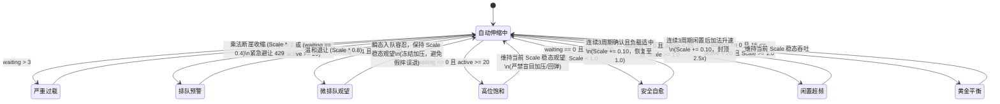

# 07-基于“一叶知秋”探针的大模型自适应动态流控与防降级架构设计

## 1. 业务背景与核心痛点

在 Code-Shield 现行架构中，大模型算力供给层（LLM Compute Resources）采用**静态配置与开环控制（Open-Loop Control）**机制：
- 每个逻辑/物理算力节点在配置文件中预先固化并发上限（如 `concurrent: 10`）；
- 全局流控依赖静态时间段规则（`WorkHoursConfig`，如周一至周五 09:00~22:00 强制统一打折为 10%）。

该机制在实际生产运行中暴露了严重的“双向失衡”问题：
1. **低峰期闲置浪费（算力吃不饱）**：
   在夜间或外部业务低峰期，后端大模型集群算力极其充裕，但 Code-Shield 因受限于静态并发配置或死板的时间段限制，扫描任务依然以低并发甚至单并发慢速爬行，导致任务队列大面积积压，海量算力白白流失。
2. **高峰期频繁遭遇 429 导致任务批量降级（业务硬伤）**：
   当其他业务突发调用或多扫描任务并发涌入时，大模型后端算力饱和，网关或推理实例频繁触发 `HTTP 429 Rate Limit`。现行机制在遇到 `ErrorClassRateLimited` 时仅做有限重试，重试耗尽后任务被迫触发失败降级（如跳过复核、默认判定通过或保守标记），直接损害了代码安全扫描的召回率与分析质量。

---

## 2. “一叶知秋”哨兵探针架构

### 2.1 拓扑原理与设计前提
大模型推理集群通常在物理节点前置一层统一的负载均衡反向代理网关。在集群各推理节点同构的前提下，网关的负载均衡策略（如 Round-Robin、Least Connections）使得各个实例的排队与并发水位趋于均匀分布。

因此，**对其中任一单台推理节点进行高频轻量指标探测，其排队与并发状态即可等比映射为整个集群的真实运行水力负荷**。这就是“**一叶知秋**”（Canary Metrics Probe）机制的核心理论依据。

```
                    ┌────────────────────────────┐
                    │  Code-Shield 扫描引擎任务   │
                    └─────────────┬──────────────┘
                                  │ 动态并发槽位分发
                                  ▼
                   ┌──────────────────────────────┐
                   │ ModelDispatcher 核心调度器   │
                   └──────────────┬───────────────┘
                                  ▲ 动态调节 EffectiveScale (0.2x ~ 2.5x)
                                  │
                   ┌──────────────┴───────────────┐
                   │ Canary Metrics Probe 探针协程│
                   └──────────────┬───────────────┘
                                  │ HTTP GET (每 3~5 秒异步拉取)
                                  ▼
┌─────────────────────────────────┼─────────────────────────────────┐
│ 大模型推理与网关集群              │                                 │
│                                 │                                 │
│    ┌─────────────────────────┐  │  ┌─────────────────────────┐   │
│    │  Inference Node A       │  │  │  Inference Node B       │   │
│    │  (Canary 哨兵探针节点)   │◄─┘  │  (同构常规算力节点)       │   │
│    │  http://...:5031/metrics│     │                         │   │
│    └────────────┬────────────┘     └────────────┬────────────┘   │
│                 ▲                               ▲                │
│                 └───────────────┬───────────────┘                │
│                                 │ 负载均衡反向代理 (Load Balancer) │
│                         ┌───────┴───────┐                        │
│                         │   API Gateway │                        │
│                         └───────────────┘                        │
└──────────────────────────────────────────────────────────────────┘
```

### 2.2 核心指标裁剪与物理映射
推理服务监控 API（如 `/api/metrics/recent?server=pd-glm52-w4a8-xs&limit=1`）返回大量性能参数，按照“极简可用、抓大放小”原则，我们仅裁剪并引入两个最核心的关键指标：

| 监控指标 | 物理定义 | 角色定位 | 核心控制价值 |
| :--- | :--- | :--- | :--- |
| **`waiting_requests`** | 服务端等待队列中的排队请求数 | **硬饱和红线 / 紧急制动踏板** | 只要 `waiting_requests > 0`，说明服务端已无法实时消化当前请求，**大模型网关即将产生 429 限流或客户端超时**。必须在服务方抛出 429 之前主动减速避让。 |
| **`active_requests`** | 服务端当前正在执行推理的活跃请求数 | **水位表征 / 增压空间指针** | 表征当前单实例的承载负荷。当 `waiting_requests == 0` 时，通过 `active_requests` 与安全容量区间的比值，决策是否可以安全增压。 |

---

## 3. 自适应拥塞控制算法（Asymmetric AIMD）

大模型推理属于典型的长 Prefill 计算密集型任务，系统控流必须严格遵循“**减速如断崖、增速如爬坡**”的非对称自适应加法递增/乘法递减（Asymmetric AIMD）策略，杜绝控制共振与钟摆震荡。

### 3.1 闭环水力决策矩阵



| 运行状态 | 判定条件 | 调度器调控行为 | 目标与业务价值 |
| :--- | :--- | :--- | :--- |
| **🚨 严重过载区<br>(Critical Overload)** | `waiting_requests > 3` | **乘法断崖下调（Fast Cut）**：<br>`Scale = max(MinScale, Scale * 0.4)`<br>直接降低发牌速率至保底区间（如 0.2x~0.3x）。 | **主动熔断避让**：在网关返回 429 之前彻底阻断新增洪峰，等待后端队列清空，彻底避免任务耗尽重试而发生降级。 |
| **⚠️ 排队预警区<br>(Queue Warning)** | `waiting_requests >= 2`<br>或 (`waiting_requests == 1` 且 `active >= active_high`) | **温和退避（Soft Backoff）**：<br>`Scale = max(MinScale, Scale * 0.8)` | **饱和与积压避让**：在确认队列积压或高水位排队时提前防微杜渐，避免恶化为严重过载。 |
| **🟡 瞬态微排队观望区<br>(Micro-Queue Tolerance)** | `waiting_requests == 1`<br>且 `active < active_high` | **容忍保持稳态（Hold & Observe）**：<br>维持当前 `Scale`，重置超频与自愈计数器。 | **消除假摔与调度毛刺**：在算力未饱和时容忍推理引擎 Continuous Batching 调度切片毫秒级时延，不进行惩罚性退缩，保障吞吐稳定。 |
| **🟢 高位饱和稳态区<br>(High Saturation Hold)** | `waiting_requests == 0`<br>且 `active_requests >= active_high_threshold` | **保持当前稳态（Hold & Maintain）**：<br>维持当前 `Scale` 观望，重置自愈与超频计数器。 | **全生命周期防冒进**：无论当前处于限流（`Scale < 1.0`）还是标称/超频状态，只要活跃请求触顶警戒天花板，严禁盲目加压回弹，防止在临界点重蹈覆辙。 |
| **🔄 安全基准自愈区<br>(Safe Self-Healing Recovery)** | `waiting_requests == 0`<br>且 `active_requests < active_high_threshold`<br>且 `Scale < 1.0` | **平稳自愈回弹（Additive Recovery）**：<br>`Scale = min(1.0, Scale + 0.10)`<br>（要求连续 3 个周期确认无排队且负载适中）。 | **安全自愈**：只有在确认集群不仅零排队、而且确实存在吞吐承载余量（`active < active_high`）时，才平稳步进回升至 100% 标称基准。 |
| **🔵 闲置超频区<br>(Overdrive Boost)** | `waiting_requests == 0`<br>且 `active_requests < active_low_threshold`<br>且 `Scale >= 1.0` | **加法缓升（Additive Ramp-up）**：<br>`Scale = min(MaxScale, Scale + 0.10)`<br>（要求连续 3 个周期持续满足此条件）。 | **榨干低峰算力**：阶梯放宽槽位，最高可升至 2.5x，大幅加速长队列排队扫描。 |
| **🟢 黄金平衡区<br>(Optimal Sweet Spot)** | `waiting_requests == 0`<br>且 `active_low <= active < active_high`<br>且 `Scale >= 1.0` | **平稳保持（Hold & Maintain）**：<br>维持当前 `Scale`，既不增压也不减压。 | 算力已被高度利用且零排队，属于标称最佳吞吐点。 |

### 3.2 防抖与安全边界（Safety Bounds & Anti-Flapping）
1. **非对称防抖时间窗**：
   - **减速即时生效**：一旦检测到确切积压（`waiting >= 2`）或高位排队（`waiting == 1 && active >= active_high`），当轮探测立即减速（0 延迟防护），并重置回弹与超频计数器；
   - **自愈与增速延迟确认**：无论是自愈回弹（恢复至 100%）还是超频增压（冲刺 250%），均必须连续 3 次探测（约 15 秒）确认稳定且未触碰高水位天花板（`active < active_high`），方可执行一步 `+0.10`（+10%）的加法平稳升速，防止因任务交替瞬态空闲引发震荡。
2. **上下界刚性约束**：
   - `MinScale`（默认 0.20）：并发下限底线；若配置为 `0.00`，则系统在严重过载时将彻底暂停并发派发（完全让路线上业务），并在零排队且算力充沛时自动唤醒回弹；
   - `MaxScale`（默认 2.50）：设置物理天花板，防止突发任务将网关自身的连接数或带宽打穿。

---

## 4. 架构集成与工程实现

### 4.1 配置数据结构扩展 (`models/config.go`)
在全局扫描流控配置中引入自适应探针子项：
```go
// AdaptiveThrottlingConfig 自适应探针流控配置
type AdaptiveThrottlingConfig struct {
    Enabled               bool     `yaml:"enabled" json:"enabled"`
    ProbeURL              string   `yaml:"probe_url" json:"probe_url"`
    IntervalSeconds       int      `yaml:"interval_seconds" json:"interval_seconds"`         // 默认 5 秒
    TimeoutMs             int      `yaml:"timeout_ms" json:"timeout_ms"`                     // 默认 1500 毫秒
    ActiveLowThreshold    int      `yaml:"active_low_threshold" json:"active_low_threshold"` // 默认 15
    ActiveHighThreshold   int      `yaml:"active_high_threshold" json:"active_high_threshold"`// 默认 20
    WaitingCriticalThreshold int   `yaml:"waiting_critical_threshold" json:"waiting_critical_threshold"` // 默认 3
    MinScale              *float64 `yaml:"min_scale,omitempty" json:"min_scale,omitempty"`   // 默认 0.20，支持 0.00 完全暂停
    MaxScale              float64  `yaml:"max_scale" json:"max_scale"`                       // 默认 2.50
}
```

### 4.2 调度器优先级与多模式协作 (`services/dispatcher/dispatcher.go`)
现有 `ModelDispatcher` 的流控仲裁机制升级为分层决策：

```
                    ┌────────────────────────────┐
                    │ 管理员手动覆盖 ManualScale   │ (具有最高优先权，有时效限制)
                    └─────────────┬──────────────┘
                                  │ 未设置或过期
                                  ▼
                    ┌────────────────────────────┐
                    │ 动态自适应探针 AdaptiveScale │ (开启时作为常驻默认基准)
                    └─────────────┬──────────────┘
                                  │ 探针不可用/故障
                                  ▼
                    ┌────────────────────────────┐
                    │ 静态模式 Normal / WorkHours │ (底层硬编码保底兜底)
                    └────────────────────────────┘
```

- **槽位容量动态计算公式**：
  $$Limit = \lceil RawConcurrent \times EffectiveScale \rceil$$
- **条件变量唤醒**：
  当探针调整 `AdaptiveScale` 引起并发槽位增加时，调度器自动触发 `d.cond.Broadcast()`，即刻唤醒等待槽位中的业务扫描协程。

### 4.3 生产级容灾与优雅降级（Fail-Safe Design）
1. **完全异步短超时探测**：
   探针独立运行于 Background Goroutine，探针 HTTP 请求配置 1.5 秒硬超时，严禁侵入核心调度与扫描主链条。
2. **连续失败自动回退（Auto Fallback）**：
   维护 `probeFailureCount` 计数器。若连续 3 次探测失败（网络抖动、探针节点宕机等），系统自动输出告警并无缝降级为原有静态 1.0 模式，保障核心业务绝对不因监控故障而阻塞。

---

## 5. UI/UX 极简交互设计

管理界面（`http://192.168.56.18:8000/shield/admin/scan`）无需增加多余页面，完全复用现有的 [`ThrottleControlCard`](file:///home/fugui/codes/code-shield/frontend/src/components/execution/ThrottleControlCard.tsx) 控制卡片，仅升级交互语义。

### 5.1 右侧控制栏（操作区）

将原有下拉选项中的 `100% (恢复默认速度)` 升级为默认项：

```html
<select value={selectedScale}>
  <!-- 默认模式：无需设置持续时间，作为系统常态运行 -->
  <option value="adaptive">🤖 按流量压力自动伸缩 (默认推荐)</option>
  
  <!-- 以下为人工紧急覆盖项：选择后显示持续时间下拉框 -->
  <option value="0">0% (临时暂停所有扫描)</option>
  <option value="0.25">25% (人工强制极度限速)</option>
  <option value="0.5">50% (人工强制半速运行)</option>
  <option value="0.75">75% (人工强制微调限速)</option>
  <option value="1.0">100% (人工强制锁定基准速度)</option>
  <option value="1.5">150% (人工强制快速运行)</option>
  <option value="2.0">200% (人工强制双倍加速)</option>
</select>
```

- **交互逻辑**：
  - 当选择 `按流量压力自动伸缩` 时，右侧自动**隐藏“持续时间”**选择框，点击应用即刻撤销一切手动限速，交还自适应控制。
  - 当管理员因特殊场景选择具体百分比（如 `50%` 或 `200%`）时，保留持续时间（0.5h~24h），到期后系统平滑自动切回自适应模式。

### 5.2 左侧状态栏（透视区）

消除“黑盒”感，让运维与测试人员对集群水位一目了然：

1. **状态徽章（Status Badge）**：
   - 处于闲置增压时：绿色徽章显示 `🤖 自动增压中 150%`
   - 处于黄金平稳时：蓝色徽章显示 `🤖 自动伸缩中 100%`
   - 处于排队避让时：黄色徽章显示 `⚠️ 自动避让中 30%`
2. **水情透视文案（Status Description）**：
   - 实时输出探针感知的哨兵数据：
     > “当前处于流量自适应模式：哨兵节点（活跃 31，排队 0），后端算力充沛，当前自动匹配为 **125%** 并发速度处理扫描任务。”

---

## 6. 预期收益与验收指标

1. **限流降级率归零**：
   通过在 `waiting_requests > 0` 阶段的主动削峰退让，阻断 429 错误风暴，使扫描任务因大模型限流超时而降级的概率趋近于 0。
2. **夜间扫描吞吐倍增**：
   在夜间及闲时阶段，`EffectiveScale` 自动探测拉升至 1.5x~2.5x，大幅消耗离线任务队列，任务平均等待时延降低 40% 以上。
3. **运维与研发零心智负担**：
   告别频繁修改配置文件的“时间表管理”，真正实现 7x24 小时全天候无人值守与自适应按需吞吐。
