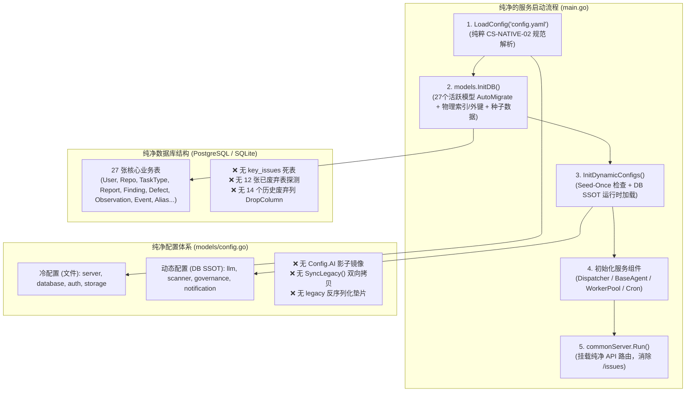

# RFC-004: 系统 Release 前夕过程性代码与历史兼容逻辑清理设计

## 📋 方案元数据与导读

* **文档编号**：`RFC-004` / `CS-RELEASE-PURIFY-01`
* **文档类型**：系统架构重构、代码库纯净化（Purification）与技术债务彻底出清设计
* **当前状态**：`Accepted / Ready for Phased Execution`（方案已完成最新代码基准对齐，进入分阶段实施准备态）
* **最新修订记录**：
  * **R2 版（当前基线刷新）**：深度吸收并整合近期系统架构重大演进成果，包括：
    1. **09 号缺陷槽位对账 Phase 3 终态演进**：已完成模型几何字段物理剔除与旧指纹关闭，需彻底出清 `models/db.go` 中临时追加的 4 个 `Defect` 旧列探测及 `MigrateDefectSlotSchema` 历史补丁；
    2. **声明式 SPI 插件架构落地（05 号设计）**：核心调度层完成去特化，前置门禁与质量复核逻辑已统一下沉至 `plugins/` 插件层；
    3. **Tier 1~4 全链路提示词与契约解耦**：完成动静分离与 `meta.json` 动态领域注入，彻底废弃历史旧版契约容错；
    4. **环境与覆盖率治理轻量化**：移除工作区清洁度阻断检查并解绑覆盖率降级，避免扫描基准受开发态工作区脏状态干扰。
* **涉及模块**：
  * `models/`（`db.go`、`models.go`、`config.go`）
  * `main.go`（服务启动生命周期与路由注册）
  * `cmd/`（`backfill_defect_texts/`、`backfill_no_scope/`）
  * `services/migration/`（全量引擎收敛迁移器及单测）
  * `handlers/`（`issue.go`、`config.go`、`task_type.go`）
  * `services/`（`dispatcher/`、`invoker/`、`runner/`、`engines/debate/resume.go`）
* **前置条件与核心前提**：
  * **全新发布环境 (Clean Slate Deployment)**：系统正式 Release 发版时，生产环境全部 PostgreSQL / SQLite 数据库实例与存储卷均为空白全新部署，绝不存在任何现网历史遗留数据。
  * **任务元数据规范已冻结**：`tasks/` 目录下全部 10 个内置任务类型的 `meta.json` 已全部升级至以 `scan_profile`、`debate_full` 及标准化字典序排版为基础的最新规范。
  * **配置规范已就绪**：系统配置文件已全面切换至 `CS-NATIVE-02` 动静分层标准（顶层划分为 `server`, `storage`, `database`, `auth`, `llm`, `scanner`, `governance`, `notification`）。

---

## 一、 背景与问题陈述 (Context & Problem Statement)

### 1.1 架构演进与技术债务沉淀
Code-Shield 系统经过多轮深度攻坚与架构演进，核心底层能力已全面收敛定型：
1. **缺陷对账体系重构（09 号设计）**：从最初脆弱的 `KeyIssue` 演进为三级指纹，最终收敛为“纯 Go 端侧物理定桩 + 两级离散槽位匹配（`CoreSlotKey` / `SlotKey`）+ 稀疏账本存储”的确定性对账体系。近期已顺利完成 **Phase 3 终态演进**：彻底剔除几何指纹字段（`occurrence_index`, `stmt_shape`, `prev_shape`, `next_shape`），关闭旧指纹回退链路，并在生产启用条件强唯一索引；
2. **声明式 SPI 插件架构（05 号设计）**：实现任务形态差异化扫描引擎 SPI 插件机制，将前置单测门禁、质量合规检查与结果后置复核等特化逻辑从调度器中剥离并下沉至 `plugins/`，实现了核心调度引擎的彻底去特化；
3. **全链路提示词动静分离与契约标准化**：重构 Tier 1~4 全阶段对抗提示词与输出契约，解除领域规则与核心流水线的强耦合，实现骨架模板动态领域注入；
4. **配置与算力架构演进（RFC-002）**：实现 `CS-NATIVE-02` 动静分层、数据库动态 SSOT 配置中心及原生多端点算力池；
5. **Agent 形态精简**：从早期按任务类型动态生成多个磁盘 Agent 文件，收敛为单一全局基座 Agent（`shield-base-scanner`）。

### 1.2 现状痛点归因：过程性代码与兼容包袱
为了在长达数月的敏捷开发中维持本地开发环境与存量测试数据的“向下平滑兼容”，代码库中遗留了大量“开发期过程性补丁”与“过渡垫片”：

```
                      现存启动流程与历史包袱链路审计
                                    │
       ┌────────────────────────────┼────────────────────────────┐
       ▼                            ▼                            ▼
【启动期全量 DDL/DML 探测】   【引擎收敛强行覆写磁盘】      【双轨配置镜像同步】
models/db.go (L68-L119)       migration.RunEngineConvergence models/config.go
- 循环 DROP 12 张废弃旧表      - 启动扫描 tasks 强行写盘     - SyncLegacy() 130 行双向拷贝
- Migrator 探测并删 14 废弃列  - 遍历 DB 报告回填旧快照      - ComputeResourceConfig 4个私有兼容字段
- 启动强刷 category_status    - 生产容器只读 RootFS 崩溃风险 - 8 个已废弃结构体别名兼容
- 强刷 governance_mode
```

1. **服务启动性能损耗与只读容器崩溃隐患**：
   * 每次启动无条件执行 12 次 `DROP TABLE IF EXISTS`，并通过 GORM Migrator 逐一探测并删除 14 个历史废弃列；
   * 每次启动强行读取 `tasks/*/meta.json` 转换后使用 `os.WriteFile` 覆写磁盘。在标准生产环境（如只读根文件系统 Read-only RootFS、受限权限的 Kubernetes Pod）下将直接引发启动 panic；
2. **数据库包含无效死表与重复迁移**：
   * `AutoMigrate` 仍包含早已废弃的 `KeyIssue` 模型，生成无用的 `key_issues` 表与孤儿路由 `/issues`；
   * `MigrateDefectSlotSchema` 中对已注册模型重复执行 `AutoMigrate`，并保留历史索引 DROP 试探；
3. **双轨配置造成高认知负荷与冗余同步**：
   * 外部 YAML 与前端 Web 配置中心均已全面采用 `CS-NATIVE-02`，但因部分旧模块未彻底解耦，底层仍在通过 `SyncLegacy()` 双向拷贝数据至 `AppConfig.AI`，维持影子配置镜像；
4. **离线修补脚本混杂在生产工程源码树中**：
   * `cmd/backfill_defect_texts/` 与 `cmd/backfill_no_scope/` 属于特定测试阶段的数据修复工具，留在主工程影响代码纯净度与构建交付。

---

## 二、 清理范围与资产审计矩阵 (Scope & Audit Matrix)

下表列出系统 Release 前夕必须彻底出清的 8 大清理维度、对应文件路径、代码行号及消除理由：

| 编号 | 清理维度 | 涉及文件/路径 | 当前代码现状 | 消除理由 (Release 全新环境前提) | 处置动作 |
| :--- | :--- | :--- | :--- | :--- | :--- |
| **DIM-1** | 离线补丁脚本 | `cmd/backfill_defect_texts/`<br>`cmd/backfill_no_scope/` | 离线遍历数据库补齐空标题与旧报告覆盖率 | 全新库无历史数据；新扫描由流水线实时计算并完整持久化 | **全目录物理删除** |
| **DIM-2** | 启动期 DDL/DML 擦除补丁 | `models/db.go` (L68-L119)<br>`models/models.go` (L1480-L1523) | 1. 循环 DROP 12 张旧表<br>2. 探测并 DROP 14 个废弃列（Finding 7 列、Report 3 列、Defect 4 列）<br>3. UPDATE category_status 与 governance_mode<br>4. 重复 AutoMigrate 与 DROP 旧索引 | 全新库由当前模型直接创建表结构，旧表、旧列与旧索引从未存在，数据为空，无须清洗 | **删除全部试探性 DROP 与 UPDATE；规范索引创建函数** |
| **DIM-3** | 引擎收敛迁移器及启动调用 | `main.go` (L54-L56)<br>`services/migration/` (全包 6 文件) | 启动时强行改写磁盘 `meta.json`，补齐历史报告快照，回填旧分类语义 | 磁盘内置任务已是最终规范；全新库无历史报告；消除生产环境只读文件系统崩溃风险 | **移除启动入口，删除 services/migration 目录** |
| **DIM-4** | 废弃实体与孤儿接口 | `models/models.go` (L1231-L1246)<br>`models/db.go` (L39)<br>`handlers/issue.go` (全文件)<br>`main.go` (L188-L190)<br>`handlers/task_type.go` (L398-L400) | `KeyIssue` 结构体、GORM 映射、增删改查路由 `/issues` 及关联删除逻辑 | 前端路由已重定向至 `/reports`；系统已全面采用 `Defect` 槽位账本体系，从不调用该接口 | **彻底删除实体、GORM注册、路由及控制器** |
| **DIM-5** | 配置双轨镜像与兼容结构体 | `models/config.go` (`SyncLegacy`, `Config.AI`, 兼容字段, 别名)<br>`services/dispatcher/`<br>`services/runner/`<br>`services/engines/debate/` 等 | 130 行 `SyncLegacy` 双向复制，私有 `legacy*` 反序列化 Hack，8 个别名结构体，业务层直接引用 `AppConfig.AI` | YAML 与 Web 配置中心已全面采用 CS-NATIVE-02；统一收敛至 `LLM` 与 `Scanner` 原生字段 | **业务调用点归一化，删除 SyncLegacy、Config.AI 及兼容结构体** |
| **DIM-6** | 续扫 Checkpoint 旧版本容错 | `models/config.go` (L249-L257, L432-L434)<br>`services/engines/debate/resume.go` (L25, L225, L251) | 兼容旧开发期的 V2/V3 bundle checkpoint 及 `LegacyV2Policy` 配置项 | 当前标准 schema version 为 5；全新环境不会产生历史版本 checkpoint | **删除 LegacyV2Policy，严格校验版本** |
| **DIM-7** | 宿主机遗留 Agent 文件清理 | `main.go` (L77)<br>`services/invoker/agent_sync.go` (L38-L58) | 启动时遍历扫描并删除 `~/.config/opencode/agents/` 下按旧任务命名的 md 文件 | 新架构已统一使用单基座 Agent；全新生产服务器/容器环境无历史文件残留 | **移除启动调用与清理函数** |
| **DIM-8** | 槽位迁移函数职责理顺与命名规范 | `models/models.go` (L1479-L1523)<br>`models/db.go` (L65-L67) | 函数名为 `MigrateDefectSlotSchema`，内部重复执行 AutoMigrate 并执行历史 DROP INDEX | 09 号 Phase 3 已完成终态收敛，该函数本质为初始化物理索引，不应承担 Migration 语义 | **重构为 EnsureDefectSlotIndexes，精简仅保留索引保障** |

---

## 三、 目标纯净架构设计 (Target Pure Architecture)

出清历史技术债务后，系统将达成**零过渡逻辑、单真实源 (SSOT)、纯净无损启动**的架构终态：



### 3.1 数据库初始化纯净化设计 (`models/db.go` & `models/models.go`)
1. **纯净模型注册**：`AutoMigrate` 严格包含且仅包含 **27 个核心活跃业务模型**，彻底移除 `&KeyIssue{}`：
   * 基础与系统：`User`, `Department`, `Repository`, `SystemConfig`, `SystemDynamicConfig`, `ScheduleConfig`, `SysAuditLog` (7)
   * 任务与调度：`TaskType`, `TaskTypeRevision`, `TaskTriggerLog`, `TaskExecutionLog`, `TaskChunkExecution`, `TaskDebateLog` (6)
   * 扫描与报告：`TaskReport`, `AnalysisFinding`, `ArtifactRepairAudit`, `ScanScopeEntry`, `CampaignFinding`, `RepoFeedbackRule` (6)
   * 缺陷台账体系（09 号设计）：`Defect`, `DefectAlias`, `DefectObservation`, `DefectEvent` (4)
   * 分类知识沉淀：`CategoryAliasUsage`, `CategoryRegressionSample`, `CategoryRegressionReview`, `CategoryConfusionMatrix` (4)
2. **彻底消除试探性 DDL / DML**：
   * 物理删除针对 12 张旧表的循环 `DROP TABLE IF EXISTS`；
   * 物理删除针对 14 个旧列的 `Migrator().DropColumn` 探测与删除；
   * 物理删除 `UPDATE analysis_findings SET category_status = 'LEGACY'`；
   * 物理删除 `UPDATE task_types ... SET governance_mode = 'full_ledger'`。
3. **索引与物理约束保障标准化**：
   * 将 `MigrateDefectSlotSchema` 理顺重命名为 `EnsureDefectSlotIndexes`：
     - 移除内部多余的 `db.AutoMigrate(&Defect{}, &DefectAlias{})`；
     - 移除 `DROP INDEX IF EXISTS uq_defects_current_identity;`；
     - 保留基于 ACTIVE 状态的强唯一索引与检索索引（PostgreSQL 建立 `uq_defect_active_slot_idx`，SQLite 建立对应条件索引）；
   * 保留外键约束 `ensureLedgerForeignKeys`、`EnsureActiveTaskReportUniqueIndex` 及 PostgreSQL 会话级超时保护。
4. **轻量只读种子数据初始化**：
   * 保留 `seedDatabase()`（默认管理员账号创建）；
   * 保留 `seedBuiltinTaskTypes()`（只读解析 `tasks/*/meta.json` 并向全新数据库注入 10 个内置任务，不反写磁盘）。

### 3.2 服务启动生命周期纯净化设计 (`main.go`)
从启动主流程中剥离所有过渡性与兼容性调用：
* **删除引擎迁移器**：移除 `migration.RunEngineConvergence(models.DB, "tasks")`，确保启动阶段对磁盘任务目录绝对只读；
* **删除历史 Agent 清理**：移除 `services.CleanupLegacyTaskAgents()`；
* **删除废弃路由注册**：移除 `api.GET/POST/PATCH("/issues", ...)`。

### 3.3 全局配置系统单真值源 (SSOT) 收敛设计 (`models/config.go`)
彻底消除 `CS-NATIVE-02` 与老 `AI` 块的双轨制，使配置中心与业务服务直接对接唯一真值：
1. **业务调用点重构收敛**：
   * `models.AppConfig.AI.Backend` ➔ `models.AppConfig.LLM.DefaultResource`
   * `models.AppConfig.AI.WorkHoursThrottle` ➔ `models.AppConfig.Scanner.Throttling.WorkHours`
   * `models.AppConfig.AI.Debate.LogRetentionDays` ➔ `models.AppConfig.Scanner.Debate.LogRetentionDays`
   * `models.AppConfig.AI.Debate.MaxCandidatesPerChunk` ➔ `models.AppConfig.Scanner.Debate.MaxCandidatesPerChunk`
   * `models.AppConfig.AI.Debate.StageTimeoutSeconds` ➔ `models.AppConfig.Scanner.Debate.StageTimeoutSeconds`
   * `models.AppConfig.AI.OutputFormat` ➔ `models.AppConfig.Scanner.OutputFormat`
   * `models.AppConfig.AI.DebugLogs` ➔ `models.AppConfig.LLM.DebugLogs`
   * `models.AppConfig.AI.Native` ➔ `models.AppConfig.LLM.FindResource("native")`
   * `models.AppConfig.AI.ToolBackends.*` ➔ 统一采用默认算力资源或专用工具端点。
2. **废除兼容代码与镜像字段**：
   * 删除 `Config.AI` 字段与 `type AIConfig struct`；
   * 删除 `SyncLegacy()` 方法；
   * 删除 `ComputeResourceConfig` 中的私有兼容字段（`legacyBaseURL`, `legacyAPIKey`, `legacyModel`, `legacyConcurrent`）及其自定义 `UnmarshalYAML`/`UnmarshalJSON`/`MarshalJSON`；
   * 删除 `ResumeConfig.LegacyV2Policy` 配置项与 `bundleResumeLegacyVersion = 3` 容错；
   * 删除 8 个废弃兼容结构体别名（`ModelConfig`, `TierConfig`, `DebateEngineConfig`, `UnifiedWorkerPoolConfig` 等）。

---

## 四、 分阶段实施路线图 (Phased Implementation Roadmap)

为确保重构在 Release 前稳妥落地，实施路线图划分为 4 个受控阶段，每阶段均具备独立的验证准则：

```
Phase 1: 零风险启动与脚本清理 ──► Phase 2: 废弃实体与路由清理 ──► Phase 3: 配置体系彻底归一 ──► Phase 4: 发布打包交付
(删除脚本/移除迁移器/清理DDL)    (清理 KeyIssue 相关全部链路)   (消除 AppConfig.AI 镜像)      (全量单测 + 纯净交付)
```

### 4.1 第一阶段：零风险启动与脚本清理（立即实施）
* **目标**：消除启动期对文件系统的写入风险、消除无意义的 DDL/DML 试探执行、移除孤立的离线数据补丁。
* **改动清单**：
  1. 物理删除目录：
     * `cmd/backfill_defect_texts/`
     * `cmd/backfill_no_scope/`
  2. 修改 `models/db.go`：
     * 删除第 68-70 行 `UPDATE analysis_findings SET category_status = 'LEGACY'`；
     * 删除第 72-91 行循环 `DROP TABLE IF EXISTS` 12 张历史旧表的逻辑；
     * 删除第 92-113 行通过 `Migrator().DropColumn` 探测并删除 14 个废弃列（Finding 7 列、TaskReport 3 列、Defect 4 列）的代码；
     * 删除第 115-119 行 `UPDATE task_types ... SET governance_mode = 'full_ledger'`。
  3. 修改 `models/models.go`：
     * 重构 `MigrateDefectSlotSchema` 为 `EnsureDefectSlotIndexes`，移除内部重复的 `AutoMigrate` 和 `DROP INDEX IF EXISTS uq_defects_current_identity`；同步调整 `models/db.go` L65 的调用点。
  4. 修改 `main.go`：
     * 删除第 54-56 行调用 `migration.RunEngineConvergence(models.DB, "tasks")`；
     * 删除第 77 行调用 `services.CleanupLegacyTaskAgents()`。
  5. 物理删除 `services/migration/` 整个包（及其单测）。
  6. 修改 `services/invoker/agent_sync.go`：删除已不再调用的 `CleanupLegacyTaskAgents` 函数。
* **验证准则**：
  * 执行 `go test ./...` 模块级测试全部通过；
  * 执行 `go build -o code-shield-server main.go` 编译成功；
  * 本地启动服务，日志中无任何 `DROP TABLE`、`DropColumn` 或 `[Migration] Converged task type` 输出。

### 4.2 第二阶段：废弃业务实体与孤儿接口清理
* **目标**：数据库模型与 API 路由彻底告别早期业务遗留，防止全新数据库生成无用死表。
* **改动清单**：
  1. 物理删除 `handlers/issue.go` 控制器；
  2. 修改 `main.go`：删除第 188-190 行注册的 `/issues` 路由（`GET /issues`, `POST /issues`, `PATCH /issues/:id`）；
  3. 修改 `models/db.go`：在 `AutoMigrate` 参数列表中移除第 39 行 `&KeyIssue{}`；
  4. 修改 `models/models.go`：删除第 1231-1246 行 `type KeyIssue struct` 定义；
  5. 修改 `handlers/task_type.go`：删除第 398-400 行清理 `KeyIssue` 的代码。
* **验证准则**：
  * 全量单测通过；
  * 使用全新 SQLite/PostgreSQL 启动，数据库内严格生成 27 张业务表，无 `key_issues` 表存在。

### 4.3 第三阶段：配置体系收敛与真值源归一
* **目标**：代码彻底告别 `AppConfig.AI` 影子镜像，实现 `CS-NATIVE-02` 规范唯一真值源。
* **改动清单**：
  1. 梳理全工程对 `models.AppConfig.AI.` 的读取点（`services/dispatcher/`、`services/runner/`、`services/engines/debate/` 等），逐一重构至 `models.AppConfig.LLM.` 或 `models.AppConfig.Scanner.`；
  2. 修改 `models/config.go`：
     * 删除 `SyncLegacy()` 方法；
     * 删除 `Config.AI` 字段与 `type AIConfig struct`；
     * 删除 `NormalizeNativeEndpoints()` 中针对 `AI.Native` 的 fallback；
     * 删除 `ComputeResourceConfig` 中的私有影子兼容字段与专用序列化 Hook；
     * 删除 `ResumeConfig.LegacyV2Policy` 配置项；
     * 删除 8 个废弃兼容结构体别名。
  3. 修改 `services/engines/debate/resume.go`：
     * 删除 `bundleResumeLegacyVersion = 3` 容错逻辑，严格校验当前 Schema Version（5）。
  4. 同步更新测试用例中对 `AppConfig.AI` 的引用。
* **验证准则**：
  * 全工程中无任何 `models.AppConfig.AI` 引用；
  * 动态配置中心与各业务模块（调度器、限流、LLM 调用、辩论流）运行完全正常。

### 4.4 第四阶段：发布打包纯净化与工程准入
* **目标**：保证最终发布交付物（Docker 镜像或归档二进制）不携带任何历史残留。
* **排查清单**：
  1. 确保构建产物 `.gitignore` 排除 `code-shield-server`、`*.db`、`*.log`、`tmp/`；
  2. 验证多阶段构建（Multi-stage Dockerfile），最终镜像仅包含单一纯净二进制、`config.yaml.example`、`tasks/`、`docs/` 及前端构建产物。

---

## 五、 质量保证与安全防线 (Verification & Guardrails)

为确保纯净化重构不对现有业务逻辑造成任何隐蔽破坏，设立以下 3 重质量防线：

### 5.1 自动化测试防线
* **单元测试全覆盖**：重构各阶段必须通过 `go test ./...`，全包测试必须保持 100% 通过；
* **测试用例纯净化同步**：修改或删除专为旧兼容逻辑编写的测试（如 `services/migration/*_test.go`），防止死逻辑测试反向制约架构演进；
* **纯 Go 交付基准**：严格保证以 `CGO_ENABLED=0` 静态编译成功，无 C 依赖回退。

### 5.2 数据库 Schema 纯净对比验证
在干净环境启动全新数据库，导出 Schema 并进行白名单比对：
```sql
-- 验证不存在任何历史遗留表
SELECT table_name FROM information_schema.tables 
WHERE table_schema = 'public' AND table_name IN (
    'key_issues', 'defect_fingerprint_records', 'scan_reconciliations', 
    'reconciliation_links', 'defect_entities', 'defect_occurrences'
);
-- 预期返回结果: 0 行
```

### 5.3 运行时核心业务冒烟基准
在干净环境执行全链路业务冒烟测试：
1. **服务引导**：执行 `./code-shield-server`，检查日志无报错、成功加载 10 个内置任务并完成默认管理员初始化；
2. **SPI 门禁判定**：触发代码扫描，验证前置门禁与质量插件正常执行放行或阻断；
3. **辩论与产物**：验证三方对抗辩论流水线正常运行，产出结构化 Findings 与 Synthesis 报告；
4. **槽位账本结算**：验证缺陷被正确分派入 `defects`、`defect_observations`、`defect_events` 台账中；
5. **动态配置中心**：验证前端访问 `/admin/config` 可以正常读取与热更新数据库 SSOT 配置。

---

## 六、 结论与后续行动 (Conclusion)

通过本设计方案的实施，Code-Shield 系统将**彻底卸下多轮重构演进沉淀的历史债务，全面出清开发期的过程性补丁与兼容代码**。这将减少约 1600+ 行死代码与过渡逻辑，显著提升服务启动效率，消除生产容器只读文件系统的崩溃风险，使系统架构以极致纯净的姿态迎接正式 Release 发版。

**建议依据本方案第四节的受控阶段规划，稳步推进代码层重构落地。**
