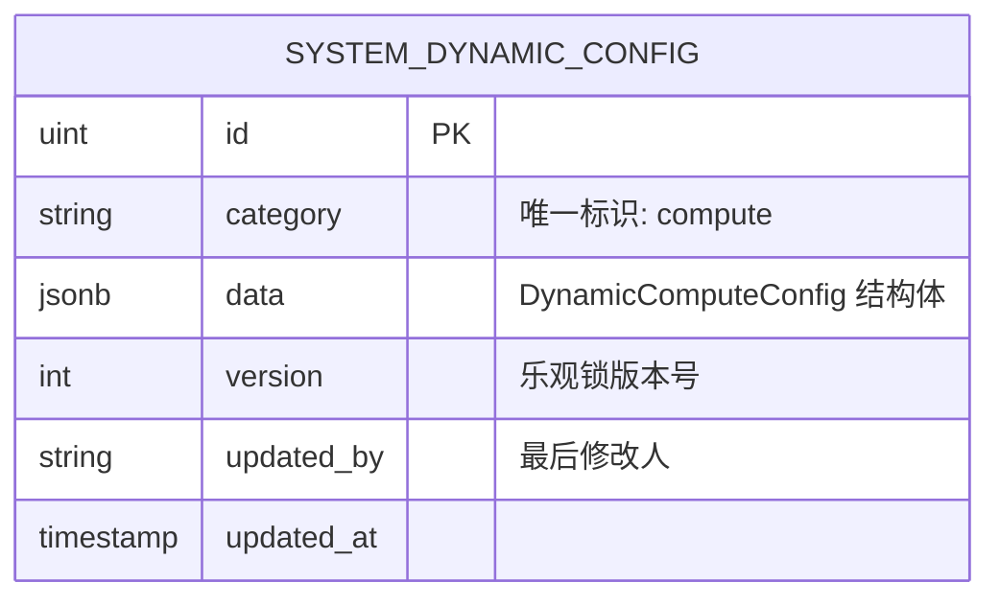
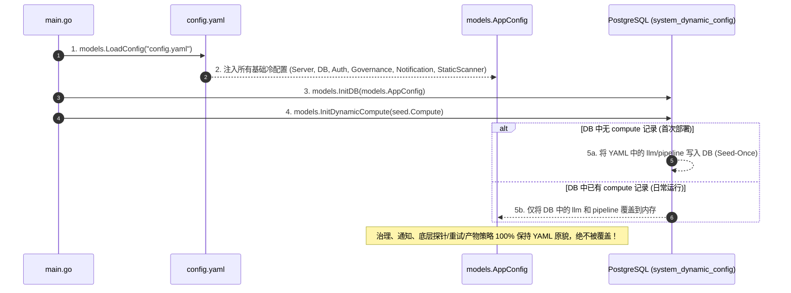

# RFC-005: 系统配置动静分离与算力管理极简化重构设计

## 📋 方案元数据与导读

* **文档编号**：`CS-NATIVE-05`
* **文档类型**：系统配置架构演进、数据源动静分离与前端体验重构提案
* **当前状态**：`PROPOSED`（待评审）
* **涉及模块**：
  * 后端配置与存储：`models/config.go`、`models/db.go`、`models/models.go`、`config.yaml`
  * API 控制器：`handlers/config.go`
  * 任务调度器：`services/dispatcher/`
  * 前端界面：`frontend/src/pages/ConfigCenter.tsx`、`frontend/src/types/config.ts`
* **核心目标**：针对当前配置体系“动态范围划分过宽、冷配置入库导致修改 YAML 不生效、前端配置中心过度臃肿复杂”等痛点，提出**“静态冷配置彻底回归 YAML，动态配置严格收敛至算力与流水线编排，前端配置中心极简化重构”**的演进方案。

---

## 一、 背景与痛点剖析：为什么需要回归理性？

在 `RFC-002`（参见 [`RFC-002-AI执行引擎与企业治理配置架构优化设计.md`](file:///home/fugui/codes/code-shield/docs/03-rfcs/RFC-002-AI执行引擎与企业治理配置架构优化设计.md)）的演进过程中，系统为了达成“大模型算力动态扩容与热重载”的目标，引入了基于数据库的动态配置中心机制（`Seed-Once + DB SSOT`），并将 `llm`、`scanner`、`governance`、`notification` 四个领域整体推入数据库持久化。

但在系统实际投产与日常迭代中，这种**“整包入库、全盘动态”**的做法暴露出了严重的结构性矛盾：


### 1.1 痛点一：动态边界划分过宽，出现“两头不讨好”的尴尬僵局
* **修改本地 YAML 惨遭无情覆盖**：
  许多本属于底层算法、系统架构、冷维护类的配置（如 `governance.identity` 对账算法版本与阈值、`scanner.analysis` 重试参数、`scanner.artifact` Schema 抢救边界、`scanner.throttling.adaptive` 哨兵探针地址等），由于被整体打包归入 `scanner` / `governance` Category，初次启动后即锁死在数据库中。
  开发者本地修改 `config.yaml` 后重启服务，启动日志直接打印：
  `Note: Dynamic sections in config.yaml (llm, scanner, governance) are bypassed.`
  **导致本地修改完全不生效，极大地阻碍了日常调试与环境部署。**
* **前端界面夹生，存在“改不了又看不全”的死角**：
  以 `scanner.throttling.adaptive`（一叶知秋探针流控）为例，前端界面根本没有制作探针地址和阈值的编辑表单；但该配置又位于数据库接管的 `scanner` 中，最终导致**“界面没法改，本地改 YAML 也不生效”**的窘境。

### 1.2 痛点二：前端配置中心（ConfigCenter）过度臃肿复杂
* 目前前端 [`ConfigCenter.tsx`](file:///home/fugui/codes/code-shield/frontend/src/pages/ConfigCenter.tsx) 代码膨胀至 **2293 行**，包含 4 个庞大 Tab、数十个 Card、上百个输入控件。
* 界面上混杂了大量普通运维和业务管理员根本不该触碰的高危参数，例如：
  * `max_schema_repair_attempts`、`schema_repair_timeout_seconds`（产物修复深度）
  * `max_candidates_per_observation`、`strong_same_threshold`、`assign_band`（跨轮对账数学阈值）
  * `retryable_errors`、`retry_backoff_ms`（底层 RPC 重试退避）
* 过于繁琐的界面不仅显著增加了前端维护成本与 Bug 率，还给运维人员带来了巨大的认知负担与误操作风险。

### 1.3 核心本质：业务真正需要“动态调整”的到底是什么？
经过实际生产经验复盘，**真正具有高频动态调整诉求的，本质上只有“算力（Compute）”这一个领域**：
1. **大模型算力池供给**：新买了一组 API Key，某个原生端点（Endpoint）临时故障需要剔除或调整权重，或者接入新的 Thick Agent 节点；
2. **流水线阶梯绑定（Pipeline Tiers）**：根据当天的算力配额，临时调整 Tier 1（初筛）或 Tier 2/3（对抗仲裁）到底绑定哪一个大模型或节点；
3. **全局应急流控**：在白天下发业务高峰期临时暂停扫描队列（`queue_paused`）或缩容并发比例（`concurrency_scale`）。

**除了上述算力与调度绑定之外，其余所有的通知地址、缺陷治理策略、重试机制、AST 解析切片规则等，均属于低频变更的静态冷配置，应当且必须回归到代码与配置文件（`config.yaml`）中！**

---

## 二、 核心重构原则：动静双轨与极简主义

本重构方案确立以下三大设计原则：

1. **动态范围最小化原则（Principle of Least Dynamics）**：
   * 严禁无节制地将配置入库。仅对**高频变化、停机成本极高的大模型算力供给与流水线阶梯绑定**保留数据库动态托管能力。
2. **极简心智模型原则（Cognitive UX Simplification）**：
   * 彻底颠覆“把所有后端配置都做成前端表单”的工程师自嗨思维。前端配置中心重新定位为 **“算力调度中心 (Compute Hub)”**，聚焦直观的可视化编排，将 2300 行臃肿表单精简到 500 行以内。
3. **真实源唯一可预期（Predictable & Pure SSOT）**：
   * 静态配置回归 YAML，修改 YAML 后**重启服务 100% 立即生效**，坚决杜绝任何“暗中从数据库反向覆盖静态配置”的行为；
   * 动态配置存储于独立轻量表，与静态配置在代码模型层面实现**物理字段隔离**。

---

## 三、 全新“动静双轨”配置架构重划（Matrix）

### 3.1 新旧架构对比全景矩阵

| 配置领域与模块 | 包含的关键字段 | 原架构状态 (RFC-002) | **新架构归属 (RFC-005)** | 调整方式与生效途径 |
| :--- | :--- | :--- | :--- | :--- |
| **基础设施层** | `server.*`, `storage.*`, `database.*`, `auth.*` | 静态 (YAML) | **静态冷配置 (YAML)** | 修改 `config.yaml`，重启生效 |
| **外部集成与数据清理** | `ai_fix.*`, `retention.*` | 静态 (YAML) | **静态冷配置 (YAML)** | 修改 `config.yaml`，重启生效 |
| **通知服务 (`notification`)** | `notification.webhook` | 动态 (DB) | **静态冷配置 (YAML)** ⬇️ | 修改 `config.yaml`，重启生效（无需做 Web 界面） |
| **企业治理策略 (`governance`)** | `identity.*`, `arbitration.*`, `lifecycle.*` | 动态 (DB) | **静态冷配置 (YAML)** ⬇️ | 修改 `config.yaml`，重启生效（底层算法硬参数） |
| **扫描引擎底层策略 (`scanner.*`)** | `analysis.*`, `artifact.*`, `resume.*`, `opencode.*`, `determinism.*`, `tools.*` | 动态 (DB) | **静态冷配置 (YAML)** ⬇️ | 修改 `config.yaml`，重启生效（无需做 Web 界面） |
| **扫描流控探针 (`scanner.throttling`)**| `work_hours.*`, `adaptive.*` | 动态 (DB) | **静态冷配置 (YAML)** ⬇️ | 修改 `config.yaml`，重启生效（探针 URL/阈值回归 YAML） |
| **大模型算力池 (`llm`)** | `llm.resources`, `endpoints`, `debug_logs` | 动态 (DB) | **动态热配置 (DB)** 保持 | Web 界面实时展示、修改、Ping 测速，热重载 |
| **辩论流水线编排 (`debate.tiers`)** | `tier1_hunter` ~ `tier4_synthesis` 算力绑定与超时 | 动态 (DB 混在 scanner 中) | **动态热配置 (DB)** 独立 🌟 | Web 界面以**可视化流水线卡片**直观切换绑定 |
| **全局运行控制 (`system_config`)** | `queue_paused`, `concurrency_scale` | 动态 (DB) | **动态热控制 (DB)** 保持 | 执行看板实时切换，无需重启 |

---

## 四、 架构演进与后端重构设计

### 4.1 数据模型重构：物理动静分离

在原实现中，`ScannerConfig` 是一个庞大的一体化结构体，混杂了流水线编排（`Debate.Tiers`）与底层解析参数。新设计将其在模型层面**彻底物理拆分**：

```go
// ── 1. 静态配置部分 (只存在于 YAML 与 AppConfig 静态内存，绝不存库) ──

type StaticScannerPolicy struct {
    OutputFormat string                   `yaml:"output_format" json:"output_format"`
    MockOnMissingCLI *bool                `yaml:"mock_on_missing_cli" json:"mock_on_missing_cli"`
    Throttling   ThrottlingConfig         `yaml:"throttling" json:"throttling"`     // 含 work_hours 与 adaptive 探针
    Analysis     AnalysisRetryConfig      `yaml:"analysis" json:"analysis"`         // 重试策略
    Artifact     ArtifactGuardConfig      `yaml:"artifact" json:"artifact"`         // 产物规范化与 Schema 抢救
    OpenCode     OpenCodeConfig           `yaml:"opencode" json:"opencode"`         // 续跑超时
    Determinism  DeterminismConfig        `yaml:"determinism" json:"determinism"`   // 采样策略
    Tools        ToolsConfig              `yaml:"tools" json:"tools"`               // 微任务路由
}

// ── 2. 动态配置部分 (独立收敛为 Compute & Pipeline，入库管理) ──

// DynamicComputeConfig 统一的动态算力调度配置实体 (Category = "compute")
type DynamicComputeConfig struct {
    LLM          LLMConfig          `json:"llm"`          // 算力供给节点与 Native 集群端点
    Pipeline     PipelineTierConfig `json:"pipeline"`     // Hunter/Challenger/Judge/Synthesis 阶梯绑定与超时
    WorkerCount  int                `json:"worker_count"` // 全局扫描任务并发工作池大小 (支持热缩扩容)
    MaxQueueSize int                `json:"max_queue_size"`
}

type PipelineTierConfig struct {
    FastPassEnabled bool              `json:"fast_pass_enabled"` // 快通模式
    Tiers           DebateTiersConfig `json:"tiers"`             // 4 阶段算力节点绑定
}
```

### 4.2 数据库存储契约精简

将 `system_dynamic_config` 表中原有的 4 个 Category (`llm`, `scanner`, `governance`, `notification`) 缩减为单一的权威 Category：
* **`category = 'compute'`**：单行存储全系统唯一的动态算力与流水线编排 JSON。
* 彻底废弃数据库中历史的 `governance`、`notification`、`scanner` 记录，启动时不再查询与覆盖。



### 4.3 引导与启动加载流程重构（彻底终结“暗中覆盖 YAML”）

重构后的启动流程（[`models/db.go`](file:///home/fugui/codes/code-shield/models/db.go)）清晰透明：



### 4.4 精简后的 API 路由设计

原有的 Category 动态路由（`GET/PUT /api/admin/config/category/:category`）整体退役，收敛为语义精准的算力专用接口：

* `GET  /api/admin/compute/config`：获取当前算力池与流水线编排配置
* `PUT  /api/admin/compute/config`：实时更新算力节点及阶梯绑定（校验算力有效性并热触发 `Dispatcher.ReloadResources`）
* `POST /api/admin/compute/ping-endpoint`：测试 Native 推理端点网络连通性与延迟
* `POST /api/admin/compute/reset-to-seed`：重置算力配置为 `config.yaml` 初始默认值

---

## 五、 前端界面重构设计：算力调度中心 (Compute Hub)

### 5.1 页面重定位：从“配置中心”全面升级为“算力调度中心”

原有的 4 个繁重 Tab 彻底移除，新版页面命名为 **“算力调度中心 (Compute Management Hub)”**，界面仅保留两个清晰聚焦的板块：

```text
┌────────────────────────────────────────────────────────────────────────┐
│ 🛡️ 算力调度中心 (Compute Hub)                  [重置为默认]  [保存生效] │
├────────────────────────────────────────────────────────────────────────┤
│ [ ⚡ 算力供给池 (Compute Pool) ]   [ 🔄 辩论流水线编排 (Pipeline Tiers) ] │
├────────────────────────────────────────────────────────────────────────┤
│                                                                        │
│ (Tab 1: 算力供给池)                                                     │
│ ┌───────────────┐ ┌───────────────┐ ┌────────────────────────────────┐ │
│ │ 🤖 agy        │ │ 🤖 opencode   │ │ ⚡ native (原生集群)            │ │
│ │ Thick Agent   │ │ Thick Agent   │ │ 3 个活跃端点 · 20 并发         │ │
│ │ 并发: 5       │ │ 并发: 5       │ │ [DeepSeek-V4] [GLM-5]          │ │
│ │ [编辑] [删除] │ │ [编辑] [删除] │ │ [管理端点] [Ping 测速] [编辑]  │ │
│ └───────────────┘ └───────────────┘ └────────────────────────────────┘ │
│  + 接入新算力节点                                                      │
└────────────────────────────────────────────────────────────────────────┘
```

### 5.2 板块 1：算力供给池 (Compute Pool)
* 以**卡片流 (Grid)** 展示当前系统接入的算力节点；
* 区分 **Thick Agent**（agy, opencode, claude）与 **Native 集群**（包含加权负载均衡的多 Endpoint）；
* 每个端点提供一键 **【Ping 测速】** 按钮，直观显示延迟（如 `32ms, HTTP 200`）；
* 点击卡片唤出轻量 Drawer，修改 API Key、Base URL 或并发配额。

### 5.3 板块 2：辩论流水线编排 (Pipeline Tiers) —— 极简可视化体验
* 摒弃原先嵌套极深的多层表单，改为**流水线可视化卡片**：

```text
┌───────────────────────────────────────────────────────────────────────────────────────────┐
│  Tier 1: 源码初筛 (Hunter)           Tier 2: 辩护对抗 (Challenger)                          │
│  ┌──────────────────────────────┐    ┌──────────────────────────────┐                    │
│  │ 推荐: Thick Agent (探索型)   │    │ 推荐: Native (低延迟高吞吐)  │                    │
│  │ 绑定算力: [ agy (5 并发) ▼ ] │ ──>│ 绑定算力: [ native (20并发)▼]│ ──> (Tier 3 & 4 ...) │
│  │ 单片超时: [ 1200 ] 秒        │    │ 单片超时: [ 1200 ] 秒        │                    │
│  └──────────────────────────────┘    └──────────────────────────────┘                    │
└───────────────────────────────────────────────────────────────────────────────────────────┘
```
* 管理员只需在下拉菜单中直接点选“让谁负责初筛、让谁负责终审”，所见即所得。

### 5.4 前端剥离清单（移出界面的内容）
以下配置彻底从前端界面剔除，回归 `config.yaml` 静态维护，代码量直接削减 75% 以上：
1. 移除整个 **`governance`** Tab（包含 18 个对账阈值、算法版本、严重级别输入框）；
2. 移除整个 **`notification`** Tab（仅一行 Webhook 输入，无独立 Tab 价值）；
3. 移除 **`scanner`** 中的以下卡片：
   * 调度器高级参数（CLI 模拟降级）；
   * 通用分析重试（Analysis Retry：重试次数、退避时长、错误类型列表）；
   * 产物修复与候选抢救（Artifact Guard：Normalization 开关、Schema 修复次数/超时、隔离比例）；
   * Checkpoint 兼容策略（Resume Policy）；
   * 工作时间避峰时段与工作日打勾选择（回归 YAML 静态配置）；
   * OpenCode 失败会话续跑；
   * 场景微任务工具路由（Tools Overrides）；
   * 确定性采样与 Seed 策略（Determinism）。

---

## 六、 实施与无损迁移方案（Migration Strategy）

### 6.1 存量数据无损迁移与自动初始化
为了保证线上正在运行的系统不受影响，后端服务提供平滑迁移逻辑：
1. 启动检查：
   - 检查 `system_dynamic_config` 表中是否存在 `category = 'compute'`；
   - 若不存在但存在旧版 `category = 'llm'` 与 `category = 'scanner'`：
     - 自动从旧版 `llm.Data` 抽取 `LLMConfig`；
     - 自动从旧版 `scanner.Data` 抽取 `debate.tiers` 与 `worker_count`；
     - 自动组装为全新的 `DynamicComputeConfig` 并写入 `category = 'compute'` 记录；
     - 记录审计日志，优雅完成数据结构升级。
2. 历史垃圾数据清理：
   - 废弃并删除 `category IN ('governance', 'notification')` 的记录，使其不再拦截 YAML 的修改。

### 6.2 配置文件模版优化 (`config.yaml.example`)
在 `config.yaml.example` 中补充清晰的注释：
```yaml
# ==============================================================================
# Code-Shield 🛡️ 架构配置规范 (CS-NATIVE-05 动静分离标准)
#
# 📌 配置生效机制：
# 1. 静态冷配置 (server, storage, database, auth, governance, notification, scanner 底层策略)：
#    100% 以本 YAML 文件为准，本地修改保存后，【重启服务即可生效】；
# 2. 动态热配置 (llm 算力资源池、scanner.debate.tiers 流水线阶段绑定)：
#    首次启动从本 YAML 导入种子数据；后续以 Web 界面【算力调度中心】实时修改生效 (DB SSOT)。
# ==============================================================================
```

---

## 七、 收益评估与评审结论

| 评估维度 | 重构前 (RFC-002) | 重构后 (RFC-005) | 改善收益 |
| :--- | :--- | :--- | :--- |
| **YAML 修改生效确定性** | 极低（大部分配置被 DB 暗中覆盖失效） | **100% 确定**（冷配置改 YAML 重启必生效） | 彻底消除“改了探针/治理参数却不生效”的暗坑 |
| **前端配置代码量** | 2293 行 (`ConfigCenter.tsx`) | **约 450 行** | 代码量减少 **80%**，大幅降低维护成本 |
| **管理员认知负荷** | 极高（4 个 Tab，上百个晦涩算法参数） | **极低**（聚焦算力卡片与 4 阶梯流水线） | 业务人员 1 分钟上手，避免误触算法参数 |
| **动态调整灵活性** | 保留 | **保留且更加聚焦** | 算力扩容、切模型、调阶段绑定依然支持零停机热更 |
| **系统健壮性** | 核心算法阈值暴露在 Web 端易被误改 | 核心算法与治理策略受版本控制与代码守护 | 提高企业级扫描流水线的稳定性与确定性 |

---

> 📝 **提案建议**：  
> 本设计遵循实用主义原则，既保留了算力弹性伸缩的核心诉求，又彻底甩掉了过度动态化的历史包袱。建议评审通过后，分步执行：先完成后端动静模型拆分与启动清理，再对前端 ConfigCenter 进行极简化重构。
