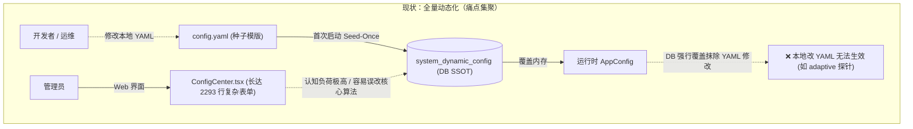
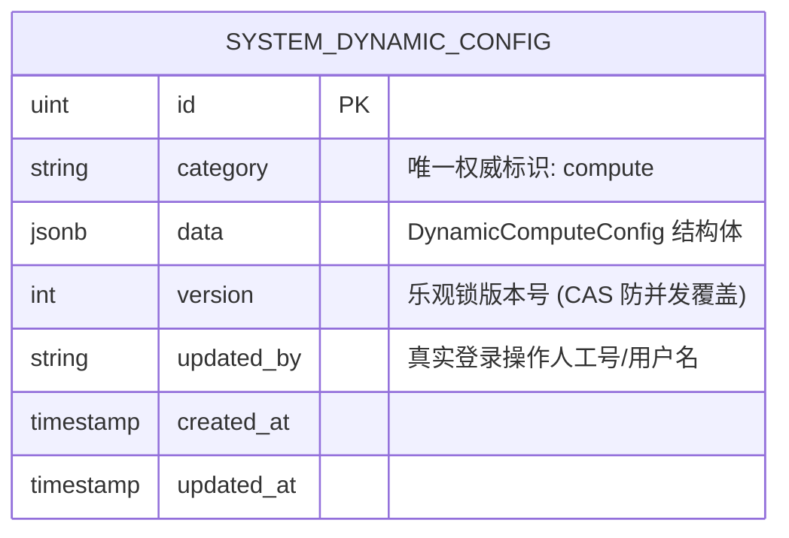
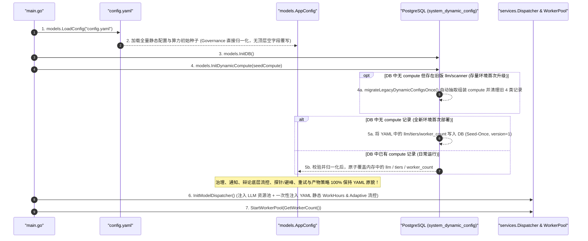

# RFC-005: 系统配置动静分离与算力管理极简化重构设计

## 📋 方案元数据与导读

* **文档编号**：`RFC-005` / `CS-NATIVE-05`
* **文档类型**：系统配置架构演进、数据源动静分离与前端体验重构提案
* **当前状态**：`Accepted`（已完成架构评审与决策收敛，待实施）
* **修订记录**：
  * **R1（初版提案）**：提出静态冷配置回归 `config.yaml`、动态配置收敛至算力与流水线编排、前端重构为极简算力调度中心。
  * **R2（评审定稿版）**：吸收全仓交叉代码评审意见并完成关键设计决策拍板：
    1. **保留同类型多节点池化多选**：流水线阶梯绑定继续支持同类型算力节点多选池化打散与强引擎类型约束，无损透传阶段级底层恢复策略（`recovery`）；
    2. **`DebateConfig` 策略全量静态化**：除 `tiers` 算力绑定与阶段超时外，`debate` 其余晦涩流控参数（快通、背压、候选上限等）及 `chunk_concurrency`、`max_queue_size` 全部回归 `config.yaml` 静态维护；
    3. **根治 `Governance` 顶层空字段覆写缺陷**：移除 `models.Config` 顶层冗余平铺的 `Identity` / `Arbitration` / `Lifecycle` 字段，消除 `LoadConfig` 反向抹零隐患；
    4. **补齐工程健壮性闭环**：引入动态算力原子快照并发保护（消除 Data Race）、`version` 乐观锁防并发覆盖（`HTTP 409`）、`api_key` 掩码脱敏审计 Diff、`reset-to-seed` 纯解析防污染及跨轨算力 ID 引用回退校验；
    5. **平滑演进与路由兼容**：前端保持现有 `/admin/config` 路由路径不变；存量数据库采用独立封装的启动期自动迁移函数平滑升级（带明确退役清理标记）。
* **涉及模块**：
  * 后端配置与存储：[`models/config.go`](file:///home/fugui/codes/code-shield/models/config.go)、[`models/db.go`](file:///home/fugui/codes/code-shield/models/db.go)、[`models/models.go`](file:///home/fugui/codes/code-shield/models/models.go)、[`config.yaml.example`](file:///home/fugui/codes/code-shield/config.yaml.example)
  * 路由与控制器：[`main.go`](file:///home/fugui/codes/code-shield/main.go)、[`handlers/config.go`](file:///home/fugui/codes/code-shield/handlers/config.go)
  * 调度器与调用方：[`services/dispatcher/`](file:///home/fugui/codes/code-shield/services/dispatcher/)、[`services/invoker/`](file:///home/fugui/codes/code-shield/services/invoker/)、[`services/runner/`](file:///home/fugui/codes/code-shield/services/runner/)、[`cron_jobs/jobs.go`](file:///home/fugui/codes/code-shield/cron_jobs/jobs.go)
  * 前端界面与菜单路由：[`frontend/src/pages/ConfigCenter.tsx`](file:///home/fugui/codes/code-shield/frontend/src/pages/ConfigCenter.tsx)、[`frontend/src/types/config.ts`](file:///home/fugui/codes/code-shield/frontend/src/types/config.ts)、[`frontend/src/App.tsx`](file:///home/fugui/codes/code-shield/frontend/src/App.tsx)、[`frontend/src/menu.ts`](file:///home/fugui/codes/code-shield/frontend/src/menu.ts)
  * 自动化测试套件：[`models/config_test.go`](file:///home/fugui/codes/code-shield/models/config_test.go)、[`handlers/config_auth_test.go`](file:///home/fugui/codes/code-shield/handlers/config_auth_test.go)、[`handlers/config_runtime_test.go`](file:///home/fugui/codes/code-shield/handlers/config_runtime_test.go)
* **核心目标**：针对当前配置体系“动态范围划分过宽、冷配置入库导致修改 YAML 不生效、前端配置中心过度臃肿复杂”等痛点，落地**“静态冷配置彻底回归 YAML，动态配置严格收敛至算力池与阶梯池化绑定，前端极简化升级为算力调度中心”**的演进方案。

---

## 一、 背景与痛点剖析：为什么需要回归理性？

在 `RFC-002`（参见 [`RFC-002-AI执行引擎与企业治理配置架构优化设计.md`](file:///home/fugui/codes/code-shield/docs/03-rfcs/RFC-002-AI执行引擎与企业治理配置架构优化设计.md)）的演进过程中，系统为了达成“大模型算力动态扩容与热重载”的目标，引入了基于数据库的动态配置中心机制（`Seed-Once + DB SSOT`），并将 `llm`、`scanner`、`governance`、`notification` 四个领域整体推入数据库持久化。

但在系统实际投产与日常迭代中，这种**“整包入库、全盘动态”**的做法暴露出了严重的结构性矛盾：



### 1.1 痛点一：动态边界划分过宽，出现“两头不讨好”的尴尬僵局
* **修改本地 YAML 惨遭无情覆盖**：
  许多本属于底层算法、系统架构、冷维护类的配置（如 `governance.identity` 对账算法版本与阈值、`scanner.analysis` 重试参数、`scanner.artifact` Schema 抢救边界、`scanner.debate` 背压与候选上限、`scanner.throttling.adaptive` 哨兵探针地址等），由于被整体打包归入 `scanner` / `governance` Category，初次启动后即锁死在数据库中。
  开发者本地修改 `config.yaml` 后重启服务，启动日志直接打印：
  `Note: Dynamic sections in config.yaml (llm, scanner, governance) are bypassed.`
  **导致本地修改完全不生效，极大地阻碍了日常调试与环境部署。**
* **存量 `LoadConfig` 隐藏覆盖缺陷加剧了治理配置失灵**：
  在 [`models/config.go`](file:///home/fugui/codes/code-shield/models/config.go#L696-L699) 中，`Config` 同时保留了嵌套的 `Governance` 与顶层平铺的 `Identity` / `Arbitration` / `Lifecycle` 字段，并在 `LoadConfig` 末尾用填充默认值后的顶层空字段反向覆写 `cfg.Governance.*`，导致 YAML 中的 `governance.*` 子项在解析阶段即被抹零。
* **前端界面夹生，存在“改不了又看不全”的死角**：
  以 `scanner.throttling.adaptive`（一叶知秋探针流控）为例，前端界面没有探针地址和阈值的编辑表单；但该配置又位于数据库接管的 `scanner` 中，最终导致**“界面没法改，本地改 YAML 也不生效”**的窘境。

### 1.2 痛点二：前端配置中心（ConfigCenter）过度臃肿复杂
* 目前前端 [`ConfigCenter.tsx`](file:///home/fugui/codes/code-shield/frontend/src/pages/ConfigCenter.tsx) 代码膨胀至 **2293 行**，包含 4 个庞大 Tab、数十个 Card、上百个输入控件。
* 界面上混杂了大量普通运维和业务管理员难以理解、也不该高频触碰的底层算法参数，例如：
  * `max_schema_repair_attempts`、`schema_repair_timeout_seconds`（产物修复深度）
  * `max_candidates_per_observation`、`strong_same_threshold`、`assign_band`（跨轮对账数学阈值）
  * `fast_pass_enabled`、`max_candidates_per_chunk`、`backpressure_threshold`（辩论引擎内部流控策略）
  * `retryable_errors`、`retry_backoff_ms`（底层 RPC 重试退避）
* 过于繁琐的界面不仅显著增加了前端维护成本与 Bug 率，还给运维人员带来了巨大的认知负担与误操作风险。

### 1.3 核心本质：业务真正需要“动态调整”的到底是什么？
经过实际生产经验复盘，**真正具有高频动态调整诉求的，本质上只有“算力与调度容量（Compute）”这一个领域**：
1. **大模型算力池供给**：新买了一组 API Key，某个原生端点（Endpoint）临时故障需要剔除或调整并发槽位，或者接入新的 Thick Agent 节点；
2. **流水线阶梯算力池绑定（Pipeline Tiers）**：根据当天的算力配额，动态调整 Tier 1（初筛）~ Tier 4（汇总）绑定哪些同类型算力节点组成资源池，以及调整阶段超时预算；
3. **全局工作池容量与应急流控**：动态扩缩容全局扫描任务并发数（`worker_count`），或在白天下发业务高峰期通过执行看板临时暂停扫描队列（`queue_paused`）或缩放并发比例（`concurrency_scale`）。

**除了上述算力供给、阶梯节点绑定与任务并发池之外，其余所有的辩论流控细节、通知地址、缺陷治理策略、重试机制、分片并发度等，均属于低频变更的静态冷配置，应当且必须回归到代码与配置文件（`config.yaml`）中！**

---

## 二、 核心重构原则：动静双轨与极简主义

本重构方案确立以下三大设计原则：

1. **动态范围最小化原则（Principle of Least Dynamics）**：
   * 严禁无节制地将配置入库。仅对**高频变化、停机成本极高的大模型算力供给、4 阶梯算力池绑定与全局任务 Worker 数**保留数据库动态托管能力。
2. **极简心智模型原则（Cognitive UX Simplification）**：
   * 彻底摒弃“把所有后端配置都做成前端表单”的做法。前端配置页面（保留 `/admin/config` 路径）重新定位为 **“算力调度中心 (Compute Hub)”**，聚焦算力池卡片与 4 阶梯多选池化编排，将 2300 行臃肿表单精简至 500 行左右。
3. **真实源唯一与并发安全原则（Predictable SSOT & Thread-Safety）**：
   * 静态配置彻底回归 YAML，修改 YAML 后**重启服务 100% 立即生效**，杜绝任何数据库旧快照或顶层冗余字段反向覆盖静态配置的行为；
   * 动态配置统一收敛为单一 `compute` 实体，采用原子指针/读写锁保障运行时热更新并发安全，并通过 `version` 乐观锁杜绝多人并发编辑静默覆盖。

---

## 三、 全新“动静双轨”配置架构重划（Matrix）

### 3.1 新旧架构对比全景矩阵

| 配置领域与模块 | 包含的关键字段 | 原架构状态 (RFC-002) | **新架构归属 (RFC-005)** | 调整方式与生效途径 |
| :--- | :--- | :--- | :--- | :--- |
| **基础设施层** | `server.*`, `storage.*`, `database.*`, `auth.*` | 静态 (YAML) | **静态冷配置 (YAML)** | 修改 `config.yaml`，重启生效 |
| **外部集成与数据清理** | `ai_fix.*`, `retention.*` | 静态 (YAML) | **静态冷配置 (YAML)** | 修改 `config.yaml`，重启生效 |
| **通知服务 (`notification`)** | `notification.webhook` | 动态 (DB) | **静态冷配置 (YAML)** ⬇️ | 修改 `config.yaml`，重启生效（移除 Web 界面） |
| **企业治理策略 (`governance`)** | `identity.*`, `arbitration.*`, `lifecycle.*`, `category_regression_*` | 动态 (DB) | **静态冷配置 (YAML)** ⬇️ | 修改 `config.yaml`，重启生效（同时移除顶层冗余镜像字段） |
| **扫描引擎底层策略 (`scanner.*`)** | `output_format`, `chunk_concurrency`, `max_queue_size`, `mock_on_missing_cli`, `analysis.*`, `artifact.*`, `resume.*`, `opencode.*`, `determinism.*`, `tools.*` | 动态 (DB) | **静态冷配置 (YAML)** ⬇️ | 修改 `config.yaml`，重启生效（移除 Web 界面） |
| **辩论引擎底层流控 (`scanner.debate.*`)** | `enabled`, `fast_pass_enabled`, `max_candidates_per_chunk`, `stage_timeout_seconds`, `backpressure_threshold`, `backpressure_timeout_seconds`, `log_retention_days` | 动态 (DB) | **静态冷配置 (YAML)** ⬇️ | 修改 `config.yaml`，重启生效（晦涩参数不暴露于界面） |
| **扫描流控探针 (`scanner.throttling`)** | `work_hours.*`, `adaptive.*` | 动态 (DB) | **静态冷配置 (YAML)** ⬇️ | 修改 `config.yaml`，重启生效（启动时一次性注入 Dispatcher） |
| **大模型算力池 (`llm`)** | `default_resource`, `debug_logs`, `resources` (含 `endpoints`) | 动态 (DB) | **动态热配置 (DB `compute`)** 保持 | Web 算力中心实时增删改、Ping 测速，热重载生效 |
| **辩论阶梯算力绑定 (`scanner.debate.tiers`)** | `tier1_hunter` ~ `tier4_synthesis` 同类型多节点池化绑定与超时（无损透传 `recovery`） | 动态 (DB 混在 scanner 中) | **动态热配置 (DB `compute`)** 独立 🌟 | Web 算力中心以 **4 阶梯池化多选卡片**直观切换绑定 |
| **全局任务并发池 (`scanner.worker_count`)** | `worker_count` | 动态 (DB 混在 scanner 中) | **动态热配置 (DB `compute`)** 保持 | Web 算力中心支持实时调整，热触发 `ResizeWorkerPool` |
| **全局运行应急控制 (`system_config`)** | `queue_paused`, `concurrency_scale`, `scale_expires_at`, `auto_notify` | 动态 (DB `system_config`) | **动态热控制 (DB `system_config`)** 保持 | 执行看板 (`GET/PATCH /api/config`) 实时切换，无需重启 |

---

## 四、 架构演进与后端重构设计

### 4.1 数据模型重构：物理动静分离与历史覆写 Bug 根治

#### 1. 静态与动态结构边界定义
YAML 反序列化继续保持清晰的领域层级兼容性，但在内存与持久化契约上严格区分**只读静态配置**与**热更新动态算力快照**：

```go
// ── 1. 静态配置部分 (只存在于 YAML 与启动期静态内存，绝不存库、绝不被热更新覆盖) ──

type StaticDebatePolicy struct {
    Enabled                    bool `yaml:"enabled" json:"enabled"`
    FastPassEnabled            bool `yaml:"fast_pass_enabled" json:"fast_pass_enabled"`
    MaxCandidatesPerChunk      int  `yaml:"max_candidates_per_chunk" json:"max_candidates_per_chunk"`
    StageTimeoutSeconds        int  `yaml:"stage_timeout_seconds" json:"stage_timeout_seconds"`
    LogRetentionDays           int  `yaml:"log_retention_days" json:"log_retention_days"`
    BackpressureThreshold      int  `yaml:"backpressure_threshold" json:"backpressure_threshold"`
    BackpressureTimeoutSeconds int  `yaml:"backpressure_timeout_seconds" json:"backpressure_timeout_seconds"`
}

// ScannerConfig 保留完整 YAML 解析结构，但仅 WorkerCount 与 Debate.Tiers 参与动态算力托管：
// OutputFormat, ChunkConcurrency, MaxQueueSize, MockOnMissingCLI,
// Throttling, Analysis, Artifact, Resume, OpenCode, Determinism, Tools 及 Debate 其余策略字段均为纯静态配置。

// ── 2. 动态算力配置实体 (独立收敛为单一权威实体，Category = "compute") ──

type DynamicComputeConfig struct {
    LLM         LLMConfig         `json:"llm"`          // 算力供给节点与 Native 集群端点
    Tiers       DebateTiersConfig `json:"tiers"`        // Tier 1~4 同类型多节点池化绑定与超时预算
    WorkerCount int               `json:"worker_count"` // 全局扫描任务并发工作池大小 (支持热扩缩容)
}
```

#### 2. 根治 `Governance` 顶层空字段反向覆写缺陷
* **清理冗余字段**：从 [`models.Config`](file:///home/fugui/codes/code-shield/models/config.go#L687-L703) 顶层彻底移除历史遗留的平铺 `Identity`、`Arbitration`、`Lifecycle` 三个镜像字段（全仓调用点统一收敛至 `AppConfig.Governance.Identity`、`AppConfig.Governance.Arbitration`、`AppConfig.Governance.Lifecycle` 及 `Config` 上的便捷方法）。
* **单一归一化入口**：在 `ParseConfigFile` / `LoadConfig` 中直接对 `cfg.Governance` 执行 `NormalizeDefaults()`，确保用户在 `config.yaml` 中配置的任何 `governance.*` 参数均被原样保留且 100% 生效。

#### 3. 运行时并发安全（消除全局无锁覆写 Data Race）
* 针对运行期可被 HTTP 接口热更新的 `LLM`、`Debate.Tiers` 与 `WorkerCount`，在 `models` 层引入读写互斥锁（`sync.RWMutex`）或原子快照指针（`atomic.Pointer[DynamicComputeConfig]`）：
  * **读路径**：`GetComputeConfig()` / `FindResource()` / `GetTierConfig()` / `GetTierResources()` 基于不可变快照安全读取（返回深拷贝或只读视图），彻底消除后台 Worker、[`NativeInvoker`](file:///home/fugui/codes/code-shield/services/invoker/native.go) 与管理端热更新协程之间的 Slice/Struct 并发读写竞争；
  * **写路径**：通过 `ApplyDynamicComputeConfig(next DynamicComputeConfig)` 统一完成默认值补齐（`NormalizeComputeDefaults`）与原子替换。
* **抽离无全局副作用的 `ParseConfigFile(filename string) (Config, error)`**：`LoadConfig` 仅在进程启动时调用一次以初始化全局 `AppConfig`；运行期的 `reset-to-seed` 接口必须调用纯函数 `ParseConfigFile` 仅提取初始 `DynamicComputeConfig` 种子，**严禁在运行期再次调用 `LoadConfig` 污染静态配置内存**。

#### 4. 跨轨引用校验与引擎架构强约束
统一封装 `ValidateComputeConfig(compute *DynamicComputeConfig, static *Config) error`：
1. **阶梯引擎类型强约束**：延续 [`ValidateTierBindings`](file:///home/fugui/codes/code-shield/models/config.go#L426-L462) 架构红线——`Tier 1 (Hunter)` 与 `Tier 3 (Judge)` **仅允许绑定 Thick Agent**（`agy` / `opencode` / `claude` / `codex`）；`Tier 2 (Challenger)` 与 `Tier 4 (Synthesis)` **仅允许绑定 Native LLM**（`native`）；且各阶段 `attempt_timeout_seconds <= timeout_seconds`。
2. **默认资源合法性校验**：`compute.LLM.DefaultResource` 必须匹配 `compute.LLM.Resources` 中已配置的节点 ID（或合法内置驱动名称），且 Native 节点至少包含 1 个有效 `Endpoint`。
3. **跨轨静态工具引用保护**：静态配置 `scanner.tools` 与 `scanner.artifact.schema_repair_resource` 通过 [`ToolResource`](file:///home/fugui/codes/code-shield/models/config.go#L286-L302) 解析算力节点时，若 YAML 静态指定的节点 ID 在当前动态 `LLM.Resources` 中已被移除，自动平滑回退至 `compute.LLM.DefaultResource`（兜底 `"native"`），避免微任务因悬空 ID 硬崩溃。

### 4.2 数据库存储契约与乐观锁保护

复用存量 `system_dynamic_config` 表（不新建无前缀裸表），将原有的 4 个 Category (`llm`, `scanner`, `governance`, `notification`) 收敛为全系统唯一的单行权威记录：
* **`category = 'compute'`**：存储 `DynamicComputeConfig` JSON 快照。
* **乐观锁防并发覆盖（CAS）**：由于算力池与流水线编排合并至单行记录，接口必须真正启用 `version` 乐观锁校验。每次 `PUT` 更新时比对客户端提交的 `version` 与数据库当前 `version`，若不一致立即拒绝写入并返回 `HTTP 409 Conflict`，防止多位超级管理员同时编辑时发生静默覆盖。



### 4.3 引导与启动加载流程重构（彻底终结“暗中覆盖 YAML”）

重构后的服务启动流程（[`main.go`](file:///home/fugui/codes/code-shield/main.go) & [`models/db.go`](file:///home/fugui/codes/code-shield/models/db.go)）清晰透明：



### 4.4 API 路由契约、安全防护与脱敏审计

#### 1. 算力专用接口（严格挂载于 `RoleSuperAdmin` 权限守卫下）
* `GET  /api/admin/compute/config`
  * 返回当前生效的动态算力快照及元数据：`{ version, updated_at, updated_by, llm, tiers, worker_count }`。
* `PUT  /api/admin/compute/config`
  * 入参包含基准 `version` 与 `DynamicComputeConfig`；
  * 依次执行：`ValidateComputeConfig` 强校验 $\rightarrow$ 数据库 `version` 乐观锁 CAS 更新（版本冲突返回 `HTTP 409 Conflict`） $\rightarrow$ 内存快照原子替换 $\rightarrow$ 热触发 `Dispatcher.ReloadResources` 与 `services.ResizeWorkerPool`；
  * **操作审计合规**：从 Gin 认证上下文提取真实操作人写入 `UpdatedBy`（替代原硬编码 `"admin"`），并向 `commonAudit.SetAuditContext` 传入**已对 `api_key` 执行掩码脱敏（如 `sk-****bb3a`）**的修改前后结构体快照，生成完整的字段级审计 Diff。
* `POST /api/admin/compute/ping-endpoint`
  * 测试 Native 推理端点连通性与延迟；
  * **安全加固**：强制校验 `base_url` Scheme 仅允许 `http` / `https`，并使用 `io.LimitReader(resp.Body, 1024)` 截断异常响应体，防止大响应流引发服务端内存膨胀。
* `POST /api/admin/compute/reset-to-seed`
  * 调用无副作用的 `models.ParseConfigFile("config.yaml")` 提取初始 `DynamicComputeConfig` 种子，递增版本号写回 `category = 'compute'`，原子刷新动态算力内存并同步调用 `Dispatcher.ReloadResources` 与 `services.ResizeWorkerPool`。

#### 2. 路由退役边界声明
* **退役路由**：彻底移除 `super_admin` 组下旧的 `/api/admin/config/{full,category/:category,ping-endpoint,reset-to-seed}` 及其 `/api/config/{full,category/:category,ping-endpoint,reset-to-seed}` 兼容别名。
* **保留路由**：**严禁改动** `/api/config`（`GET` 供执行看板读取流控状态，`PATCH` 供 `shield_admin` 控制 `queue_paused` / `concurrency_scale` / `auto_notify`）以及 `/api/config/frontend`（AI-Fix 前端跳转配置）。

---

## 五、 前端界面重构设计：算力调度中心 (Compute Hub)

### 5.1 路由兼容与页面重定位

* **保留前端访问路径 `/admin/config`**：为兼容宿主门户（`code-bench`）导航集成与用户既有书签，前端路由继续保留 `/admin/config`（兼容 `/admin/config/:tab` 自动收敛至有效视图），[`menu.ts`](file:///home/fugui/codes/code-shield/frontend/src/menu.ts) 与 [`App.tsx`](file:///home/fugui/codes/code-shield/frontend/src/App.tsx) 导航及顶栏标题统一升级为 **“算力调度中心”**。
* **视觉与主题规范**：严格遵循 `@code/common` Design Tokens 规范（统一使用 `--color-*` 语义变量适配 Light / Dark 双主题模式，严禁内联硬编码色值）。
* 原有的 4 个繁重 Tab 全面精简，界面仅保留两个核心聚焦板块及全局任务并发控制：

```text
┌──────────────────────────────────────────────────────────────────────────────┐
│ 🛡️ 算力调度中心 (Compute Hub)         全局并发 Worker: [ 5 ] [重置默认] [保存] │
├──────────────────────────────────────────────────────────────────────────────┤
│ [ ⚡ 算力供给池 (Compute Pool) ]       [ 🔄 辩论流水线编排 (Pipeline Tiers) ] │
├──────────────────────────────────────────────────────────────────────────────┤
│                                                                              │
│ (Tab 1: 算力供给池)                                                           │
│ ┌───────────────┐ ┌───────────────┐ ┌──────────────────────────────────────┐ │
│ │ 🤖 agy        │ │ 🤖 opencode   │ │ ⚡ native (原生推理集群)              │ │
│ │ Thick Agent   │ │ Thick Agent   │ │ 2 个活跃端点 · 总并发 20 槽           │ │
│ │ 并发: 5 槽    │ │ 并发: 5 槽    │ │ [deepseek-primary] [glm-backup]      │ │
│ │ [编辑] [删除] │ │ [编辑] [删除] │ │ [管理端点] [Ping 测速] [高级参数]    │ │
│ └───────────────┘ └───────────────┘ └──────────────────────────────────────┘ │
│  + 接入新算力节点                                                            │
└──────────────────────────────────────────────────────────────────────────────┘
```

### 5.2 板块 1：算力供给池 (Compute Pool)
* 以**响应式卡片网格 (Grid)** 直观展示当前接入的算力节点及默认兜底资源（`default_resource`）、调试日志开关（`debug_logs`）；
* 清晰区分 **Thick Agent**（`agy`, `opencode`, `claude`, `codex`）与 **Native 集群**（按多 `Endpoint` 各自的 `concurrent` 并发槽位数自动负载分流，总并发等于各端点并发之和）；
* 每个 Native 端点提供一键 **【Ping 测速】** 按钮，直观展示连通状态与延迟（如 `🟢 32ms`）；
* 通过轻量 `Drawer` 编辑节点连接凭据、并发配额或 Native 流式超时参数。

### 5.3 板块 2：辩论流水线编排 (Pipeline Tiers) —— 同类型多节点池化多选

* 保留并强化生产核心特性——**同类型算力节点多选池化（Multi-Select Resource Pooling）**与**引擎类型强制架构约束**：

```text
┌───────────────────────────────────────────────────────────────────────────────────────────────┐
│  Tier 1: Hunter 源码初筛 [强制: 仅 Thick Agent]   Tier 2: Challenger 辩护对抗 [强制: 仅 Native] │
│  ┌──────────────────────────────────────────┐    ┌──────────────────────────────────────────┐ │
│  │ 绑定算力池 (点击多选打散 · 池化 10 槽):  │    │ 绑定算力池 (池化 20 槽):                 │ │
│  │  [✓ agy · 5槽]  [✓ opencode · 5槽]       │ ──>│  [✓ native · 20槽]                       │ │
│  │ 阶段总预算(秒): [ 7200 ] 单次超时: [1800]│    │ 阶段总预算(秒): [ 1200 ] 单次超时: [ 900]│ │
│  └──────────────────────────────────────────┘    └──────────────────────────────────────────┘ │
│                     │                                                │                        │
│                     ▼ (Tier 3: Judge 终审裁决 [仅 Thick]  ──>  Tier 4: Synthesis 汇总 [仅 Native])
└───────────────────────────────────────────────────────────────────────────────────────────────┘
```

* **防抹零无损透传机制**：界面卡片仅聚焦展示“同类型节点多选胶囊按钮”、“阶段总预算（`timeout_seconds`）”与“单次调用超时（`attempt_timeout_seconds`）”及预算告警提示；前端状态管理对接口返回的 `TierBindingConfig` 采用**对象展开合并（`{ ...existingTierBinding, ...editedFields }`）**，确保 YAML 种子或存量配置中的 `recovery`、`timeout_recovery`、`max_split_depth`、`first_byte_timeout_seconds`、`idle_timeout_seconds`、`max_output_bytes` 等底层恢复参数在保存时 **100% 无损保留，绝不被抹零**。

### 5.4 前端剥离清单（彻底移出界面的晦涩配置）
以下配置全面从前端界面剔除，回归 `config.yaml` 静态维护，前端代码量预计削减 **75% 以上**：
1. 移除整个 **`governance`** Tab（包含 18 个跨轮对账数学阈值、算法版本、仲裁开关与生命周期轮次输入框）；
2. 移除整个 **`notification`** Tab（单一 Webhook 地址回归 YAML）；
3. 移除原 **`scanner`** Tab 中的全部底层策略卡片：
   * 分片并发度（`chunk_concurrency`）、队列上限（`max_queue_size`）与 CLI 缺失模拟降级（`mock_on_missing_cli`）；
   * **辩论引擎内部流控参数**（`debate.enabled`、`fast_pass_enabled`、`max_candidates_per_chunk`、`stage_timeout_seconds`、`log_retention_days`、`backpressure_threshold`、`backpressure_timeout_seconds`）；
   * 通用分析重试（`Analysis Retry`：重试次数、退避时长、可重试错误类型列表）；
   * 产物修复与候选抢救（`Artifact Guard`：Normalization 开关、Schema 修复次数/超时/节点、隔离比例）；
   * Checkpoint 兼容策略（`Resume Policy`）；
   * 工作时间避峰时段与工作日选择（`throttling.work_hours`，统一由 YAML 静态配置）；
   * OpenCode 失败会话续跑（`opencode.continuation`）；
   * 场景微任务工具路由（`tools.overrides`）；
   * 确定性采样与 Seed 策略（`determinism`）。

---

## 六、 实施、无损自动迁移与 TDD 验收方案

### 6.1 存量数据启动期无损自动迁移（过渡期保留，独立封装）

为确保现网与存量开发/测试环境零人工干预平滑升级，在 [`models/db.go`](file:///home/fugui/codes/code-shield/models/db.go) 中提供独立封装的自动迁移函数 `migrateLegacyDynamicConfigsOnce(db *gorm.DB)`（标注明确的 `// TODO(cleanup): 存量环境升级完毕后统一清理` 注释，便于后续一键移除）：

1. **事务内幂等检测与组装**：
   * 在数据库事务中查询 `system_dynamic_config` 是否已存在 `category = 'compute'`；
   * 若已存在：仅确保清理可能残余的 `category IN ('llm', 'scanner', 'governance', 'notification')` 旧记录后直接返回；
   * 若不存在且存在旧版 `category = 'llm'` 或 `category = 'scanner'`：
     * 从旧版 `llm.Data` 反序列化提取 `LLMConfig`（若缺失则回退至 `seed.LLM`）；
     * 从旧版 `scanner.Data` 反序列化提取 `Debate.Tiers` 与 `WorkerCount`（若缺失则回退至 `seed` 对应值）；
     * 归一化并组装为 `DynamicComputeConfig`，写入 `category = 'compute'`（`version = 1`, `updated_by = 'system_migration'`）。
2. **历史拦截记录彻底清除**：
   * 在同一事务内物理删除 `category IN ('llm', 'scanner', 'governance', 'notification')` 的全部历史记录，彻底释放 `config.yaml` 对治理、通知及扫描底层策略的控制权，并输出清晰的迁移审计日志。

### 6.2 配置文件模版优化与勘误 (`config.yaml.example`)

在 [`config.yaml.example`](file:///home/fugui/codes/code-shield/config.yaml.example) 中同步完成动静规范注释升级与存量失配项清理：
1. **升级头部动静边界说明**：
   ```yaml
   # ==============================================================================
   # Code-Shield 🛡️ 架构配置规范 (CS-NATIVE-05 动静分离标准)
   #
   # 📌 配置生效机制：
   # 1. 静态冷配置 (server, storage, database, auth, governance, notification,
   #    以及 scanner 下的流控探针/辩论参数/重试/产物修复/工具路由等底层策略)：
   #    100% 以本 YAML 文件为准，本地修改保存后，【重启服务立即生效】；
   # 2. 动态热配置 (llm 算力资源池、scanner.debate.tiers 阶梯节点绑定、scanner.worker_count)：
   #    首次启动从本 YAML 导入种子数据；后续通过 Web【算力调度中心】(/admin/config) 实时热更新生效 (DB SSOT)。
   # ==============================================================================
   ```
2. **勘误与补全模版字段**：
   * 清理 `native` 节点顶层已废弃的 `base_url` / `api_key` 示例字段及 `endpoints` 下未使用的 `weight` 字段，替换示例脱敏占位符密钥；
   * 修正 `tier2_challenger` 与 `tier3_judge` 中混绑 `native` 与 `agy` 的违规示例，使其严格符合引擎类型强约束；
   * 补全 `governance.identity` 与 `governance.lifecycle` 的默认参数及中文说明注释，为移除前端 `governance` Tab 后的离线调优提供完整文档参考。

### 6.3 SDD + TDD 自动化验收门禁清单

严格遵循工作区 `SDD + TDD` 研发红线，实施阶段须覆盖以下自动化测试并通过全部门禁：
1. **配置加载与迁移测试（[`models/config_test.go`](file:///home/fugui/codes/code-shield/models/config_test.go)）**：
   * 验证 `config.yaml` 中 `governance.identity` / `governance.arbitration` / `governance.lifecycle` 解析后不被顶层字段抹零；
   * 验证存在 DB `compute` 记录时，修改 YAML 中的 `governance`、`notification`、`scanner.throttling.adaptive`、`scanner.debate.fast_pass_enabled` 重启加载 100% 生效，且仅 `llm` / `tiers` / `worker_count` 取自 DB；
   * 验证存量旧版 4 类记录在启动后无损自动迁移为单行 `compute` 并彻底清除旧记录。
2. **RBAC 鉴权与运行时热更新测试（[`handlers/config_auth_test.go`](file:///home/fugui/codes/code-shield/handlers/config_auth_test.go)、[`handlers/config_runtime_test.go`](file:///home/fugui/codes/code-shield/handlers/config_runtime_test.go)）**：
   * 基于 `testdb.SetupIsolatedDB(t)` 物理隔离测试库，验证 `/api/admin/compute/*` 严格限制 `super_admin` 访问（匿名 `401`、`developer` / `shield_admin` `403`）；
   * 验证 `PUT /api/admin/compute/config` 的引擎类型约束拦截、乐观锁 `version` 冲突 `409` 拦截、`Dispatcher.ReloadResources` 与 `ResizeWorkerPool` 热生效及 `api_key` 脱敏审计日志写入；
   * 验证 `POST /api/admin/compute/reset-to-seed` 仅重置动态算力配置，不污染运行期已修改的静态内存状态。
3. **质量门禁命令**：
   * 架构防腐、全量单测与前端类型/Lint 零警告通过：`make lint-arch && make test && make lint && make build`。

---

## 七、 收益评估与评审结论

| 评估维度 | 重构前 (RFC-002) | 重构后 (RFC-005 R2) | 改善收益 |
| :--- | :--- | :--- | :--- |
| **YAML 修改生效确定性** | 极低（冷配置被 DB 暗中覆盖 + `Governance` 顶层覆写 Bug） | **100% 确定**（冷配置改 YAML 重启必生效） | 彻底消除“改了探针/辩论/治理参数却不生效”的暗坑 |
| **前端配置代码量** | 2293 行 (`ConfigCenter.tsx`) | **约 450~550 行** | 代码量削减 **75%+**，大幅降低维护成本 |
| **管理员认知负荷** | 极高（4 个 Tab，上百个晦涩算法与流控参数） | **极低**（聚焦算力池卡片与 4 阶梯池化多选） | 既保留同类型多节点池化吞吐，又杜绝误触底层算法 |
| **并发与变更安全性** | 全局无锁写存在 Data Race；无乐观锁校验；无审计 Diff | **原子快照读写 + `version` CAS (`409`) + 脱敏审计 Diff** | 达到企业级高并发配置热更新与安全审计标准 |
| **升级平滑度** | — | **启动期自动无损迁移 + 保持 `/admin/config` 路由** | 存量环境零停机手工干预，门户书签无缝衔接 |
