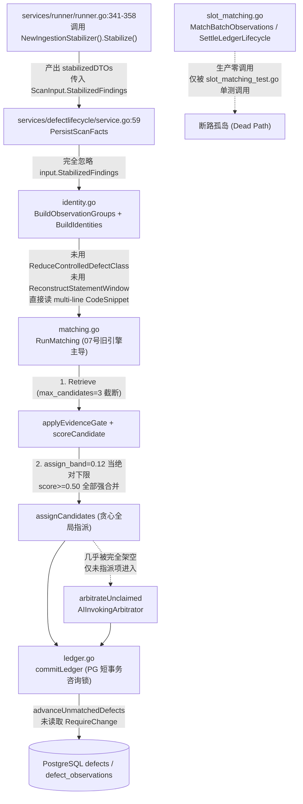

# RFC-006: 缺陷对账机制现状深度诊断与演进建议报告

## 📋 方案元数据与导读

* **文档编号**：`RFC-006` / `CS-RECON-06`
* **文档类型**：现状深度技术诊断、根因归因分析与演进路线建议（**纯分析评审，不修改源码**）
* **当前状态**：`Draft`（待架构评审与改版拍板）
* **关联前置文档**：
  * [`07-问题清单跨轮增量治理重构设计：统一缺陷台账SSOT与分层对账算法.md`](file:///home/fugui/codes/code-shield/docs/02-architecture/04-fingerprint-governance/07-问题清单跨轮增量治理重构设计：统一缺陷台账SSOT与分层对账算法.md)
  * [`08-缺陷台账存储与IO性能演进：稀疏覆盖、事务解耦与TTL分级归档设计.md`](file:///home/fugui/codes/code-shield/docs/02-architecture/04-fingerprint-governance/08-缺陷台账存储与IO性能演进：稀疏覆盖、事务解耦与TTL分级归档设计.md)
  * [`09-极简缺陷对账架构演进：物理前置定桩、离散槽位匹配与认知降维设计.md`](file:///home/fugui/codes/code-shield/docs/02-architecture/04-fingerprint-governance/09-极简缺陷对账架构演进：物理前置定桩、离散槽位匹配与认知降维设计.md)
  * [`01-实测复盘-现网连续扫描重复缺陷无法识别归因分析报告.md`](file:///home/fugui/codes/code-shield/docs/04-reports/02-post-mortems/01-实测复盘-现网连续扫描重复缺陷无法识别归因分析报告.md)
  * [`RFC-005-系统配置动静分离与算力管理极简化重构设计.md`](file:///home/fugui/codes/code-shield/docs/03-rfcs/RFC-005-系统配置动静分离与算力管理极简化重构设计.md)
* **核心涉事模块**：
  * 扫描编排入口：[`services/runner/runner.go`](file:///home/fugui/codes/code-shield/services/runner/runner.go)
  * 生命周期与对账引擎：[`services/defectlifecycle/service.go`](file:///home/fugui/codes/code-shield/services/defectlifecycle/service.go)、[`identity.go`](file:///home/fugui/codes/code-shield/services/defectlifecycle/identity.go)、[`anchor.go`](file:///home/fugui/codes/code-shield/services/defectlifecycle/anchor.go)、[`matching.go`](file:///home/fugui/codes/code-shield/services/defectlifecycle/matching.go)、[`ledger.go`](file:///home/fugui/codes/code-shield/services/defectlifecycle/ledger.go)、[`config.go`](file:///home/fugui/codes/code-shield/services/defectlifecycle/config.go)、[`arbitration.go`](file:///home/fugui/codes/code-shield/services/defectlifecycle/arbitration.go)
  * 09 号定桩与离散槽位模块（半接入状态）：[`stabilizer.go`](file:///home/fugui/codes/code-shield/services/defectlifecycle/stabilizer.go)、[`stabilizer_lexer.go`](file:///home/fugui/codes/code-shield/services/defectlifecycle/stabilizer_lexer.go)、[`stabilizer_taxonomy.go`](file:///home/fugui/codes/code-shield/services/defectlifecycle/stabilizer_taxonomy.go)、[`slot_matching.go`](file:///home/fugui/codes/code-shield/services/defectlifecycle/slot_matching.go)
  * 配置与上游扫描链路：[`config.yaml`](file:///home/fugui/codes/code-shield/config.yaml)、[`config.yaml.example`](file:///home/fugui/codes/code-shield/config.yaml.example)、[`models/config.go`](file:///home/fugui/codes/code-shield/models/config.go)、[`services/engines/debate/engine.go`](file:///home/fugui/codes/code-shield/services/engines/debate/engine.go)、[`services/engines/debate/output_contract.go`](file:///home/fugui/codes/code-shield/services/engines/debate/output_contract.go)
  * 报告与前端展示：[`main.go`](file:///home/fugui/codes/code-shield/main.go)、[`services/reports/report_service.go`](file:///home/fugui/codes/code-shield/services/reports/report_service.go)、[`frontend/src/components/report/ReportViewer.tsx`](file:///home/fugui/codes/code-shield/frontend/src/components/report/ReportViewer.tsx)、[`frontend/src/components/report/ReportReconciliationTab.tsx`](file:///home/fugui/codes/code-shield/frontend/src/components/report/ReportReconciliationTab.tsx)、[`frontend/src/components/report/FindingCard.tsx`](file:///home/fugui/codes/code-shield/frontend/src/components/report/FindingCard.tsx)

---

## 🎯 执行摘要与总体判断

### 一句话结论

**用户与团队对现有对账机制“效果存在许多疑虑”的直觉完全成立，且代码的实际运行状态比表面现象更严峻。**

当前系统之所以在同一代码仓、同一任务多次扫描后频繁出现“重复问题没认出来（假新增 `NEW`）”“不同问题被莫名并到一起（假存量 `EXISTED`）”“代码一字未改却被自动关闭又复发（`RESOLVED -> REOPENED`）”“人工对比两份清单始终对不上账”，并不是某一个正则或权重没调准，而是**五重结构性问题并发叠加的结果**：

| 问题维度 | 核心病灶（代码实证） | 对最终用户体感的直接破坏 | 影响级别 |
| :--- | :--- | :--- | :--- |
| **1. 架构双轨断路** | 09 号方案仅在 `runner.go` 算了一半，`PersistScanFacts` 完全丢弃 `StabilizedFindings`；`slot_matching.go` 仅在单测中被调用、生产零执行 | 团队以为“极简双槽位架构”已在服役，实际上线上跑的仍是 07 号复杂旧引擎与半拼凑的混合逻辑 | **Critical** |
| **2. 致命配置击穿** | `config.yaml` 中 `assign_band: 0.12` 被代码当绝对分值下限；`max_candidates_per_observation: 3` 强截断；`require_change: true` 在台账层从未实现；`high_risk_severities` 英文配置失配 | **同时制造高误合并与高漏召回**：凡 `score >= 0.50` 直接跳过 AI 仲裁强合并；文件超 3 条历史缺陷即大量漏召回；代码未改扫 3 次空漏报被自动关闭 | **Critical** |
| **3. 混合算法退化** | `defectClassMajor` 未用受控大类归约；用多行上下文 `CodeSnippet` 抽受体变量；`TargetSymbol` 未接入扫描契约；`OccurrenceIndex` 硬编码死为 `1`；`<4` 字符短变量被门禁丢弃；`HUMAN_CLOSED` 被精确槽位跳过 | 同一问题行号/说法微调即失配；常见 C/C++ 短指针（`ptr/buf/fd`）跨重构即一票否决；已确认误报会在后续扫描复活 | **High** |
| **4. 上游不幂等** | `scanner.determinism` 默认关闭（不锁 temperature）；`max_candidates_per_chunk: 20` 截断；超时触发动态分片切分（`splitHunterBundle`）与文件覆盖波动 | 同一仓连扫两次“本轮实际检出集合”本身存在约数成漏报波动；对账对下游漏报无能为力，只能把上次漏报标为 `NEW`、本次漏报推向 `RESOLVED` | **High** |
| **5. 产品语义错位** | 不存在 `Report A vs Report B` 直接比对能力，只有 `Report N vs 全局累计 defects 台账` 投影；`AnalysisFinding` 清单仍按原始检出展示；标签字典前后端割裂 | 用户想要“两次扫描结果交集与差集对照”，系统给的是“全局累计状态机流转视图”，心智预期与产品模型根本不在同一频道 | **High** |

---

## 一、现状全链路还原：代码里真正跑的是什么？

在排查“为什么效果差”之前，必须先打破一个团队内部容易产生的认知误区：**09 号演进文档提出的“物理前置定桩 + 离散槽位匹配 + 认知降维”架构，在当前生产代码路径中并未接通。**

### 1.1 生产运行真实数据流与“断路点”



### 1.2 代码证据核查表

1. **定桩器算完即丢（[`runner.go#L341-L358`](file:///home/fugui/codes/code-shield/services/runner/runner.go#L341-L358) -> [`service.go#L59-L170`](file:///home/fugui/codes/code-shield/services/defectlifecycle/service.go#L59-L170)）**：
   * `runner.go` 先后实例化 `defectlifecycle.NewIngestionStabilizer()`，调用 `stabilizer.Stabilize(...)` 计算出 `stabilizedDTOs`，并将其赋值给 `ScanInput.StabilizedFindings`（[`types.go#L46`](file:///home/fugui/codes/code-shield/services/defectlifecycle/types.go#L46)）。
   * 然而进入 [`PersistScanFacts`](file:///home/fugui/codes/code-shield/services/defectlifecycle/service.go#L59)（注：`lifecycle.go` 仅有 247 字节定义了 `LifecyclePolicy` 结构体，实际对账主流程在 `service.go` 中）后，**整个 `services/defectlifecycle/` 包没有任何生产逻辑读取 `input.StabilizedFindings`**。`PersistScanFacts` 直接基于原始 `input.Findings` 调用 `BuildObservationGroups()` 和 `RunMatching()`。
2. **离散槽位引擎仅存在于单元测试（[`slot_matching.go#L185`](file:///home/fugui/codes/code-shield/services/defectlifecycle/slot_matching.go#L185)、[`slot_matching.go#L379`](file:///home/fugui/codes/code-shield/services/defectlifecycle/slot_matching.go#L379)）**：
   * 全仓代码调用链检索确认，`MatchBatchObservations` 与 `SettleLedgerLifecycle` **仅在 `slot_matching_test.go` 中被调用**，在 `runner`、`service.go` 或任何生产接口中均零调用。
3. **09 号文档设计 vs 生产实际运行核查对照**：

| 09 号文档演进模块 | 文档宣称设计 | 当前生产实际执行情况 | 真实状态 |
| :--- | :--- | :--- | :--- |
| **物理前处理定桩** (`Stabilizer`) | 使用 `ReconstructStatementWindow` 重建物理语句窗口，用 `ReduceControlledDefectClass` 归约 17 个受控大类，产出 `CoreSlotKey` / `PreciseSlotKey` | `runner.go` 算完 `stabilizedDTOs` 后被 `PersistScanFacts` 丢弃；`identity.go` 自己另写了简陋 `defectClassMajor` 与全段 `CodeSnippet` 抽受体，仅算出了 `SlotKey` 写入 | **名存实亡（关键步骤被旁路）** |
| **两级离散槽位匹配与自愈** (`MatchBatchObservations`) | 一级 `PreciseSlot`、二级 `CoreSlot` 单实例自愈、三级受限弹性召回与 `CONSERVATIVE_HEAL` 安全护栏 | 完全未接入；生产环境执行 `RunMatching()`（07 号引擎：别名检索 -> 4 道门禁 -> 10 维连续打分 -> 贪心二分匹配 -> AI 仲裁 -> 灰区兜底） | **完全未上线（仅存单测）** |
| **认知降维（取消连续多维权重打分）** | 抛弃“行距+Jaccard+上下文”脆弱调参，收敛为离散确定性槽位匹配 | `config.yaml` 中所有 07 号阈值与权重依然生效，且正因阈值配置语义反转而大面积误判 | **完全未退场（仍在主导）** |

---

## 二、五大核心问题域深度诊断与根因实证

### 2.1 问题域一：07 / 09 架构双轨分裂与契约不兼容（为什么新方案没能切上去？）

进一步检查可以发现，`slot_matching.go` 之所以停留在单测阶段，不仅是因为“忘了接线”，更因为 **09 号的新模块与现有 [`ledger.go`](file:///home/fugui/codes/code-shield/services/defectlifecycle/ledger.go) 持久化契约存在结构性断层，无法直接替换 `RunMatching`**：

1. **粒度不匹配**：`RunMatching` 的输入与输出单位是经过同轮同位置聚合的 `ObservationGroup`（对应 `ObservationDecision`，关联 `ObservationGroupUID` 和 `DefectObservation` 表）；而 `MatchBatchObservations` 直接按扁平的逐条 `StabilizedFindingDTO` 输入，产出 `SlotObservationDecision`，缺乏同报告内多条同类检出的聚合去重层。
2. **生命周期状态语义缺失**：`slot_matching.go` 的输出判决仅覆盖 `EXISTED` 与 `NEW` 两种基础分支，没有完整承载 `ledger.go` 所依赖的关键治理语义：
   * **`REOPENED` 状态跃迁**：已关闭（`RESOLVED`/`FIXED`）缺陷再次出现时的复发判定与事件记录；
   * **`HUMAN_CLOSED` 豁免保护**：已被人工标注“误报/不处理”的历史缺陷在再次检出时的防复活语义；
   * **`MERGED` 指针重定向**：历史上被人工合并到主缺陷的别名映射跟踪；
   * **唯一索引冲突与 PASS 清理**：`ledger.go` 要求在 PG 咨询锁短事务内对活跃精确槽位与合并状态做防冲突裁决及 `MatchPass` 处理。

结果就形成了最糟糕的过渡态：**开发者为了急用，把 `ComputeCoreSlotKey` / `ComputePreciseSlotKey` 硬塞进了旧的 [`identity.go#L215-L224`](file:///home/fugui/codes/code-shield/services/defectlifecycle/identity.go#L215-L224) 与 `ledger.go` 里，却保留了旧的 `RunMatching` 框架外壳**——既没享受到 09 号极简自愈的红利，又把旧架构的复杂性全部背在身上。

---

### 2.2 问题域二：配置层面的“自毁级”参数语义错配与空转字段

哪怕先不谈 07/09 架构更替，当前现网 [`config.yaml`](file:///home/fugui/codes/code-shield/config.yaml) 与种子模板 [`config.yaml.example`](file:///home/fugui/codes/code-shield/config.yaml.example) 中的参数配合现网代码，已经足以**直接导致系统性误合并与漏召回**。

#### 1. `assign_band: 0.12` 彻底击穿灰区，旁路 AI 仲裁（最严重：把不同问题硬合并为重复！）

* **配置文件声明**（[`config.yaml#L177-L179`](file:///home/fugui/codes/code-shield/config.yaml#L177-L179) 及 [`config.yaml.example#L268-L270`](file:///home/fugui/codes/code-shield/config.yaml.example#L268-L270)）：
  ```yaml
  strong_same_threshold: 0.88   # 强相同确定性置信度阈值 (高于此值直接归为同一缺陷)
  assign_band: 0.12             # 关联判定浮动带宽
  reject_below: 0.50            # 拒绝判定阈值 (低于此值直接判定为不同缺陷)
  ```
  从命名、注释（`关联判定浮动带宽`）和数值（`0.88 - 0.12 = 0.76` 或 `±0.12`）显然可以看出，配置作者将其理解为**围绕高置信区间的一个“浮动带宽差值 (Delta/Band)”**。
* **后端真实代码逻辑**（[`matching.go#L699-L716`](file:///home/fugui/codes/code-shield/services/defectlifecycle/matching.go#L699-L716)）：
  ```go
  if edge.score >= thresholds.AssignBand { ... }
  ```
  **代码把 `AssignBand` 当成了绝对得分下限（Absolute Min Score）！** 虽然 [`models/config.go#L642-L643`](file:///home/fugui/codes/code-shield/models/config.go#L642-L643) 写了兜底 `if g.Identity.AssignBand <= 0 { g.Identity.AssignBand = 0.65 }`，但因为配置文件显式写进了大于 0 的 `0.12`，`0.65` 的安全保护完全没有触发！
* **毁灭性后果**：
  在 `RunMatching` 中，先由 `reject_below: 0.50` 过滤掉 `< 0.50` 的边，随后进入 `assignCandidates` 判断 `edge.score >= 0.12` —— **所有原本 `>= 0.50` 但 `< 0.88` 应当落入灰区等待 AI 仲裁或人工 `PROBABLE` 确认的边缘/弱相似候选，100% 必定满足 `>= 0.12`！**
  于是它们在二分图指派阶段全部被直接贪心裁决为 `EXISTED`（`MatchAssign` / `MatchStruct` 等），不再处于 `DefectID == nil` 的未指派状态，导致后续 `arbitrateUnclaimed` 几乎彻底架空！**同一文件内两个完全不同的低分弱相似缺陷，只要没被门禁一票否决且得分刚过 `0.50`，就会被当成“重复问题”直接吞并。**

#### 2. `max_candidates_per_observation: 3` 极度狭隘的预算截断（造成大规模“假 NEW”）

* **配置与代码**（[`config.yaml#L174`](file:///home/fugui/codes/code-shield/config.yaml#L174)、[`matching.go#L355-L358`](file:///home/fugui/codes/code-shield/services/defectlifecycle/matching.go#L355-L358)）：
  `config.yaml` 将 `max_candidates_per_observation` 设死为 **`3`**。在 `retrieveCandidates` 中，按多种别名顺序收集历史候选，一旦 `len(candidates) >= limit`（即满 3 个），代码直接设置 `budgetExceeded = true; return`。
* **直接后果**：
  对于一个长期演进、稍微复杂些的源文件中只要累积了超过 3 条历史缺陷（在实际 C/C++ 核心文件中极常见），只要新扫描中该问题未能 100% 命中最优先的 `SLOT_PRECISE`（例如行号和语句略微变化、或分类名称轻微波动），第 4 个以后的历史缺陷压根进不去评分池，直接被迫判定为 `NEW`，在台账中不断衍生一模一样的重复条目。

#### 3. `lifecycle.require_change: true` 完全空转未实现（造成“代码没改却被误判自动修复”）

* **配置声明**（[`config.yaml#L198`](file:///home/fugui/codes/code-shield/config.yaml#L198) -> [`config.go#L42`](file:///home/fugui/codes/code-shield/services/defectlifecycle/config.go#L42) -> [`service.go#L222`](file:///home/fugui/codes/code-shield/services/defectlifecycle/service.go#L222)）：
  `config.yaml` 明确开启了 `require_change: true`（“判定解决是否要求代码发生变更”），`RuntimeLifecyclePolicy()` 也将其读取并塞入 `LedgerInput.Lifecycle`。
* **代码实证**：
  全仓代码检索确认，**`ledger.go`（包括 `advanceUnmatchedDefects` 在内）和 `slot_matching.go` 从未读取过 `Lifecycle.RequireChange` 字段**，也没有校验文件的 `BlobHash` / Git Diff 是否发生变化！
* **直接后果**：
  在“对同一份未改动的仓库代码连续扫描”的场景下，只要某老缺陷在后续扫描中因大模型随机波动被漏报（下文 2.4 节详述），且该文件处于 `ScopeScanned` 状态，经过 `resolved_rounds: 3` 轮后就会被自动流转为 `RESOLVED`（用户看到“问题已解决”）；第 4 次扫出时又摇身变成 `REOPENED`（“修复后复发”），严重败坏系统可信度。

#### 4. `lifecycle.high_risk_severities: ["Critical", "High"]` 中英文语义失配

* [`services/governance/calibrator.go#L48, L56`](file:///home/fugui/codes/code-shield/services/governance/calibrator.go#L48) 与整个后台报告体系产出的严重级别规范是中文枚举（`"致命"`、`"严重"`、`"一般"`、`"建议"`），而 `config.yaml#L193` 默认配成英文 `["Critical", "High"]`。
* [`ledger.go#L990`](file:///home/fugui/codes/code-shield/services/defectlifecycle/ledger.go#L990) 调用 `containsString(input.Lifecycle.HighRiskSeverities, defect.Severity)` 必然不命中（虽然部分分支在 `#L988` 搭配 `severityWeight` 进行了权重判断，但配置本身已形同虚设、存在静默失效风险）。

---

### 2.3 问题域三：现网生产路径的指纹提取与匹配算法实现缺陷

即使把 `config.yaml` 的数值全盘调对，实际在运行的 `BuildIdentities` + `anchor.go` + `RunMatching` 混合体中依然存在大量具体代码缺陷，精准踩中跨轮扫描的各种常见场景：

| 序号 | 缺陷位置 | 具体代码问题 | 导致的对账异常表现 |
| :---: | :--- | :--- | :--- |
| **1** | [`identity.go#L175-L184`](file:///home/fugui/codes/code-shield/services/defectlifecycle/identity.go#L175-L184)、[`#L215`](file:///home/fugui/codes/code-shield/services/defectlifecycle/identity.go#L215) | **大类归约未接入受控字典**：用 `defectClassMajor` 仅按冒号、斜杠、竖线、连字符简单切分首段，而非调用 `stabilizer_taxonomy.go` 的 `ReduceControlledDefectClass` | 带/不带 CWE 前缀、中英文近义分类、或子分类跨界（如资源泄漏 vs 内存管理）直接被算成不同 `DefectClassMajor`，触发 `applyEvidenceGate` 否决；反之带同一大前缀的子分类（如 `deep-review` 多个子项）又全被碾平坍缩 |
| **2** | [`identity.go#L216-L218`](file:///home/fugui/codes/code-shield/services/defectlifecycle/identity.go#L216-L218)、[`debate/engine.go#L797`](file:///home/fugui/codes/code-shield/services/engines/debate/engine.go#L797) | **受体变量抽取输入被上下文污染**：直接传 `finding.CodeSnippet` 给 `ExtractPhysicalTargetEntity`，而未用 `ReconstructStatementWindow` | `debate` 引擎已用 `ExtractPhysicalCodeSnippet` 把触发点前 5 行、后 8 行的上下文写入 `CodeSnippet`。多行语料导致词法器抓到前置日志宏/无关控制变量，且 `CodeSnippet` 上下漂移 1 行就会抽出完全不同的 `TargetEntity` |
| **3** | [`output_contract.go#L304-L338`](file:///home/fugui/codes/code-shield/services/engines/debate/output_contract.go#L304-L338)、[`stabilizer_lexer.go#L263`](file:///home/fugui/codes/code-shield/services/defectlifecycle/stabilizer_lexer.go#L263) | **`TargetSymbol` 契约脱节空转**：全仓仅 `entityreview/profile.go#L139` 填充了 `TargetSymbol`，通用缺陷扫描引擎（`debate` 等）完全没有生成该字段 | 设计上用于一行出现多个受体变量（如 `memcpy(dst, src, n)`）时打破平局的 Prompt 语义消歧机制（Tie-Breaker）在实际扫描中从未生效 |
| **4** | [`matching.go`](file:///home/fugui/codes/code-shield/services/defectlifecycle/matching.go)、[`anchor.go#L419-L423`](file:///home/fugui/codes/code-shield/services/defectlifecycle/anchor.go#L419-L423) | **缺乏 `CoreSlotKey` 自愈 + 单行锚点脆性**：`RunMatching` 不使用 `CoreSlotKey` 做单实例自愈，且 `CleanToken` 只抽取目标单物理行 `lines[targetLine-1]` | 只要代码格式化换了个行、模型将多行函数调用指到了下一行、或者同一行微调了一个注释/变量形式导致 `StmtAnchorHash` 改变，就掉出 `SLOT_PRECISE`；再配合候选截断极易误报 `NEW` |
| **5** | [`identity.go#L324-L327`](file:///home/fugui/codes/code-shield/services/defectlifecycle/identity.go#L324-L327) | **`OccurrenceIndex` 硬编码 Bug**：在同位置/同类聚合索引循环内，`occurrence := 1` 未执行递增 | 同一作用域内有多处结构相同的重复问题时，`OccurrenceIndex` 全部恒等于 `1`，序次区分机制失效 |
| **6** | [`identity.go#L280`](file:///home/fugui/codes/code-shield/services/defectlifecycle/identity.go#L280)、[`matching.go#L558-L567`](file:///home/fugui/codes/code-shield/services/defectlifecycle/matching.go#L558-L567) | **短变量名被盲目过滤导致门禁误杀**：`extractIdentityToken` 写死跳过长度 `< 4` 的标识符（`if len(token) < 4 { continue }`） | C/C++ 代码最核心的缺陷载体命名几乎都是 2–3 个字符（`ptr`、`buf`、`fd`、`len`、`it`、`ctx`、`ret`）。一旦重构引发函数名变化（`sameScope == false`），由于没有 `resourceGate` 支撑，`applyEvidenceGate` 直接返回 `veto_reason = 1` 强制拆分 |
| **7** | [`matching.go#L376-L407`](file:///home/fugui/codes/code-shield/services/defectlifecycle/matching.go#L376-L407) | **`HUMAN_CLOSED` 被 `SlotPrecise` 主动忽略**：精确槽位扫描条件过滤掉了 `DefectStatusHumanClosed` 与 `DefectStatusMerged` | 若此前人工已将某精确位置的问题标记为误报关闭（`HUMAN_CLOSED`），下次原封不动再扫出时精确槽位直接跳过它，转而走别名/评分，一旦触发预算截断或未覆盖就会重新创建出一条 `ACTIVE` 缺陷，发生“误报复活” |
| **8** | [`anchor.go#L351-L360`](file:///home/fugui/codes/code-shield/services/defectlifecycle/anchor.go#L351-L360) | **长函数体提取 150 行硬截断**：`ExtractScopeAndBodyFromLines` 向下最多截 150 行，逆向边界检索依靠启发式正则 | 超过 150 行的 C/C++ 长函数下半段发生逻辑重写时，`ScopeBodyHash` 完全不变；同时宏定义、C++ 模板、Lambda 易误判作用域起止边界 |
| **9** | Assessment 任务 / 低置信锚点 | `occurrencereview`、`changereview` 等模式或文件读取失败时会退化至 `AnchorLow` | 退化为低置信度后退出上下文邻域（`ContextShape`）和同轮物理指纹构建流程，跨轮极其脆弱 |

---

### 2.4 问题域四：上游扫描结果的不确定性是对账准确率的“天花板瓶颈”

团队常期望通过“完善对账算法”来消除两次扫描清单不一致的困扰，但在复盘上游链路（[`services/engines/debate/engine.go`](file:///home/fugui/codes/code-shield/services/engines/debate/engine.go)、[`config.yaml`](file:///home/fugui/codes/code-shield/config.yaml) 及现网复盘报告 [`01-实测复盘`](file:///home/fugui/codes/code-shield/docs/04-reports/02-post-mortems/01-实测复盘-现网连续扫描重复缺陷无法识别归因分析报告.md)）后，必须正视一个冰冷的事实：**当上游扫描本身不满足“同输入近似幂等”时，任何下游对账算法都无法制造出本轮没扫出来的问题。**

1. **未启用确定性采样温度**：
   [`models/config.go#L604-L608`](file:///home/fugui/codes/code-shield/models/config.go#L604-L608) 定义的 `DeterministicTemperature()` 只有在 `scanner.determinism.enabled == true` 时才会下发温度覆盖，否则返回 `nil`。但无论是现网 [`config.yaml`](file:///home/fugui/codes/code-shield/config.yaml) 还是模板 [`config.yaml.example`](file:///home/fugui/codes/code-shield/config.yaml.example) 均未配置并启用 `determinism`，导致 [`debate/engine.go#L2332`](file:///home/fugui/codes/code-shield/services/engines/debate/engine.go#L2332)、[`invoker/native.go#L377`](file:///home/fugui/codes/code-shield/services/invoker/native.go#L377)、[`runner/synthesis.go#L330`](file:///home/fugui/codes/code-shield/services/runner/synthesis.go#L330) 及 [`runner/analysis.go#L106`](file:///home/fugui/codes/code-shield/services/runner/analysis.go#L106) 全部采用模型默认自由随机采样。
2. **分片候选硬截断（`max_candidates_per_chunk: 20`）**：
   [`config.yaml#L129`](file:///home/fugui/codes/code-shield/config.yaml#L129) 限制单个分片最多保留 20 条 Hunter 候选。当复杂模块存在 25+ 潜在风险时，模型两次输出顺序稍有起伏，第 19~25 位的缺陷就会随机掉队或入围，直接造成“报告 A 有、报告 B 无”。
3. **异常分片动态分裂改变上下文粒度**：
   当遇到超时、JSON 修复降级或超长文件时，引擎会触发动态拆分分片（如 `splitHunterBundle`）和不同层级的重试兜底，使得相邻两次扫描甚至连同一个函数所处的切片边界、邻域提示词上下文都不一致，继而导致检出覆盖抖动。

**叠加效应**：如果 A 扫描检出 40 个问题，B 扫描仅检出其中 28 个且多检出另外 7 个以前漏报的老问题——哪怕对账算法精准到 100%，B 报告中多出来的 7 个依然只能被正确标记为 `NEW`（因为台账里确实没有），而漏检的那 12 个会在 3 轮之后因为前述 `RequireChange` 空转而被标成 `RESOLVED`。在用户眼里，体现出来的就是：**“同一份代码扫两次，一次说新增好几个，一次说修好了十几个，对账根本不靠谱。”**

---

### 2.5 问题域五：产品心智模型与交互展示语义错位

造成用户“疑虑重重”的最后一个关键原因，是**产品设计与用户预期之间存在根本的心智模型偏差**：

1. **没有“Report A vs Report B 两两直接对比”，只有“Report N vs 全局累计台账”**：
   * **用户预期**：“我用同一任务先后扫了两次代码仓，产生报告 A 和报告 B。我想知道 A 和 B 两份清单里哪些是重复的、B 比 A 多了什么、少了什么。”
   * **实际实现**：检索 [`main.go#L164-L174`](file:///home/fugui/codes/code-shield/main.go#L164-L174) 全量路由表，系统**根本不存在“指定两份历史报告直接做 Diff/对账”的后端接口或前端页面**；仅提供 `/tasks/:id/report/reconciliation`（单份报告相对 `(repo_id, task_type_id)` 累计全局 `defects` 台账的对账快照）以及 `/defects` 台账管理接口。
   * **常见困惑场景**：测试期残留在 `defects` 里的旧数据、不同分支或参数（如先跑了一次 `change_focus` 或局部范围扫描，再跑一次 `full_ledger`）都会共用/干扰累计状态；即使只对比第 2 份和第 3 份报告，系统实际上在拿第 3 份和“包含第 1、2 份及中间所有历史态的累计台账”比对，直观计数必然对不上号。
2. **报告详情列表仍直接呈现原始 `AnalysisFinding`，易造成“自己跟自己也没去重”观感**：
   * 在前端报告详情页的“详细问题清单”（[`ReportFindingsTab.tsx`](file:///home/fugui/codes/code-shield/frontend/src/components/report/ReportFindingsTab.tsx)、[`FindingCard.tsx`](file:///home/fugui/codes/code-shield/frontend/src/components/report/FindingCard.tsx)），展示的直接源自当次扫描写入的 `AnalysisFinding` 记录，对账结果仅以卡片徽章（`历史存量`/`本轮新增`/`疑似存量，待确认`）附加其上。若同轮多条或重报检出未在前端按观察组/Defects 合并收口，视觉观感非常零散。
3. **前后端展示文案与状态枚举存在脱节**：
   * [`FindingCard.tsx#L41`](file:///home/fugui/codes/code-shield/frontend/src/components/report/FindingCard.tsx#L41) 将 `EXISTED` 翻译为 **`历史存量`**，而同一页面的 [`ReportReconciliationTab.tsx#L47`](file:///home/fugui/codes/code-shield/frontend/src/components/report/ReportReconciliationTab.tsx#L47) 将 `EXISTED` 翻译为 **`本轮复现`**，[`ReportReconciliationTab.tsx#L408`](file:///home/fugui/codes/code-shield/frontend/src/components/report/ReportReconciliationTab.tsx#L408) 将 `PROBABLE` 简称为 `疑似重复`（卡片上则是 `疑似存量，待确认`）。
   * [`ReportReconciliationTab.tsx#L54-L63`](file:///home/fugui/codes/code-shield/frontend/src/components/report/ReportReconciliationTab.tsx#L54-L63) 定义了 `BUCKET`（旧层级名）的中文映射，却缺失后端实际可产出的 `PASS`（`MatchPass`）。
   * 对于 `governance_mode == 'entity_assessment'` 的评估类任务（如 `ut-effectiveness`、`ut-quality`）：后端 `PersistScanFacts` 在无明确模式跳过约束下仍照常执行分析入库，而前端 [`ReportViewer.tsx#L87, #L215`](file:///home/fugui/codes/code-shield/frontend/src/components/report/ReportViewer.tsx#L87) 与 [`FindingCard.tsx#L35`](file:///home/fugui/codes/code-shield/frontend/src/components/report/FindingCard.tsx#L35) 又刻意隐藏了对账 Tab 与标签，形成数据侧与 UI 侧行为不对称。

---

## 三、客观评价与架构取舍判断

经过全链路代码审计，我们对当前对账体系做出如下客观工程判断：

### 3.1 哪些方向是正确的（应当坚决保留的工程资产）

1. **三阶段解耦架构与短事务锁机制（[`service.go#L133-L248`](file:///home/fugui/codes/code-shield/services/defectlifecycle/service.go#L133-L248)）**：
   “Phase 1 无锁加载快照 -> Phase 2 纯内存无锁匹配 -> Phase 3 获取 PG 事务级咨询锁（`pg_advisory_xact_lock`）并在数毫秒内完成乱序时间线校验（`validateLatestLedgerReport`）与状态提交”，兼顾了并发安全性、幂等防覆盖与数据库性能，设计相当成熟。
2. **稀疏覆盖持久化 + 全量内存覆盖判定（[`service.go#L111-L118`](file:///home/fugui/codes/code-shield/services/defectlifecycle/service.go#L111-L118)）**：
   使用 `MemoryScopeEvaluator` 保留完整文件扫描状态用于台账精确判断，同时对落库 `ScanScopeEntry` 与 Manifest 归档做稀疏压缩，兼顾了准确性与存储成本。
3. **09 号提出的“物理词法定桩 + 受控异常类归约”建模思路**：
   放弃对 LLM 飘忽不定的标题、自由分类词和易漂移绝对行号的依赖，转为基于目标代码物理词法受体（`TargetEntity`）、语句窗口归一化哈希（`StmtAnchorHash`）与有限受控异常大类（`ReduceControlledDefectClass`）构造两级离散槽位（`CoreSlotKey` -> `PreciseSlotKey`），这是治本的方向。
4. **不可变观测留痕 + `DefectAlias` 历史别名机制**：
   每次扫描的 `DefectObservation` 与人为合并/拆分的 `DefectAlias` 均独立留痕可溯源，具备很强的企业级可审计基础。

### 3.2 哪些做法走了弯路（必须果断止损）

1. **新老双轨只切一半、生产跑拼装版**：写好了 `Stabilize` 和 `slot_matching`，却停在集成最后一公里，长期让半改造的旧引擎带着致命 Bug 运行，白白浪费前期算力却换不来预期收益。
2. **缺少配置自检守卫，任由“带宽/绝对值”语义冲突的冷配置直接线上裸奔**：`0.12` 和 `3` 这两个数字直接把再精巧的匹配代码毁掉大半，却没有任何启动期校验（Assert）或单测去卡 `config.yaml` 真实线上配置。
3. **过度迷信连续多维概率打分 + 运行时大规模 LLM 仲裁来解决指纹识别问题**：10 维经验权重参数极难通用调平；真正确定同一位置的缺陷不需要算分，真正表述完全跨维度的复杂重构靠 20 次预算上限的 snippet 仲裁也救不回来。
4. **混淆“持续缺陷台账治理”和“双报告直观对比”两个场景**：拿状态机台账去强行充当用户“对照两次扫描清单”的工具，把所有上游漏报波动统统甩锅给对账算法背负。

---

## 四、分阶段改进建议与演进路线图

建议严格遵循 **“先 P0 立即止血配置与算法硬伤 -> 再 P1 打通并收口唯一确定性对账主链 -> 最后 P2 补齐双报告直观对比能力与上游稳态基线”** 的三步走策略，避免在旧泥潭里反复叠补丁。

### 阶段一（P0 — 紧急止血：消除“致命误合并、大规模漏召回与空扫描假关闭”）

> 目标：最小改动范围，优先修复当前导致线上效果明显失真、违背常识的问题。

1. **消除 `assign_band` 语义歧义与增加启动期配置红线校验**：
   * 梳理清楚阈值单调性语义，显式要求并校验：`0 < RejectBelow < AssignMinScore <= StrongSameThreshold <= 1.0`；将语义不明的 `assign_band` 更名为清晰的 `assign_min_score`（推荐阈值如 `0.72`~`0.78`，在 `strong_same_threshold: 0.88` 与 `reject_below: 0.50` 之间留出真正的灰区供 AI 仲裁和 `PROBABLE` 人工确认工作），在加载 `config.yaml` 时若校验失败直接报错阻断，杜绝静音失效。
2. **解除 `max_candidates_per_observation: 3` 的不合理截断**：
   * 将默认预算提高至足够覆盖单文件存量缺陷数（如 `30`~`50`），或至少保证**同规范化路径 `NormPath` 下的全部活跃及近期缺陷无条件优先入池**，避免因排序靠后导致老问题永远找不到历史主缺陷。
3. **修复 `BuildIdentities` 与 `matching.go` 4 处低风险高收益硬伤**：
   * **大类归约切入**：将 [`identity.go#L215`](file:///home/fugui/codes/code-shield/services/defectlifecycle/identity.go#L215) 的 `defectClassMajor` 替换为 [`ReduceControlledDefectClass`](file:///home/fugui/codes/code-shield/services/defectlifecycle/stabilizer_taxonomy.go#L74)（需先补齐面向全部 10 个内置任务的映射覆盖测试，避免未覆盖分类被过多归为大杂烩）；
   * **隔离多行上下文污染**：抽取 `TargetEntity` 时严禁直接喂入前后共 14 行的完整 `CodeSnippet`，改用 [`ReconstructStatementWindow`](file:///home/fugui/codes/code-shield/services/defectlifecycle/stabilizer_lexer.go) 重建触发语句窗口；
   * **修正短变量拦截与序次硬编码**：清理 `extractIdentityToken` 中 `len(token) < 4` 的粗暴截断，改为轻量编程语言关键字/停用词表过滤，完整保留 `ptr/buf/fd/len/it/ctx`；同时修复 `assignOccurrenceIndexes` 中 `occurrence` 恒为 `1` 未递增的编码错误；
   * **补齐 `HUMAN_CLOSED` 防复活拦截**：在 `SLOT_PRECISE` 精确槽位召回阶段不再简单过滤跳过 `DefectStatusHumanClosed`，若最新精确物理槽位已由人工确认为误报关闭且相关代码未变，应优先拦截或继承关闭结论，而非新建 `ACTIVE` 缺陷。
4. **落实或显式止损 `RequireChange` 空转问题**：
   * 若短期内未能接入精确的文件/函数级 `BlobHash` / Diff Hunk 变更校验，必须在文档与策略配置上明确诚实收敛：对未确认代码变更的同仓重复扫描，**禁止推进“连续漏报自动关闭为 `RESOLVED`”**（或者严格核对仓库 `HeadCommit` + 文件 `BlobHash` 未变时冻结生命周期衰减计数器），彻底杜绝“代码一字未改越扫问题越少”的荒诞现象。
5. **对齐严重程度配置**：
   * 将 `high_risk_severities` 统一收敛到系统实际落库的中文评级（如 `["致命", "严重"]`）或统一通过规范枚举映射，确保策略与实现名副其实。

---

### 阶段二（P1 — 架构收敛：终止双轨分裂，落地单一一致的对账主链路）

> 目标：让 09 号演进方案真正、完整地统一线上执行路径，同时补全现有单测漏掉的企业治理状态机契约。

1. **彻底统一流水线入口（废除 `PersistScanFacts` 的弃用忽略行为）**：
   * 明确由 `IngestionStabilizer` 生成的 `StabilizedFindings` 作为唯一标准化指纹输入（包含 `ControlledClass`、`TargetEntity`、`StatementWindow`、`CoreSlotKey`、`PreciseSlotKey`、`ScopeBodyHash`），删除 `identity.go` 里冗余自建的半吊子副本逻辑，严格遵守单一真实源原则。
2. **以“离散槽位优先 + 轻量兜底”替代纯黑盒 10 维算分体系，并完整对齐 `ledger.go` 契约**：
   * 将 `slot_matching.go` 中经过验证的良性机制——**精确槽位命中 -> `CoreSlotKey` 同作用域单实例自愈（`CORE_SLOT_SINGLETON`）-> 文件内受控大类+目标实体两级弹性召回（`CONSERVATIVE_HEAL` 护栏）**——提升为线上主决策通道，并补充其缺失的 `ObservationGroup` 聚合层、`REOPENED` 状态跃迁、`HUMAN_CLOSED` 豁免、`MERGED` 重定向与双人人工确认兼容，彻底淘汰易受漂移与权重失衡影响的 10 维连续打分拼凑，把 AI 仲裁真正收敛到仅处理极少数确有结构冲突/跨函数搬迁的残差疑似项。
3. **打通 `TargetSymbol` 上游供给契约**：
   * 在 `services/engines/debate/output_contract.go` 的 `Hunter` 与 `Judge` 输出契约中增设可选字段 `target_symbol`（明确要求填写被泄漏/越界/未锁保护的核心变量、指针或锁对象名），贯穿入库至 `AnalysisFinding.TargetSymbol`，激活 `ExtractPhysicalTargetEntity` 的平局消歧能力。
4. **明确 `GovernanceMode` 的入账隔离边界**：
   * 确认 `entity_assessment` 模式（实体全量评估型任务）是否需要写入 `defects` 台账；若仅作独立报告展示，应在 `PersistScanFacts` 入口显式隔离分流，避免与 `full_ledger` / `change_focus` 产生脏台账交互；统一 `FindingCard` 与 `ReportReconciliationTab` 的 Verdict 中文术语与 `MatchTier` 全枚举映射（补齐 `PASS` 等状态）。

---

### 阶段三（P2 — 治本闭环：新增显式“双报告对比”能力与上游可复现性治理）

> 目标：从产品语义与扫描源头上，正面回应用户“同仓两次扫描清单对齐”的真实诉求。

1. **产品侧新增一等公民能力：`Report A vs Report B` 直接对账对比视图**：
   * 新增对比接口（如 `GET /api/reports/compare?base_id=A&target_id=B`）与前端两两对比 Tab/视图，允许用户在历史扫描列表直接勾选**任意两份同仓同任务（甚至同仓跨分支/跨提交）的报告**进行静态集合比对。
   * 对账对比算法直接复用阶段二收口后的统一标准化槽位引擎（按 `PreciseSlotKey` -> `CoreSlotKey` -> `NormPath + ControlledClass + TargetEntity` 计算交集/差异），直观分类呈现：
     * **两份共同命中（重复确认项）**：并排展示两端行号与描述差异（证明为何是同一个问题，哪怕行号偏移/措辞不同）；
     * **仅基础报告 A 检出（新增差异之“消失/疑似遗漏项”）**：关联显示对应文件在 B 中的 `ScopeStatus`（覆盖状态）与文件 Git Diff 是否变动，清晰告诉用户这是“代码已修复”还是“本次上游大模型没报出来”；
     * **仅目标报告 B 检出（净增项）**：关联展示文件是否在两次扫描间被改动。
   * 这样可将 **“当前这次相对上一次选定报告有何差异”** 与 **“项目长期缺陷资产累计台账生命周期”** 彻底解耦，各司其职。
2. **上游扫描稳态化治理（压缩漏报抖动基数）**：
   * 校准并默认开启确定性采样参数（评估开启低 `temperature`，平衡召回与稳定性）；
   * 针对 `max_candidates_per_chunk: 20` 风险，改为优先级排序截断或超限自动拆分小分片重扫而非静默丢弃尾部候选；
   * 固化语义切分（AST/函数边界排序确定性），减少重复扫描同一仓时的分片随机漂移。
3. **建立可回归的“对账黄金评估基准集 (Golden Benchmark)”与上线门禁**：
   * 基于现网历史误判案例（如 [`01-实测复盘`](file:///home/fugui/codes/code-shield/docs/04-reports/02-post-mortems/01-实测复盘-现网连续扫描重复缺陷无法识别归因分析报告.md) 样本），沉淀 4 类黄金测试集，建议为每次修改指纹或对账逻辑设定如下离线回放验收目标：
     * **基准 A（零变更连扫一致性）**：同仓同任务无改动连扫，建议以“对两端共同覆盖且均检出的同类同位缺陷重复识别率高保真、零变更误推 `RESOLVED` 归零”作为核心门禁目标；
     * **基准 B（干扰重构鲁棒性）**：包含空行增减、注释变动、长函数内部局部修改、常见短变量（`ptr/buf/fd`）保留而外层函数改名的重构场景；
     * **基准 C（严格防误合并红线）**：同一函数/文件内多个同类型但作用于不同变量的相似缺陷（如先后漏释放 `pA` 与 `pB`）必须保持零误合并；
     * **基准 D（性能与并发短事务基线）**：维持当前 `PersistScanFacts` Phase 3 PG 短事务提交耗时的既有水平，不引入长锁回退。

---

## 五、总结建议（执行优先级一览）

| 优先级 | 关键动作 | 预期即时改善效果 | 投入估算 |
| :--- | :--- | :--- | :--- |
| **P0（立即可做）** | 修正 `assign_band` 语义及线上值（留出真实灰区）、放大 `max_candidates_per_observation`、修复 `identity.go` 大类归约/多行切片受体/`OccurrenceIndex`/短变量过滤/防 `HUMAN_CLOSED` 复活、修复 `RequireChange` 空转（同代码不自动标已解决） | **立竿见影解决当前最突出的异常**：大幅消除不同问题误合并、单文件超 3 个缺陷漏匹配、以及相同代码越扫问题越少的假修复现象 | 低（局部精准修复） |
| **P1（中期重构）** | 打通 09 号 `StabilizedFindings` 与统一离散槽位匹配到主链路，废除双轨并存与黑盒 10 维打分；补齐 `TargetSymbol` 上游 Prompt 契约与 `REOPENED`/`MERGED`/`ObservationGroup` 状态机契约；统一前后端标签语义 | **对账核心逻辑彻底简洁可控、高可解释**：面对行号漂移、函数改名与语句微调具备确定性抗抖动能力 | 中（架构收口） |
| **P2（体验与治本）** | 上线独立一等公民 **“任意两份历史报告直接 Diff 对账”** 页面与 API；推动上游扫描稳态化（开启 `determinism`、解除分片 20 条静默截断）；建设 Golden Benchmark 回归集 | **彻底对齐用户直觉心智**，并从“报告比对”和“上游降噪”两端彻底根除怀疑土壤 | 中高（全栈协同） |
