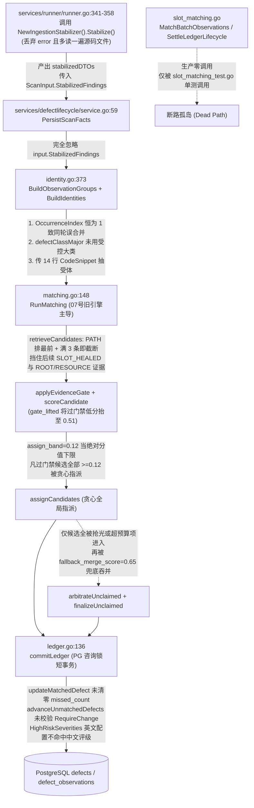
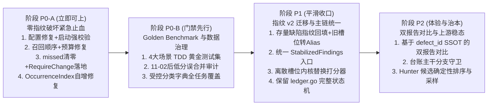

# RFC-006: 缺陷对账机制现状深度诊断与演进建议报告

## 📋 方案元数据与导读

* **文档编号**：`RFC-006` / `CS-RECON-06`
* **文档类型**：现状深度技术诊断、根因归因分析与可实施演进方案（**纯分析与施工蓝图设计，不直接修改业务源码**）
* **当前状态**：`In-Review`（已完成二次代码审计与可实施性加固）
* **关联前置文档**：
  * [`07-问题清单跨轮增量治理重构设计：统一缺陷台账SSOT与分层对账算法.md`](file:///home/fugui/codes/code-shield/docs/02-architecture/04-fingerprint-governance/07-问题清单跨轮增量治理重构设计：统一缺陷台账SSOT与分层对账算法.md)
  * [`08-缺陷台账存储与IO性能演进：稀疏覆盖、事务解耦与TTL分级归档设计.md`](file:///home/fugui/codes/code-shield/docs/02-architecture/04-fingerprint-governance/08-缺陷台账存储与IO性能演进：稀疏覆盖、事务解耦与TTL分级归档设计.md)
  * [`09-极简缺陷对账架构演进：物理前置定桩、离散槽位匹配与认知降维设计.md`](file:///home/fugui/codes/code-shield/docs/02-architecture/04-fingerprint-governance/09-极简缺陷对账架构演进：物理前置定桩、离散槽位匹配与认知降维设计.md)
  * [`01-实测复盘-现网连续扫描重复缺陷无法识别归因分析报告.md`](file:///home/fugui/codes/code-shield/docs/04-reports/02-post-mortems/01-实测复盘-现网连续扫描重复缺陷无法识别归因分析报告.md)
  * [`RFC-005-系统配置动静分离与算力管理极简化重构设计.md`](file:///home/fugui/codes/code-shield/docs/03-rfcs/RFC-005-系统配置动静分离与算力管理极简化重构设计.md)
* **核心涉事模块**：
  * 扫描编排入口：[`services/runner/runner.go`](file:///home/fugui/codes/code-shield/services/runner/runner.go)
  * 生命周期与对账引擎：[`services/defectlifecycle/service.go`](file:///home/fugui/codes/code-shield/services/defectlifecycle/service.go)、[`identity.go`](file:///home/fugui/codes/code-shield/services/defectlifecycle/identity.go)、[`anchor.go`](file:///home/fugui/codes/code-shield/services/defectlifecycle/anchor.go)、[`matching.go`](file:///home/fugui/codes/code-shield/services/defectlifecycle/matching.go)、[`ledger.go`](file:///home/fugui/codes/code-shield/services/defectlifecycle/ledger.go)、[`config.go`](file:///home/fugui/codes/code-shield/services/defectlifecycle/config.go)、[`arbitration.go`](file:///home/fugui/codes/code-shield/services/defectlifecycle/arbitration.go)、[`scope_evaluator.go`](file:///home/fugui/codes/code-shield/services/defectlifecycle/scope_evaluator.go)
  * 09 号定桩与离散槽位模块（半接入状态）：[`stabilizer.go`](file:///home/fugui/codes/code-shield/services/defectlifecycle/stabilizer.go)、[`stabilizer_lexer.go`](file:///home/fugui/codes/code-shield/services/defectlifecycle/stabilizer_lexer.go)、[`stabilizer_taxonomy.go`](file:///home/fugui/codes/code-shield/services/defectlifecycle/stabilizer_taxonomy.go)、[`slot_matching.go`](file:///home/fugui/codes/code-shield/services/defectlifecycle/slot_matching.go)
  * 配置与上游扫描链路：[`config.yaml`](file:///home/fugui/codes/code-shield/config.yaml)、[`config.yaml.example`](file:///home/fugui/codes/code-shield/config.yaml.example)、[`models/config.go`](file:///home/fugui/codes/code-shield/models/config.go)、[`services/engines/debate/engine.go`](file:///home/fugui/codes/code-shield/services/engines/debate/engine.go)、[`services/engines/debate/output_contract.go`](file:///home/fugui/codes/code-shield/services/engines/debate/output_contract.go)
  * 报告与前端展示：[`main.go`](file:///home/fugui/codes/code-shield/main.go)、[`services/reports/report_service.go`](file:///home/fugui/codes/code-shield/services/reports/report_service.go)、[`frontend/src/components/report/ReportViewer.tsx`](file:///home/fugui/codes/code-shield/frontend/src/components/report/ReportViewer.tsx)、[`frontend/src/components/report/ReportReconciliationTab.tsx`](file:///home/fugui/codes/code-shield/frontend/src/components/report/ReportReconciliationTab.tsx)、[`frontend/src/components/report/FindingCard.tsx`](file:///home/fugui/codes/code-shield/frontend/src/components/report/FindingCard.tsx)

---

## 🎯 执行摘要与总体判断

### 一句话结论

**用户与团队对现有对账机制“效果存在许多疑虑”的直觉完全成立，且代码的实际运行状态比表面现象更复杂。**

当前系统之所以在同一代码仓、同一任务多次扫描后频繁出现“重复问题没认出来（假新增 `NEW`）”“不同问题被莫名并到一起（假存量 `EXISTED`）”“代码一字未改却被自动关闭又复发（`RESOLVED -> REOPENED`）”“人工对比两份清单始终对不上账”，并不是单一正则或权重没调准，而是**五重结构性问题并发叠加、相互放大的结果**：

| 问题维度 | 核心病灶（代码实证） | 对最终用户体感的直接破坏 | 影响级别 |
| :--- | :--- | :--- | :--- |
| **1. 架构双轨断路** | 09 号方案仅在 `runner.go` 算了一半（且忽略了返回 `error`），`PersistScanFacts` 完全丢弃 `StabilizedFindings`；`slot_matching.go` 仅在单测中被调用、生产零执行 | 团队误以为“09 号极简双槽位架构”已在服役，实际上线上跑的仍是 07 号旧引擎与半接入槽位的混合逻辑，且每轮白白多做一次全文件磁盘读取 | **Critical** |
| **2. 配置回归与连锁错配** | `RFC-005`（提交 `c89f79b`，2026-11-02）迁移静态配置时写入了未校验的参数：`assign_band: 0.12`（与代码绝对下限语义冲突）、`max_candidates_per_observation: 3`（配合 `PATH` 别名优先顺序）、`high_risk_severities` 英文值（与落库中文评级失配） | **同时制造高误合并、错配老缺陷与高漏召回**：文件超 3 条历史缺陷时，名额被最老的 3 条 `PATH` 记录占满并挡住 `SLOT_HEALED` 强别名，随后因 `score >= 0.12` 被错配给无关老缺陷或漏报为 `NEW` | **Critical** |
| **3. 状态机与指纹硬伤** | `updateMatchedDefect` 命中后**从不将 `missed_count` 清零**（“连续漏报”实为“累计漏报”）；`RequireChange` 从未实现；`OccurrenceIndex` 硬编码死为 `1` 导致同轮同结构缺陷被强合并；`defectClassMajor` 未接受控字典导致 `ExtractPhysicalTargetEntity` 分支失效 | **只要上游偶发漏报，所有缺陷迟早被误关为 `RESOLVED`**；同一函数内两处相似缺陷（如先后 `free(pA)`/`free(pB)`）在同轮内被直接折叠吞并 | **Critical** |
| **4. 上游扫描抖动** | 本地运行态 `config.yaml` 未同步模板的 `scanner.determinism`；`PreferSeed` 等字段在代码中未实现；`max_candidates_per_chunk: 20` 按模型原始输出顺序直接截断尾部 | 同一仓连扫两次“本轮实际检出集合”存在漏报波动；对账无法凭空造出本轮未检出的问题，只能把上次漏报标为 `NEW`、本次漏报累加 `missed_count` 推向关闭 | **High** |
| **5. 产品语义错位** | 不存在 `Report A vs Report B` 直接比对能力，只有 `Report N vs (repo_id, task_type_id) 全局累计台账`（且无分支隔离）；前端枚举与中文文案多处割裂 | 用户想要“两次扫描结果交集与差集对照”，系统给的是“跨分支混用的全局累计状态机流转视图”，心智预期与产品模型不在同一频道 | **High** |

---

## 一、现状全链路还原：代码里真正跑的是什么？

在排查“为什么效果差”之前，必须先厘清一个关键工程事实：**09 号演进文档提出的“物理前置定桩 + 离散槽位匹配 + 认知降维”架构，在当前生产代码路径中并未接通。**

### 1.1 生产运行真实数据流与“断路点”



### 1.2 代码证据核查表

1. **定桩器算完即丢，且忽略错误、重复磁盘 I/O（[`runner.go#L341-L358`](file:///home/fugui/codes/code-shield/services/runner/runner.go#L341-L358) -> [`service.go#L59-L170`](file:///home/fugui/codes/code-shield/services/defectlifecycle/service.go#L59-L170)）**：
   * `runner.go` 实例化 `defectlifecycle.NewIngestionStabilizer()`，以 `stabilizedDTOs, _ := stabilizer.Stabilize(...)`（忽略了 `error` 返回值）计算出 `stabilizedDTOs` 并赋给 `ScanInput.StabilizedFindings`（[`types.go#L46`](file:///home/fugui/codes/code-shield/services/defectlifecycle/types.go#L46)）。
   * 进入 [`PersistScanFacts`](file:///home/fugui/codes/code-shield/services/defectlifecycle/service.go#L59) 后，**整个 `services/defectlifecycle/` 包没有任何生产逻辑读取 `input.StabilizedFindings`**。`PersistScanFacts` 直接基于原始 `input.Findings` 调用 `BuildObservationGroups()`（内部再次通过 `EnrichSourceAnchor` 读取源码文件）和 `RunMatching()`。
2. **离散槽位引擎仅存在于单元测试（[`slot_matching.go#L185`](file:///home/fugui/codes/code-shield/services/defectlifecycle/slot_matching.go#L185)、[`slot_matching.go#L379`](file:///home/fugui/codes/code-shield/services/defectlifecycle/slot_matching.go#L379)）**：
   * 全仓调用链检索确认，`MatchBatchObservations` 与 `SettleLedgerLifecycle` **仅在 `slot_matching_test.go` 中被调用**，在 `runner`、`service.go` 或任何生产接口中均零调用。
3. **09 号文档设计 vs 生产实际运行核查对照**：

| 09 号文档演进模块 | 文档宣称设计 | 当前生产实际执行情况 | 真实状态 |
| :--- | :--- | :--- | :--- |
| **物理前处理定桩** (`Stabilizer`) | 使用 `ReconstructStatementWindow` 重建物理语句窗口，用 `ReduceControlledDefectClass` 归约 17 个受控大类，产出 `CoreSlotKey` / `PreciseSlotKey` | `runner.go` 算完 `stabilizedDTOs` 后被 `PersistScanFacts` 丢弃；`identity.go` 另写了简陋 `defectClassMajor` 与全段 `CodeSnippet` 抽受体，仅半途计算了 `SlotKey` | **关键步骤被旁路** |
| **两级离散槽位匹配与自愈** (`MatchBatchObservations`) | 一级 `PreciseSlot`、二级 `CoreSlot` 单实例自愈、三级受限弹性召回与 `CONSERVATIVE_HEAL` 安全护栏 | 完全未接入；生产环境执行 `RunMatching()`（07 号引擎：别名检索 -> 门禁 -> 7 项加权连续打分 -> 贪心二分指派 -> AI 仲裁 -> 灰区兜底） | **未上线（仅存单测）** |
| **认知降维（取消连续多维权重打分）** | 抛弃“行距+Jaccard+上下文”调参，收敛为离散确定性槽位匹配 | `config.yaml` 中所有 07 号阈值依然生效，且因 `RFC-005` 迁移时的配置值与代码语义冲突而大面积误判 | **未退场（仍在主导）** |

---

## 二、五大核心问题域深度诊断与根因实证

### 2.1 问题域一：07 / 09 架构双轨分裂与状态机契约断层

深究 `slot_matching.go` 停留在单测阶段的原因，除了未完成集成接线外，更关键的是 **09 号新模块与现有 [`ledger.go`](file:///home/fugui/codes/code-shield/services/defectlifecycle/ledger.go) 持久化状态机存在严重的契约断层，不能简单直接替换 `RunMatching`**：

1. **输入输出粒度不兼容**：`RunMatching` 处理的是同轮去重后的 `ObservationGroup`（对应 `ObservationDecision` 及 `DefectObservation` 表中的 `observation_group_uid`）；而 `MatchBatchObservations` 直接按扁平的逐条 `StabilizedFindingDTO` 输入，缺乏同报告内多条同类同位置检出的聚合层。
2. **生命周期状态语义缺失与激进退化**：
   * `slot_matching.go` 的输出判决仅定义了 `EXISTED` 与 `NEW` 两种字面量（[`slot_matching.go#L15`](file:///home/fugui/codes/code-shield/services/defectlifecycle/slot_matching.go#L15)），缺失了 `REOPENED`（复发）、`HUMAN_CLOSED`（人工确认误报豁免）、`MERGED`（合并重定向）以及 `PASS`（`MatchPass` 显式清理）；
   * 更危险的是，`slot_matching.go` 中的 [`SettleLedgerLifecycle`](file:///home/fugui/codes/code-shield/services/defectlifecycle/slot_matching.go#L379-L420) 只要发现某活跃缺陷所在文件本轮 `IsCovered == true` 且未被认领，**在第 1 次漏报时就立即无条件判为 `RESOLVED`**（无视 `ResolvedRounds` 轮数缓冲、`HighRiskSeverities` 高危保护与 `RequireChange` 代码变更校验）。如果盲目将 `SettleLedgerLifecycle` 切上生产，“代码未改却自动关闭”的现象反而会比现在严重数倍。

---

### 2.2 问题域二：`RFC-005` 配置迁移引入的参数错配与连锁反应

通过 Git 历史溯源（`git log -S`）可以精准定位：当前 [`config.yaml`](file:///home/fugui/codes/code-shield/config.yaml) 与 [`config.yaml.example`](file:///home/fugui/codes/code-shield/config.yaml.example) 中的异常治理参数，并非历史遗留，而是由 **`RFC-005` 提交 `c89f79b`（2026-11-02，系统配置动静分离重构）** 在将 `governance` 从数据库动态配置迁回 YAML 静态冷配置时新增写入的。这批参数在缺乏启动期契约校验的情况下直接生效，形成了以下连锁破坏：

#### 1. `assign_band: 0.12` 与代码“绝对得分下限”语义冲突，加上 `gate_lifted` 与灰区兜底双重吞并

* **代码与测试的真实契约**：
  在 [`matching.go#L699-L716`](file:///home/fugui/codes/code-shield/services/defectlifecycle/matching.go#L699-L716)、默认值 [`models/config.go#L642-L643`](file:///home/fugui/codes/code-shield/models/config.go#L642-L643)（默认 `0.65`）以及单元测试 [`models/config_test.go#L608`](file:///home/fugui/codes/code-shield/models/config_test.go#L608)（测试值 `0.70`）中，`AssignBand` 均被定义为**参与全局贪心指派的绝对最低得分阈值（Absolute Min Assignment Score）**：
  ```go
  if edge.score >= thresholds.AssignBand { ... }
  ```
* **YAML 模板的误配**（[`config.yaml#L177-L179`](file:///home/fugui/codes/code-shield/config.yaml#L177-L179)、[`config.yaml.example#L268-L270`](file:///home/fugui/codes/code-shield/config.yaml.example#L268-L270)）：
  YAML 模板将其按“相对于 `0.88` 的浮动带宽差值（`0.88 - 0.12 = 0.76`）”写成了 **`0.12`**。由于 `0.12 > 0`，`models/config.go` 中 `<= 0` 回退至 `0.65` 的保护完全被绕过。
* **三重叠加的真实后果**：
  1. **门禁抬分（`gate_lifted`）**：在 [`matching.go#L228-L231`](file:///home/fugui/codes/code-shield/services/defectlifecycle/matching.go#L228-L231) 中，只要候选通过了 `evidence_gate == 1`，即便原始加权分低于 `reject_below: 0.50`，也会被强制抬升至 `input.Thresholds.RejectBelow + 0.01`（即 `0.51`）；
  2. **灰区被 `assignCandidates` 击穿**：所有留在 `edges[i]` 中的候选（得分 `>= 0.50`）100% 满足 `edge.score >= 0.12`，在 `assignCandidates` 阶段被直接贪心指派为 `EXISTED` / `REOPENED`（`MatchAssign`）；
  3. **次级灰区兜底隐患（`gray_zone_fallback_merge_score: 0.65`）**：即使把 `assign_band` 调高到 `0.75`，由于配置开启了 `auto_resolve_gray_zone: true` 且 `gray_zone_fallback_merge_score: 0.65`（[`config.yaml#L180-L182`](file:///home/fugui/codes/code-shield/config.yaml#L180-L182)），当单报告超过 20 次 AI 仲裁预算或 AI 返回待审时，[`applyGrayZoneFallback`](file:///home/fugui/codes/code-shield/services/defectlifecycle/matching.go#L886-L903) 仍会将所有单候选且得分 `>= 0.65` 的未指派观测强制合并为 `MatchAIFallback`。

#### 2. `max_candidates_per_observation: 3` + `PATH` 别名排最前 + 预算前置拦截（同时制造“错配老缺陷”与“假 NEW”）

* **代码执行细节**（[`service.go#L139-L144`](file:///home/fugui/codes/code-shield/services/defectlifecycle/service.go#L139-L144)、[`matching.go#L312-L375`](file:///home/fugui/codes/code-shield/services/defectlifecycle/matching.go#L312-L375)）：
  1. `PersistScanFacts` 从数据库加载 `defect_aliases` 时按 `ORDER BY id`（即最早创建的记录在前）排序构建 `aliasIndex`；
  2. `retrieveCandidates` 构造查询切片 `values` 时，**将桶级弱别名 `{AliasPath, identity.NormPath}` 放在第 1 位，而将自愈强别名 `{AliasSlotHealed, slotKey}` 放在最后一位**（`#L316-L332`）；
  3. `addAlias` 函数在**尚未检查 `alias.DefectID` 是否已在 `candidates` 字典中**之前，先执行了 `if len(candidates) >= limit { budgetExceeded = true; return }`（`#L355-L358`）！
* **恶劣的复合效应**：
  当某源文件累积超过 3 条历史缺陷（包括早已 `RESOLVED` 或 `HUMAN_CLOSED` 的历史记录）且本轮某缺陷因行号/格式微调未命中第 0 步 `SLOT_PRECISE` 时：
  1. **强别名与证据源被饥饿截断**：`AliasPath` 循环瞬间用该文件内 **ID 最小的 3 条最老缺陷**占满 `limit = 3` 的名额；排在后面的 `AliasRoot`、`AliasResource`、`AliasChain`（甚至无法为已在池内的这 3 条候选补充 `rootAliasGate` / `resourceAliasGate` 来源标记！）以及真正对应的 `AliasSlotHealed` 强别名被 100% 拒之门外；
  2. **张冠李戴或漏召回**：如果池内这 3 条最老缺陷中恰好有一条与当前观测同属一个大类且在同一函数内，得分刚过 `0.50`，就会在 `assignCandidates` 中因 `score >= 0.12` 被**错误合并到那条最老的缺陷上**（若该老缺陷已关闭，则直接造成莫名其妙的 `REOPENED`）；如果 3 条老缺陷都被门禁否决，则当前实存老问题被强判为 `NEW`。

#### 3. `high_risk_severities: ["Critical", "High"]` 英文配置失配 + `matchedVerdict` 复发闪烁陷阱

* **现状实证**：[`services/governance/calibrator.go#L48-L116`](file:///home/fugui/codes/code-shield/services/governance/calibrator.go#L48-L116) 及辩论引擎契约落库的 `Severity` 严格为中文枚举（`"致命"`、`"严重"`、`"一般"`、`"建议"`），`models/config.go#L672` 的内置默认值也是 `[]string{"致命", "严重"}`。但 `config.yaml#L193` 显式写成了英文 `["Critical", "High"]`。
* **直接后果（非潜在风险，而是现网已发生的事实）**：
  在 [`ledger.go#L990`](file:///home/fugui/codes/code-shield/services/defectlifecycle/ledger.go#L990) 中，`containsString(input.Lifecycle.HighRiskSeverities, defect.Severity)` 永远为 `false`！所有 `"致命"`（权重 5）和 `"严重"`（权重 4）缺陷全部掉入 `case severity >= 3:` 分支，失去 `VERIFIED_PENDING` 保护，直接走满轮自动 `RESOLVED` 逻辑。
* **必须同步修补的次生陷阱**：
  在 [`matching.go#L798-L807`](file:///home/fugui/codes/code-shield/services/defectlifecycle/matching.go#L798-L807) 中：
  ```go
  case "VERIFIED_PENDING", "RESOLVED", "DORMANT", "OBSOLETE":
      return VerdictReopened
  ```
  如果仅仅把 `high_risk_severities` 改回 `["致命", "严重"]`，那么致命/严重缺陷只要在某次扫描中偶发漏报 1 次就会进入 `VERIFIED_PENDING`（待验证），而下一轮一旦正常检出，就会被 `matchedVerdict` 判定为 **`REOPENED`（复发）**！`VERIFIED_PENDING` 与 `COVERAGE_GAP` 一样属于未结待确认态，再次命中时必须返回 `VerdictExisted` 而非 `VerdictReopened`。

---

### 2.3 问题域三：台账状态机与指纹提取算法的底层实现缺陷

除配置问题外，核查 [`ledger.go`](file:///home/fugui/codes/code-shield/services/defectlifecycle/ledger.go)、[`identity.go`](file:///home/fugui/codes/code-shield/services/defectlifecycle/identity.go)、[`anchor.go`](file:///home/fugui/codes/code-shield/services/defectlifecycle/anchor.go) 与 [`matching.go`](file:///home/fugui/codes/code-shield/services/defectlifecycle/matching.go) 发现以下 9 处具体代码硬伤：

| 序号 | 缺陷位置 | 具体代码问题 | 导致的对账异常表现 |
| :---: | :--- | :--- | :--- |
| **1** | [`ledger.go#L705-L873`](file:///home/fugui/codes/code-shield/services/defectlifecycle/ledger.go#L705-L873) vs [`#L987-L1022`](file:///home/fugui/codes/code-shield/services/defectlifecycle/ledger.go#L987-L1022) | **`missed_count` / `dormant_rounds` 命中后从不清零（最致命状态机 Bug）**：`updateMatchedDefect` 在缺陷被重新检出并恢复 `ACTIVE` 时，未将 `missed_count` 和 `dormant_rounds` 重置为 `0` | 配置定义的“**连续** 3 轮未发现即判定解决”，在代码中实际跑成了“**历史累计** 3 次未发现即解决”！只要上游大模型存在 20% 的随机漏报率，任何长期存在的真缺陷扫够约 15 次后**100% 必被自动关闭为 `RESOLVED`** |
| **2** | [`config.yaml#L198`](file:///home/fugui/codes/code-shield/config.yaml#L198)、[`ledger.go#L893-L1049`](file:///home/fugui/codes/code-shield/services/defectlifecycle/ledger.go#L893-L1049) | **`Lifecycle.RequireChange` 完全空转未实现**：`advanceUnmatchedDefects` 从未读取 `input.Lifecycle.RequireChange`，也未对比文件 `BlobHash` 是否变动 | 在“对同一份未改动代码连续扫描”场景下，上游一旦漏报即无条件累加 `missed_count`，制造“代码一字未改问题却自动解决”的假象 |
| **3** | [`identity.go#L324-L327`](file:///home/fugui/codes/code-shield/services/defectlifecycle/identity.go#L324-L327) -> [`#L407-L416`](file:///home/fugui/codes/code-shield/services/defectlifecycle/identity.go#L407-L416) | **`OccurrenceIndex` 恒为 `1` 引发同轮误合并**：`assignOccurrenceIndexes` 循环内漏写 `occurrence++`，导致同作用域内相同语句形状（`StmtShape`）的 `K1` 完全相同；若上下文邻域形状也相同则 `K2` 完全相同 | 在 `BuildObservationGroups`（`#L407`）中，当 `existing.K2 == incoming.K2` 时**无视行号距离直接强合并**！同一函数内两处独立的同类缺陷（如先后对 `pA`、`pB` 重复释放或未判空）在进入对账前就被压扁成 1 条 |
| **4** | [`identity.go#L175-L184`](file:///home/fugui/codes/code-shield/services/defectlifecycle/identity.go#L175-L184) -> [`stabilizer_lexer.go#L230-L255`](file:///home/fugui/codes/code-shield/services/defectlifecycle/stabilizer_lexer.go#L230-L255) | **大类归约未接入受控字典，连带废掉词法器专项分支**：`identity.go#L215` 用 `defectClassMajor` 按 `:/|-` 切分小写前缀（如 `use-after-free` 变成 `"use"`），传入 `ExtractPhysicalTargetEntity` | `ExtractPhysicalTargetEntity` 内部 `switch classMajor` 检查的是受控大写枚举（`"SEC_INJECT"`, `"DEADLOCK"`, `"DATA_RACE"`, `"CONCUR"`, `"SIGNAL_SAFE"`, `"LOGIC_RISK"`），导致这 6 类合成受体提取逻辑在生产环境中 **100% 死代码** |
| **5** | [`identity.go#L216-L218`](file:///home/fugui/codes/code-shield/services/defectlifecycle/identity.go#L216-L218)、[`debate/engine.go#L797`](file:///home/fugui/codes/code-shield/services/engines/debate/engine.go#L797) | **受体变量抽取输入被 14 行上下文污染**：直接将 `finding.CodeSnippet`（触发点前 5 行 + 后 8 行）传给 `ExtractPhysicalTargetEntity`，而非单语句窗口 | 词法器从 `CodeSnippet` 第一行开始扫标识符，极易把触发行上方 5 行内的无关局部变量、函数参数或日志宏当成 `TargetEntity`；且行号微移 1 行就会改变切片首行，导致 `CoreSlotKey` 突变 |
| **6** | [`identity.go#L280`](file:///home/fugui/codes/code-shield/services/defectlifecycle/identity.go#L280)、[`matching.go#L558-L567`](file:///home/fugui/codes/code-shield/services/defectlifecycle/matching.go#L558-L567) | **两套受体抽取并存 + 短变量名过滤误杀**：除 `TargetEntity` 外，`identity.go` 还维护了另一套 `extractIdentityToken` 生成 `ResourceIdentity`，且硬编码跳过 `len(token) < 4` | C/C++ 最常见的缺陷载体（`ptr`、`buf`、`fd`、`len`、`it`、`ctx`、`ret`）全被丢弃为 `""`；一旦重构改动外层函数签名（`sameScope == false`），`applyEvidenceGate` 因 `resourceGate == false` 直接返回 `veto_reason = 1` 强制否决 |
| **7** | [`matching.go#L376-L407`](file:///home/fugui/codes/code-shield/services/defectlifecycle/matching.go#L376-L407) | **`HUMAN_CLOSED` 被 `SlotPrecise` 跳过**：精确槽位扫描条件排除了 `DefectStatusHumanClosed`；若 `SLOT_HEALED` 别名又被 `limit=3` 截断，则无法命中 [`ledger.go#L706`](file:///home/fugui/codes/code-shield/services/defectlifecycle/ledger.go#L706) 的豁免逻辑 | 人工已明确标记为“误报/不处理（`HUMAN_CLOSED`）”的问题，在单文件缺陷较多时再次扫出会绕过豁免保护，重新创建出一条 `ACTIVE` 缺陷（“误报复活”） |
| **8** | [`anchor.go#L351-L360`](file:///home/fugui/codes/code-shield/services/defectlifecycle/anchor.go#L351-L360) | **函数体提取无花括号配对、固定向下截取 150 行**：`ExtractScopeAndBodyFromLines` 从 `scopeStart` 无脑向下拼满 150 行，不识别当前函数右花括号结束位置 | 对不足 150 行的中短函数，`ScopeBodyHash` 把下方相邻的其他函数也算了进去（修改下方无关函数会导致本函数 `ScopeBodyHash` 变化）；对超 150 行的长函数则无法感知 150 行之后的修改 |
| **9** | [`output_contract.go#L304-L338`](file:///home/fugui/codes/code-shield/services/engines/debate/output_contract.go#L304-L338) | **`TargetSymbol` 契约脱节**：全仓仅 `entityreview/profile.go#L139` 填充了 `TargetSymbol`，通用辩论引擎未输出该字段 | 一行包含多个变量（如 `memcpy(dst, src, n)`）时，用于打破词法平局的 Prompt 语义消歧机制（Tie-Breaker）在通用扫描中从未生效 |

---

### 2.4 问题域四：上游扫描结果的不确定性是对账准确率的外部瓶颈

复盘上游链路（[`services/engines/debate/engine.go`](file:///home/fugui/codes/code-shield/services/engines/debate/engine.go)、[`models/config.go`](file:///home/fugui/codes/code-shield/models/config.go) 及 [`01-实测复盘`](file:///home/fugui/codes/code-shield/docs/04-reports/02-post-mortems/01-实测复盘-现网连续扫描重复缺陷无法识别归因分析报告.md)）可知：**当上游扫描本身不满足“同输入近似幂等”时，任何下游对账算法都无法凭空匹配上本轮根本没报出来的问题。**

1. **运行态 `config.yaml` 与模板 `config.yaml.example` 漂移，且确定性配置存在未实现字段**：
   * 种子模板 [`config.yaml.example#L230-L235`](file:///home/fugui/codes/code-shield/config.yaml.example#L230-L235) 已声明 `scanner.determinism.enabled: true` 与 `temperature: 0.0`；但本地运行态 [`config.yaml`](file:///home/fugui/codes/code-shield/config.yaml)（被 `.gitignore` 忽略）并未同步该配置段，导致 `models.AppConfig.DeterministicTemperature()` 返回 `nil`，线上调用仍走模型默认随机采样温度。
   * 同时，[`models/config.go#L595-L601`](file:///home/fugui/codes/code-shield/models/config.go#L595-L601) 中定义的 `BindModelPerTask`、`PreferSeed`、`SeedPolicy` 三个字段**在全仓没有任何业务代码读取**，属于空转配置。
2. **分片候选无序硬截断（`max_candidates_per_chunk: 20`）**：
   [`debate/engine.go#L643-L651`](file:///home/fugui/codes/code-shield/services/engines/debate/engine.go#L643-L651) 在 Hunter 阶段产出超过 20 条候选时，直接按大模型返回的原始切片顺序 `hunterOut.Candidates[:maxCap]` 截断尾部，未按严重度或文件行号做确定性排序。当复杂分片存在 20+ 潜在问题时，模型两次输出顺序微调就会导致尾部问题随机入围或掉队。
3. **异常分片动态分裂改变上下文粒度**：
   遇到超时或 JSON 降级修复时，引擎触发 `splitHunterBundle` 动态二分重试，使相邻两次扫描的切片边界与上下文窗口不同，造成检出波动。

---

### 2.5 问题域五：产品心智模型、命名空间隔离与展示语义错位

1. **缺乏“Report A vs Report B 两两对比”，且全局台账缺乏分支（Branch）维度隔离**：
   * 系统目前仅提供单份报告相对于 `(repo_id, task_type_id)` 全局累计 `defects` 台账的流转快照（`/tasks/:id/report/reconciliation`），不存在指定两份报告直接比对交集/差集的接口与视图。
   * **跨分支污染**：`defects` 与 `defect_aliases` 表的命名空间仅为 `(repo_id, task_type_id)`，**不包含 `branch` 维度**。当用户在同一仓库切换不同分支（或交替执行局部扫描与全量扫描）时，所有扫描共享并改写同一套活跃台账状态，导致计数和状态流转互相干扰。
2. **前后端展示文案与状态枚举不一致**：
   * [`FindingCard.tsx#L41`](file:///home/fugui/codes/code-shield/frontend/src/components/report/FindingCard.tsx#L41) 将 `EXISTED` 译为 **`历史存量`**，而 [`ReportReconciliationTab.tsx#L47`](file:///home/fugui/codes/code-shield/frontend/src/components/report/ReportReconciliationTab.tsx#L47) 译为 **`本轮复现`**；`PROBABLE` 在卡片上为 `疑似存量，待确认`，在统计栏（`#L408`）为 `疑似重复`。
   * [`ReportReconciliationTab.tsx#L54-L63`](file:///home/fugui/codes/code-shield/frontend/src/components/report/ReportReconciliationTab.tsx#L54-L63) 的 `matchTierLabels` 缺失后端 [`matching.go#L25`](file:///home/fugui/codes/code-shield/services/defectlifecycle/matching.go#L25) 实际产出的 `PASS`（`MatchPass`）。
   * 对 `governance_mode == 'entity_assessment'` 的任务，后端 `PersistScanFacts` 照常写库更新 `defects` 台账，前端 [`ReportViewer.tsx#L87`](file:///home/fugui/codes/code-shield/frontend/src/components/report/ReportViewer.tsx#L87) 却隐藏对账 Tab，造成数据侧与视图侧行为不一。

---

## 三、现网数据量化取证与污染审计方案

在动手修改算法前，应先在**只读数据库副本**上执行以下 4 条取证 SQL（字段已与 [`models/models.go#L1140-L1215`](file:///home/fugui/codes/code-shield/models/models.go#L1140-L1215) 严格核对），用真实数据量化各项病灶的影响规模，并圈定自 `2026-11-02`（`RFC-005` 上线）以来被污染的台账记录：

```sql
-- 1. 量化 assign_band=0.12 与灰区兜底导致的低分误合并规模（ASSIGN/STRUCT/AI_FALLBACK 档中 confidence 即匹配得分）
SELECT match_tier,
       COUNT(*) AS obs_count,
       ROUND(MIN(confidence), 4) AS min_score,
       ROUND(AVG(confidence), 4) AS avg_score
FROM defect_observations
WHERE confidence >= 0.50 AND confidence < 0.65
  AND match_tier IN ('ASSIGN', 'STRUCT', 'AI_FALLBACK')
GROUP BY match_tier;

-- 2. 量化单文件历史缺陷超过 3 条（触发 max_candidates_per_observation=3 截断）的文件分布
SELECT repo_id, task_type_id, norm_path,
       COUNT(*) AS total_defects,
       COUNT(*) FILTER (WHERE status = 'ACTIVE') AS active_defects
FROM defects
GROUP BY repo_id, task_type_id, norm_path
HAVING COUNT(*) > 3
ORDER BY total_defects DESC
LIMIT 30;

-- 3. 量化因 missed_count 累计不清零或 RequireChange 空转导致的“自动关闭后又复发 (RESOLVED/VERIFIED_PENDING -> ACTIVE)”抖动规模
SELECT from_status, to_status, COUNT(*) AS event_count, COUNT(DISTINCT defect_id) AS affected_defects
FROM defect_events
WHERE event_type = 'STATUS_CHANGED'
  AND from_status IN ('RESOLVED', 'VERIFIED_PENDING', 'DORMANT', 'COVERAGE_GAP')
  AND to_status = 'ACTIVE'
GROUP BY from_status, to_status;

-- 4. 圈定 2026-11-02 之后被低分强行并入老缺陷的可疑观测明细（供人工拆解或重算审计）
SELECT o.id AS observation_id, o.report_id, o.defect_id, o.verdict, o.match_tier, o.confidence, o.reason,
       d.norm_path, d.line_start AS defect_line, d.title AS defect_title
FROM defect_observations o
JOIN defects d ON d.id = o.defect_id
WHERE o.created_at >= '2026-11-02 00:00:00'
  AND o.match_tier IN ('ASSIGN', 'AI_FALLBACK')
  AND o.confidence < 0.70
ORDER BY o.confidence ASC
LIMIT 100;
```

---

## 四、可实施性深度设计：分阶段落地蓝图与防回归方案

> [!IMPORTANT]
> **可实施性核心原则（为什么不能把“改配置”和“换指纹算法”混在一锅端？）**
> 1. **指纹兼容性红线**：现网 `defects` 表已持久化了旧版 `defect_class_major`、`target_entity`、`core_slot_key` 与 `slot_key`。由于 [`matching.go#L381-L384`](file:///home/fugui/codes/code-shield/services/defectlifecycle/matching.go#L381-L384) 要求 `defect.SlotKey == slotKey && defect.DefectClassMajor == identity.DefectClassMajor`，如果直接在线上把 `defectClassMajor` 替换为 `ReduceControlledDefectClass`（如 `"memory"` 变为 `"MEM_LEAK"`），且不做历史数据回填或双轨过渡，**上线后第 1 次扫描就会与存量台账发生 100% 类别与槽位失配，制造全量“假 NEW”雪崩**！
> 2. **TDD 基准先行红线**：遵循工作区 SDD + TDD 宪法，**Golden Benchmark 回归测试集必须在任何指纹或匹配算法重构之前先行落地**，作为后续每一步改动的自动化验收门禁。

因此，我们将演进路线严格重构为 **P0-A（零指纹破坏的紧急止血） -> P0-B（Golden 基准集与污染修复） -> P1（带双轨平滑迁移的架构收口） -> P2（基于 SSOT 的双报告对比与上游稳态化）** 四个阶段：



---

### 4.1 阶段 P0-A：零指纹破坏的紧急止血（保持 `v1` 指纹不变，立即可交付）

> **阶段目标**：**不改变任何存量指纹哈希的计算公式**（确保与线上存量 `defects` 表 100% 兼容），仅通过修正配置、检索顺序、计数清零与 `RequireChange` 守卫，立即消除“低分乱合并”“超 3 条截断错配”“代码未改自动关闭”三大痛点。

#### 施工项 1：修复配置文件并增加启动期阈值单调性守卫

* **涉及文件**：[`config.yaml`](file:///home/fugui/codes/code-shield/config.yaml)、[`config.yaml.example`](file:///home/fugui/codes/code-shield/config.yaml.example)、[`models/config.go`](file:///home/fugui/codes/code-shield/models/config.go)
* **具体修改规范**：
  1. 在 `config.yaml` 与 `config.yaml.example` 中同步修正以下参数：
     ```yaml
     scanner:
       determinism:
         enabled: true
         temperature: 0.0
     governance:
       identity:
         max_candidates_per_observation: 64    # 原为 3，恢复至 64 以容纳单文件全部存量缺陷
         strong_same_threshold: 0.88           # 强相同确定性置信度阈值
         assign_band: 0.75                     # 原为 0.12；修正为全局指派最低绝对得分阈值 (预留 0.50~0.75 真实灰区)
         reject_below: 0.50                    # 拒绝判定阈值
         auto_resolve_gray_zone: true
         ai_arbitration_confidence: 0.75
         gray_zone_fallback_merge_score: 0.75  # 原为 0.65；与 assign_band 对齐，防止 AI 预算耗尽时低分候选被兜底强并
       lifecycle:
         high_risk_severities: ["致命", "严重"] # 原为 ["Critical", "High"]；对齐系统真实中文落库枚举
         resolved_rounds: 3
         require_change: true
     ```
  2. 在 [`models/config.go#L626`](file:///home/fugui/codes/code-shield/models/config.go#L626) 的 `NormalizeDefaults()` 中增加**阈值单调性自愈与告警守卫**（防止部署环境旧 `config.yaml` 残留 `0.12` 或 `3`）：
     ```go
     // 防御 RFC-005 历史模板残留值：若配置成了 < RejectBelow 的带宽差值（如 0.12），自动转换为 StrongSameThreshold - AssignBand
     if g.Identity.AssignBand > 0 && g.Identity.AssignBand < g.Identity.RejectBelow {
         converted := g.Identity.StrongSameThreshold - g.Identity.AssignBand
         if converted >= g.Identity.RejectBelow && converted <= g.Identity.StrongSameThreshold {
             g.Identity.AssignBand = converted
         } else {
             g.Identity.AssignBand = 0.75
         }
     }
     if g.Identity.MaxCandidatesPerObservation > 0 && g.Identity.MaxCandidatesPerObservation < 16 {
         g.Identity.MaxCandidatesPerObservation = 64
     }
     ```
     *注：通过该自适应转换逻辑，哪怕已部署环境的运维人员未手动更新本地 `config.yaml`，系统重启后也会自动将 `0.88 - 0.12` 修正为 `0.76`、将候选上限提升至 `64`，实现零运维故障的向后兼容！*

#### 施工项 2：修正 `retrieveCandidates` 别名优先级、预算检查位置与 `HUMAN_CLOSED` 精确召回

* **涉及文件**：[`services/defectlifecycle/matching.go#L305-L435`](file:///home/fugui/codes/code-shield/services/defectlifecycle/matching.go#L305-L435)
* **具体修改规范**：
  1. **将强别名移至弱别名之前**（`#L312-L338`）：按信号强度从高到低排列 `values`，依次为：`AliasSlotHealed` -> `AliasRename` -> `AliasResource` -> `AliasChain` -> `AliasRoot` -> 最后才是桶级 `{AliasPath, identity.NormPath}`；
  2. **修复 `addAlias` 预算拦截顺序**（`#L351-L375`）：先判断 `candidate, exists := candidates[alias.DefectID]`，**若该候选已在池中，直接为其追加 `candidate.Sources[alias.AliasType] = struct{}{}` 并返回**；仅当 `!exists` 需要新增候选入池时，才检查 `if len(candidates) >= limit`（且对 `AliasPath` 弱别名跳过已处于 `RESOLVED`/`OBSOLETE` 状态的陈旧缺陷，优先保留 `ACTIVE`/`VERIFIED_PENDING`/`COVERAGE_GAP`/`HUMAN_CLOSED`）；
  3. **恢复 `HUMAN_CLOSED` 的精确槽位召回**（`#L390`）：在 `SLOT_PRECISE` 查找中允许召回 `DefectStatusHumanClosed`（仅排除 `DefectStatusMerged`），并在 `matchedVerdict`（`#L798`）中新增：
     ```go
     case "ACTIVE", "COVERAGE_GAP", "VERIFIED_PENDING":
         return VerdictExisted
     case "HUMAN_CLOSED":
         return VerdictExisted // 交由 ledger.go:706 updateMatchedDefect 执行 EventTypeExemptRecheck 豁免，不转 ACTIVE
     ```
     这样既消除了 `VERIFIED_PENDING` 恢复检出时的假 `REOPENED` 闪烁，又彻底堵住了 `HUMAN_CLOSED` 误报复活漏洞。

#### 施工项 3：修复 `missed_count` 命中清零、落地 `RequireChange` 文件哈希守卫与 `OccurrenceIndex` 自增

* **涉及文件**：
  * [`services/defectlifecycle/ledger.go#L734-L746`](file:///home/fugui/codes/code-shield/services/defectlifecycle/ledger.go#L734-L746)、[`#L939-L1018`](file:///home/fugui/codes/code-shield/services/defectlifecycle/ledger.go#L939-L1018)
  * [`services/defectlifecycle/scope_evaluator.go`](file:///home/fugui/codes/code-shield/services/defectlifecycle/scope_evaluator.go)
  * [`services/defectlifecycle/identity.go#L324-L327`](file:///home/fugui/codes/code-shield/services/defectlifecycle/identity.go#L324-L327)
  * [`services/runner/runner.go#L341-L355`](file:///home/fugui/codes/code-shield/services/runner/runner.go#L341-L355)
* **具体修改规范**：
  1. **命中时清零漏报计数（[`ledger.go#L734`](file:///home/fugui/codes/code-shield/services/defectlifecycle/ledger.go#L734)）**：
     在 `updateMatchedDefect` 的 `updates` 字典中显式加入：
     ```go
     "missed_count":   0,
     "dormant_rounds": 0,
     ```
     确保“连续 N 轮未检出”名副其实，彻底终结“历史累计 3 次漏报即永久关闭”的 Bug。
  2. **最小成本落地 `RequireChange`（[`scope_evaluator.go`](file:///home/fugui/codes/code-shield/services/defectlifecycle/scope_evaluator.go) + [`ledger.go#L981-L1018`](file:///home/fugui/codes/code-shield/services/defectlifecycle/ledger.go#L981-L1018)）**：
     * 在 `ScopeCoverageEvaluator` 接口与 `MemoryScopeEvaluator` 中增加 `GetBlobHash(normPath string) string` 方法（直接从已有的 `fullScopeEntries` 读取 `entry.BlobHash`，无需任何额外 Git I/O）；
     * 在 `advanceUnmatchedDefects` 中，当 `covered == true` 时：
       ```go
       currentBlob := ""
       if input.Evaluator != nil {
           currentBlob = input.Evaluator.GetBlobHash(defect.NormPath)
       } else if scope := scopeEntryByPath(input.Scope, defect.NormPath); scope != nil {
           currentBlob = scope.BlobHash
       }
       fileUnchanged := input.Lifecycle.RequireChange &&
           defect.BlobHash != "" && currentBlob != "" && defect.BlobHash == currentBlob
       ```
       若 `fileUnchanged == true`，**不递增 `missed` 与 `dormant`，也不将状态推进至 `RESOLVED` / `OBSOLETE`**（保持原状态或标记 `status_reason = "file scanned with identical blob_hash; lifecycle decay frozen"`）。
  3. **修复 `OccurrenceIndex` 漏自增（[`identity.go#L324-L327`](file:///home/fugui/codes/code-shield/services/defectlifecycle/identity.go#L324-L327)）**：
     ```go
     occurrence := 1
     for _, index := range indexes {
         identities[index].OccurrenceIndex = occurrence
         occurrence++
     }
     ```
  4. **消除 `runner.go` 冗余 I/O 与未处理错误（[`runner.go#L341-L347`](file:///home/fugui/codes/code-shield/services/runner/runner.go#L341-L347)）**：
     在 P1 正式将 `StabilizedFindings` 接入 `PersistScanFacts` 之前，移除 `runner.go` 中无消费方的 `stabilizer.Stabilize` 调用（或在 P1 接入时显式处理 `if err != nil`），遵循 `AGENTS.md` 严禁 `_ = err` 忽略错误的规范。

---

### 4.2 阶段 P0-B：建立 TDD Golden Benchmark 回归测试集与受控分类补全

> **阶段目标**：在改动任何指纹生成函数（`defectClassMajor`、`ExtractPhysicalTargetEntity`）之前，先把离线回放门禁建好，并补齐受控分类字典对全部 10 个内置任务类型的覆盖。

1. **在 `services/defectlifecycle/` 下构建 4 组 Golden Benchmark 单测套件（`reconciliation_benchmark_test.go`）**：
   * **Benchmark A（零变更连扫 + 模拟 20% 随机漏报）**：给定固定 `BlobHash` 的 30 条缺陷连续回放 10 轮（每轮随机抽掉 6 条模拟上游漏报），断言：**0 条被标为 `RESOLVED`**、**所有复现项 100% 判为 `EXISTED`（零假 `NEW`、零假 `REOPENED`）**；
   * **Benchmark B（代码微调与行号漂移自愈）**：对目标文件插入前置空行/注释（行号下移 15 行）、修改同函数内其他语句、或将多行调用折行，断言：**单实例缺陷 100% 自动关联原 `DefectID`**；
   * **Benchmark C（同函数多实例防误合并红线）**：同一函数内先后对 `ptrA` 与 `ptrB`（含 2~3 字符短变量名如 `fd`/`buf`/`ctx`）触发同类缺陷，断言：**同轮内生成 2 个独立 `ObservationGroup`，跨轮扫描保持 2 条独立 `ACTIVE` 缺陷，零误合并**；
   * **Benchmark D（`HUMAN_CLOSED` 防复活与单文件高密度场景）**：单文件预置 15 条历史缺陷（含 3 条 `RESOLVED`、2 条 `HUMAN_CLOSED`、10 条 `ACTIVE`），再次扫描时断言：**10 条 `ACTIVE` 全部命中 `EXISTED`，2 条 `HUMAN_CLOSED` 全部触发 `EXEMPT_RECHECK` 不转 `ACTIVE`**。
2. **审计并补齐 `stabilizer_taxonomy.go` 受控字典**：
   * 修正现有规则冲突：如 [`stabilizer_taxonomy.go#L59`](file:///home/fugui/codes/code-shield/services/defectlifecycle/stabilizer_taxonomy.go#L59) 将中文 `悬空指针|悬垂指针` 归入 `ClassNPD`，而 `#L62` 将英文 `dangling.?pointer` 归入 `ClassUAF`，必须统一归入 `ClassUAF`；
   * 为非 CWE 内存类的内置任务（如单元测试有效性 `ut-*`、架构规范、性能退化等）补充专属受控主类，避免非内存安全任务 90% 坍缩进同一个 `ClassOther`（`"OTHER"`）导致跨类别误合并；
   * 限制 `ReduceControlledDefectClass(category, title)` 的 `title` 回退：仅当 `category` 为空或未命中时才用 `category` 规范化回退，避免自由文本 `title` 中偶然包含 `"死锁"`、`"注入"` 等背景词时篡改缺陷主类。

---

### 4.3 阶段 P1：带双轨平滑迁移的指纹升级与匹配主链收口

> **阶段目标**：在不引发存量台账“冷启动全量失配”的前提下，将线上流水线收口至统一的定桩输入与离散槽位匹配内核，同时完整保留 `ledger.go` 的企业级状态机。

#### 施工项 1：存量台账指纹 `v1 -> v2` 双轨兼容与平滑迁移协议（关键！）

为解决“修改 `DefectClassMajor` 和 `TargetEntity` 算法导致存量 `defects` 槽位失配”的工程难题，采用**“读时双槽位兼容 + 写时自动升级 + 可选后台回填”**方案：

1. **`Identity` 结构体保留 `LegacySlotKey` 与 `LegacyClassMajor`（[`types.go`](file:///home/fugui/codes/code-shield/services/defectlifecycle/types.go)、[`identity.go`](file:///home/fugui/codes/code-shield/services/defectlifecycle/identity.go)）**：
   在计算 `v2` 指纹（使用 `ReduceControlledDefectClass` + `ReconstructStatementWindow` 提取 `TargetEntity`，且令 `ResourceIdentity = TargetEntity` 彻底废弃 `len < 4` 的 `extractIdentityToken`）的同时，用旧函数计算 `LegacyClassMajor = defectClassMajor(finding.Category)` 和 `LegacySlotKey`；
2. **检索与门禁双版本兼容（[`matching.go`](file:///home/fugui/codes/code-shield/services/defectlifecycle/matching.go)）**：
   * 在 `SLOT_PRECISE` 与 `AliasSlotHealed` 查找时，同时匹配 `defect.SlotKey == identity.SlotKey || defect.SlotKey == identity.LegacySlotKey`；
   * 在判断 `defect_class_major_equal` 时，若存量 `defect.DefectClassMajor` 仍为旧版小写前缀，实时对其调用一次 `ReduceControlledDefectClass(defect.Category, "")` 后再与新版 `identity.DefectClassMajor` 比对；
3. **命中后原地升级（[`ledger.go#L734-L778`](file:///home/fugui/codes/code-shield/services/defectlifecycle/ledger.go#L734-L778)）**：
   一旦存量 `defect` 被成功匹配，在 `updateMatchedDefect` 中将其 `defect_class_major`、`target_entity`、`core_slot_key`、`slot_key` 原地更新为 `v2` 新值，并将旧 `slot_key` 记入 `defect_aliases`（`AliasSlotHealed`）。这样**无需停机迁移，只需经过 1 轮常规扫描即可平滑完成存量台账热升级，且零假 `NEW`**！

#### 施工项 2：重构匹配主链（保留 `ledger.go` 状态机 + 嵌入四级离散槽位决策）

* **明确废弃项**：**废弃 `slot_matching.go` 中的 `SettleLedgerLifecycle`**（因其缺失 `REOPENED`/`HUMAN_CLOSED`/`RequireChange`/`ResolvedRounds`），统一由 [`ledger.go`](file:///home/fugui/codes/code-shield/services/defectlifecycle/ledger.go) 的 `commitLedger` 承担状态流转。
* **统一输入与四级匹配流水线**：
  1. 在 `PersistScanFacts` 中统一执行一次物理定桩与 `ObservationGroup` 同轮去重（废除 `runner.go` 与 `identity.go` 的重复读盘）；
  2. 将 `RunMatching` 内部改造为清晰可解释的四级阶梯（全部输出标准 `ObservationDecision`，无缝对接 `commitLedger`）：
     * **Tier 1 (`SLOT_PRECISE`)**：精确槽位 `(NormPath, ScopeSymbol, ControlledClass, TargetEntity, StmtAnchorHash)` 命中 -> 直接绑定（耗时 `O(1)`）；
     * **Tier 2 (`CORE_SLOT_SINGLETON`)**：同函数核心槽位 `(NormPath, ScopeSymbol, ControlledClass, TargetEntity)` 唯一单实例命中（即行号/语句微调，但该函数内该变量只有这 1 处同类缺陷） -> 原地自愈绑定；
     * **Tier 3 (`SLOT_ALIAS` / `ELASTIC_SELF_HEAL`)**：命中历史 `SLOT_HEALED` / `HUMAN` / `RENAME` 强别名，或同文件内 `(NormPath, ControlledClass, TargetEntity)` 唯一单实例命中（应对函数改名或拆分重构） -> 绑定并记录自愈别名；
     * **Tier 4 (`SCOPED_AI_ARBITRATION`)**：仅当同一函数/文件内存在多个相同 `(ControlledClass, TargetEntity)` 实例且语句哈希均发生改变时，才将这几个冲突候选送入 AI 仲裁或标为 `PROBABLE` 供人工确认。
* **修复 `ExtractScopeAndBodyFromLines` 花括号边界（[`anchor.go#L351-L360`](file:///home/fugui/codes/code-shield/services/defectlifecycle/anchor.go#L351-L360)）**：
  在从 `scopeStart` 向下扫描提取函数体时，增加花括号深度计数（`braceDepth`），遇到配对闭合的右花括号立即终止（上限仍设 300 行保底），消除“修改下方相邻函数导致上方短函数 `ScopeBodyHash` 变化”的误报。

---

### 4.4 阶段 P2：基于台账 SSOT 的“双报告直接对比”与上游稳态治理

#### 施工项 1：基于 `defect_id` 单一真值源（SSOT）实现 `Report A vs Report B` 对比视图

> [!WARNING]
> **防脑裂架构约束（严禁在双报告对比中另起炉灶重跑一套独立匹配器！）**
> 如果双报告对比接口脱离 `defect_observations` 台账表、临时把报告 A 和报告 B 的原始 Findings 拿出来重算一遍匹配，一旦其结论与入库时的台账结论不一致（例如台账认为 B1 继承自 A1，而临时对比认为 B1 是新增），用户在同一页面的两个 Tab 之间就会看到自相矛盾的结果。

* **正确的 SSOT 实现方案**：
  1. **后端接口**：新增 `GET /api/reports/compare?base_report_id=A&target_report_id=B`；
  2. **核心关联逻辑**：直接查询 `defect_observations` 表中 `report_id = A` 与 `report_id = B` 的记录，**以归一化的主缺陷 ID（若 `defect.status == 'MERGED'` 则取 `merged_into_id`，否则取 `defect_id`）作为第一交集键**（对于未关联 `defect_id` 的 `entity_assessment` 报告则回退使用 `(PreciseSlotKey, CoreSlotKey)`）；
  3. **结合覆盖范围与 `BlobHash` 输出 5 类清晰对比结论**：
     * **`COMMON_PERSISTED`（两份报告共同检出）**：并排展示 A 与 B 的行号、代码片段及分类描述（直观向用户证明“虽然行号从 42 移到了 50，但它们指向同一个 `Defect #108`”）；
     * **`ONLY_A_CODE_CHANGED`（仅 A 检出 · 文件已修改）**：A 有、B 无，且文件在 B 中已扫描、`BlobHash(A) != BlobHash(B)` -> 提示**“代码已变更，疑似已修复”**；
     * **`ONLY_A_CODE_UNCHANGED`（仅 A 检出 · 文件未修改）**：A 有、B 无，文件在 B 中已扫描且 **`BlobHash(A) == BlobHash(B)`** -> 诚实明确提示**“代码未变，本次扫描未复现（上游模型漏报波动，台账已冻结关闭计数）”**；
     * **`ONLY_A_NOT_COVERED`（仅 A 检出 · B 未覆盖该文件）**：提示“扫描范围差异，B 未扫描该文件”；
     * **`ONLY_B_NEW`（仅 B 检出）**：区分“文件有修改（变更引入）”与“文件无修改（首次检出或历史复现）”。
  4. **同步统一前端字典（[`FindingCard.tsx`](file:///home/fugui/codes/code-shield/frontend/src/components/report/FindingCard.tsx)、[`ReportReconciliationTab.tsx`](file:///home/fugui/codes/code-shield/frontend/src/components/report/ReportReconciliationTab.tsx)）**：
     抽取共享常量文件 `reconciliationLabels.ts`，统一 `EXISTED`/`PROBABLE` 中文文案，并在 `matchTierLabels` 中补齐 `PASS: '显式通过清理'`。

#### 施工项 2：分支隔离守卫与上游分片候选确定性排序

1. **台账主干分支守卫**：
   对于非仓库默认分支（或临时 PR / 局部路径扫描）的任务报告，支持配置“仅对账投影、不推进主干全局 `defects` 的未命中衰减计数（`advanceUnmatchedDefects`）”，防止个人特性分支或局部目录扫描把主干分支的活跃缺陷刷成 `COVERAGE_GAP` 或 `RESOLVED`。
2. **Hunter 候选截断前确定性排序（[`debate/engine.go#L643-L651`](file:///home/fugui/codes/code-shield/services/engines/debate/engine.go#L643-L651)）**：
   在执行 `hunterOut.Candidates[:maxCap]` 截断之前，先按 `(severityWeight DESC, file_path ASC, line_number ASC, category ASC)` 对候选切片执行稳定排序，确保高危问题永不被截断丢弃，且相同候选集合的截断结果 100% 确定一致。
3. **清理或接通 `DeterminismConfig` 空转字段（[`models/config.go#L595-L601`](file:///home/fugui/codes/code-shield/models/config.go#L595-L601)）**：
   在 `services/invoker/native.go` 中将 `PreferSeed` / `SeedPolicy` 转化为基于 `sha256(repo + task + commit + chunk)` 的整型 `seed` 参数下发给兼容 OpenAI 协议的推理端，或从配置结构体中移除未实现的虚设字段。

---

## 五、分阶段交付与验收门禁清单（Checklist）

| 阶段 | 交付模块与关键改动点 | 破坏性 / 迁移风险 | 自动化验收门禁 (Acceptance Criteria) |
| :--- | :--- | :--- | :--- |
| **P0-A**<br/>紧急止血 | 1. `config.yaml(.example)` + `models/config.go`：`assign_band` 自愈守卫（`0.75`）、`max_candidates: 64`、`high_risk_severities: ["致命","严重"]`、`determinism.enabled: true`<br/>2. `matching.go`：`AliasSlotHealed` 置顶、`addAlias` 先判已存在再判预算、`HUMAN_CLOSED` 精确槽位召回、`VERIFIED_PENDING` 判 `EXISTED`<br/>3. `ledger.go`：`updateMatchedDefect` 重置 `missed_count=0`、`advanceUnmatchedDefects` 校验 `BlobHash` 落地 `RequireChange`<br/>4. `identity.go`：`OccurrenceIndex` 补 `occurrence++` | **零破坏**<br/>（不改动任何存量指纹公式，存量 `defects` 100% 直接兼容；旧配置文件自动兜底转换） | `make test && make lint` 全绿；新增单测覆盖：① 命中后 `missed_count` 归零；② 同 `BlobHash` 连扫 5 轮未命中不转 `RESOLVED`；③ 同函数 2 处同形状缺陷生成不同 `OccurrenceIndex` 与独立 `ObservationGroup`；④ 单文件 10 条历史缺陷下第 10 条仍能命中 `SLOT_HEALED` |
| **P0-B**<br/>基准先行 | 1. 落地 `reconciliation_benchmark_test.go`（Benchmark A/B/C/D 四大回放测试集）<br/>2. 补齐 `stabilizer_taxonomy.go` 10 个内置任务映射并修复 `悬空指针` 规则冲突<br/>3. 在只读副本执行 §三 的 4 条取证 SQL | **零生产变更**<br/>（纯测试与字典加固） | Benchmark A/B/C/D 在 P0-A 代码基线上 100% 通过；全部 10 个内置任务的典型 Category 映射单测覆盖率 100%（非兜底类不落入 `OTHER`） |
| **P1**<br/>架构收口 | 1. `identity.go` + `matching.go` + `ledger.go`：实现 `v1/v2` 双槽位读取兼容与命中原地升级，令 `ResourceIdentity = TargetEntity`<br/>2. `service.go` + `matching.go`：统一 `StabilizedFindings` 入口，以四级离散槽位决策替换连续打分器，**废弃 `SettleLedgerLifecycle` 保留 `commitLedger`**<br/>3. `anchor.go`：函数体提取增加花括号配对边界<br/>4. `entity_assessment` 任务入口显式分流 | **平滑热迁移**<br/>（存量 `v1` 缺陷通过 `LegacySlotKey` 无缝命中并原地升级为 `v2`，零冷启动断崖） | Benchmark A/B/C/D + 新增跨版本迁移测试（预置 `v1` 数据库记录，用 `v2` 引擎扫描，断言 100% 命中 `EXISTED` 且升级 `slot_key`）全绿 |
| **P2**<br/>体验闭环 | 1. 新增基于 `defect_observations.defect_id` SSOT 的 `GET /api/reports/compare` 接口与前端双报告对比视图<br/>2. 抽离前后端统一枚举文案字典（补齐 `PASS`）<br/>3. `debate/engine.go` 候选截断前按严重度+位置稳定排序 | **向后兼容扩展**<br/>（新增只读对比 API 与 UI 视图，不改动已有台账表结构） | `make test && make lint && make build` 全绿；双报告对比结果与单报告对账 Tab 的 `defect_id` 归属 100% 一致（零脑裂） |
