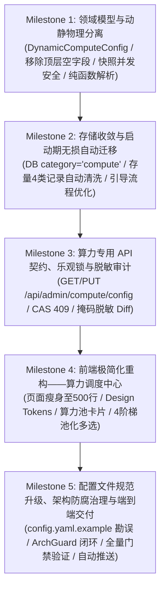

# RFC-005 实施路线图与任务分解作战卡 (SDD + TDD Roadmap)

本文档依据 [`RFC-005: 系统配置动静分离与算力管理极简化重构设计`](../03-rfcs/RFC-005-系统配置动静分离与算力管理极简化重构设计.md) 制定，严格遵循工作区通用宪法（`AGENTS.md`）中的 **SDD (规范驱动) + TDD (测试驱动)** 流程，作为端到端实施与质量验收的唯一真实路线图。

---

## 🗺️ 一、里程碑依赖拓扑 (Milestone DAG)

---

## 🎯 二、分阶段任务分解与验收门禁 (AC)

### 📌 Milestone 1: 领域模型与动静物理分离 (Domain Model & Concurrency Protection)
* **任务清单**：
  1. [x] **定义单一动态算力实体**：在 `models/config.go` 中定义 `DynamicComputeConfig`（收敛 `LLMConfig`、`DebateTiersConfig` 与 `WorkerCount`）。
  2. [x] **根治 `Governance` 覆写缺陷**：从 `models.Config` 顶层彻底移除历史平铺的 `Identity`、`Arbitration`、`Lifecycle` 镜像字段；全仓调用点统一切换至 `models.AppConfig.Governance.*`；在 `GovernancePolicyConfig` 上实现 `NormalizeDefaults()`。
  3. [x] **运行时原子快照与并发保护**：引入原子快照指针（`atomic.Pointer[DynamicComputeConfig]`），重构 `GetComputeConfig()`、`ApplyDynamicComputeConfig()`、`FindResource()`、`GetTierConfig()`、`GetTierResources()` 与 `GetWorkerCount()`，彻底消除 Slice/Struct 并发读写竞争。
  4. [x] **抽离纯解析函数**：抽离无全局副作用的 `ParseConfigFile(filename string) (Config, error)`，供服务启动与运行期 `reset-to-seed` 提取初始算力种子，严禁运行期污染静态配置内存。
  5. [x] **跨轨引用校验与引擎强约束**：实现 `ValidateComputeConfig(compute *DynamicComputeConfig, static *Config) error`，强化 Tier 1/3 Thick 与 Tier 2/4 Native 约束；在 `ToolResource` 中增加悬空节点自动平滑回退至 `compute.LLM.DefaultResource`（兜底 `"native"`）。
* **TDD 验收门禁**：
  * 在 `models/config_test.go` 中编写用例，验证 `governance` 嵌套参数 100% 生效不被抹零、原子快照并发读写无 Data Race、悬空工具资源平滑回退。

---

### 📌 Milestone 2: 存储收敛与启动期无损自动迁移 (DB SSOT & Migration)
* **任务清单**：
  1. [x] **启动期自动无损迁移函数**：在 `models/db.go` 中提供独立封装的 `migrateLegacyDynamicConfigsOnce(db *gorm.DB)`（带 `// TODO(cleanup): 存量环境升级完毕后统一清理` 标记），在事务内幂等检测；若不存在 `category = 'compute'` 且存在旧版 `llm`/`scanner`，自动抽取组装为单行 `compute`（`version = 1`, `updated_by = 'system_migration'`），并物理清除旧的 4 类记录（`llm`, `scanner`, `governance`, `notification`）。
  2. [x] **初始化与引导流程重构**：实现 `InitDynamicCompute(seed DynamicComputeConfig)`；全新环境执行 Seed-Once 写入；存量环境原子覆盖内存中的算力配置，全量静态配置 100% 保持 YAML 原貌。
  3. [x] **启动入口改造**：更新 `main.go`，在初始化 DB 后调用 `InitDynamicCompute`，并一次性向 Dispatcher 注入 YAML 静态流控策略（`WorkHours` 与 `Adaptive`）。
* **TDD 验收门禁**：
  * 在 `models/config_test.go` 中使用隔离测试库，验证旧 4 类记录无损迁移为 `compute` 且历史拦截记录彻底删除；验证存在 DB `compute` 记录时修改 YAML 冷配置重启必生效。

---

### 📌 Milestone 3: 算力专用 API 契约、乐观锁与脱敏审计 (Compute APIs & Security)
* **任务清单**：
  1. [x] **实现算力中心专用 RESTful 路由**：
     * `GET  /api/admin/compute/config`：返回当前动态算力快照及元数据（`version`, `updated_at`, `updated_by`, `llm`, `tiers`, `worker_count`）；
     * `PUT  /api/admin/compute/config`：强校验 `ValidateComputeConfig`，数据库 `version` 乐观锁 CAS 比对（版本不一致返回 `HTTP 409 Conflict`），原子替换快照，热触发 `ReloadResources` 与 `ResizeWorkerPool`；
     * `POST /api/admin/compute/ping-endpoint`：校验 `http`/`https` scheme，`io.LimitReader(resp.Body, 1024)` 截断防内存膨胀；
     * `POST /api/admin/compute/reset-to-seed`：纯解析 `config.yaml` 提取初始算力种子，递增版本号写回 DB，原子刷新内存并热重载服务。
  2. [x] **安全与脱敏审计 Diff**：从 Gin 上下文提取真实操作人姓名；向 `commonAudit.SetAuditContext` 写入前将所有 `api_key` 执行脱敏掩码（`sk-****bb3a`），防止敏感凭据泄露。
  3. [x] **路由退役与权限收敛**：从 `main.go` 中彻底移除旧的 `/api/admin/config/{full,category/:category,ping-endpoint,reset-to-seed}` 及其 `/api/config/*` 兼容别名；保留 `/api/config`（执行看板）与 `/api/config/frontend`。
* **TDD 验收门禁**：
  * 更新并扩展 `handlers/config_auth_test.go`，验证 `/api/admin/compute/*` 严格仅限 `super_admin`（非超管 401/403）；
  * 更新 `handlers/config_runtime_test.go`，验证 `version` 乐观锁 CAS 冲突拦截（`HTTP 409`）、WorkerPool 与 Dispatcher 热重载、API Key 掩码审计 Diff。

---

### 📌 Milestone 4: 前端极简化重构——算力调度中心 (Compute Hub Frontend)
* **任务清单**：
  1. [x] **契约与类型定义**：更新 `frontend/src/types/config.ts`，新增 `DynamicComputeConfig`、`ComputeConfigResponse` 等接口。
  2. [x] **页面极简重构 (`frontend/src/pages/ConfigCenter.tsx`)**：
     * 代码量从 2293 行彻底瘦身至 450~550 行；
     * 遵循 `@code/common` Design Tokens，全量使用 `--color-*` 语义变量，全面适配 Light / Dark 双主题；
     * 顶栏：标题“🛡️ 算力调度中心 (Compute Hub)”、全局 Worker 并发输入框、重置默认按钮与保存变更按钮；
     * 板块 1（算力供给池）：响应式卡片网格，展示 Thick Agent 与 Native 集群，原生端点 Ping 测速与延迟高亮，轻量 Drawer 增删改节点；
     * 板块 2（辩论流水线编排）：Tier 1~4 编排卡片，同类型多节点池化多选胶囊按钮，阶段总预算与单次超时设置；
     * 保存时对象展开合并（`{ ...existingTier, ...editedFields }`），无损透传 `recovery`、`idle_timeout` 等底层参数；
     * 乐观锁 409 友好弹窗提示与刷新处理。
  3. [x] **导航与路由兼容**：保持前端 `/admin/config` 路径不变，`frontend/src/menu.ts` 与 `frontend/src/App.tsx` 统一更名为“算力调度中心”。
* **TDD 验收门禁**：
  * 前端编译与静态检查零错误零警告：`cd frontend && npm run build && npm run lint`。

---

### 📌 Milestone 5: 配置文件规范升级、架构防腐治理与端到端交付 (Verification & Delivery)
* **任务清单**：
  1. [x] **模版规范升级与勘误 (`config.yaml.example`)**：
     * 头部增加动静分离规范说明注释；
     * 清理 Native 废弃的顶层 `base_url`/`api_key` 示例及 `endpoints` 下未使用的 `weight` 字段；
     * 修正 Tier 2 与 Tier 3 中混绑违规示例，使其严格符合引擎类型强约束；
     * 补全 `governance` 默认参数与中文说明注释。
  2. [x] **架构防腐治理 (ArchGuard)**：
     * 解耦 `services/engines/debate/` 中对 `models.DB` 的直接访问，引入封装方法/隔离接口，确保 `make lint-arch` 100% 成功。
  3. [x] **自动化测试与门禁验证**：
     * 执行 `make lint-arch && make test && make lint && make build` 全量通过。
  4. [x] **代码自检与自动交付**：
     * 检视全部 Diff，确保无任何硬编码绝对色值、无冗余代码；
     * 按照 Conventional Commits 规范提交代码并推送至远端 GitHub 仓库。

---

## 📊 三、阶段验收标准矩阵 (Definition of Done)

| 阶段 | 核心交付物 | 质量门禁命令 | 状态 |
| :--- | :--- | :--- | :--- |
| **M1** | `models/config.go`, `models/config_test.go` | `go test -v ./models/...` | 已完成 (100% PASS) |
| **M2** | `models/db.go`, `main.go`, `models/config_test.go` | `go test -v ./models/...` | 已完成 (100% PASS) |
| **M3** | `handlers/config.go`, `handlers/config_auth_test.go`, `handlers/config_runtime_test.go` | `go test -v ./handlers/...` | 已完成 (100% PASS) |
| **M4** | `frontend/src/pages/ConfigCenter.tsx`, `frontend/src/types/config.ts`, `menu.ts`, `App.tsx` | `npm run lint && npm run build` | 已完成 (100% PASS) |
| **M5** | `config.yaml.example`, `services/engines/debate/`, Git Commit & Push | `make lint-arch && make test && make lint && make build` | 已完成 (100% PASS) |
